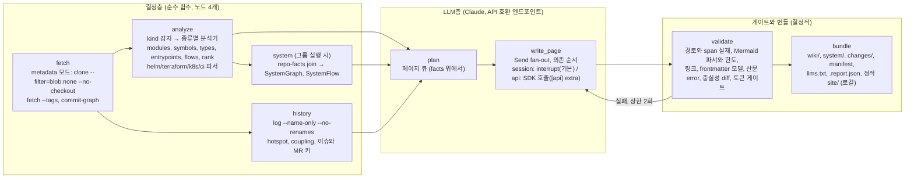

# repowiki PLAN

> 상태: **초안 8판**, 작성 2026-09-09. 자립 문서다(이전 판 참조 없음). 7판에 Codex 5차 리뷰(`docs/reviews/codex-5-plan-v7.md`), 사용자 결정 셋(LangGraph 기본, Bedrock 제외, **LLM은 Claude 구독제의 Claude Code 세션으로 실행**), 의존성 재계측(리서치 15 §7)을 반영했다. 사이트 생성기는 리서치 17(Fumadocs 루프백 재실측) 뒤 사용자 결정으로 Fumadocs가 됐고, 로컬 조건이 `file://`에서 127.0.0.1 루프백 서버로 바뀌었다. 리뷰 원문은 `docs/reviews/`에 보존한다. 이전 판은 `docs/plan-history/`에 있다. 근거는 리서치 `01–16`(`docs/reports/research/`; 템플릿 대장에 맞춘 `docs/reports/research/`로의 이동은 Phase 0 완료 항목)와 의존 문서 대장 `docs/reference/dependency-docs.md`. 라벨: [실측] 이 세션의 로컬 실행, [코드] 대상 저장소 정독, [웹] 문서와 이슈, [it] syntopicon KB, [문면] 벤더 문서, [14] 편향 감사, [15] 의존성 감사, [unverified] 미확인.
> 진행 상태는 이 문서가 적지 않는다. 정본은 `scripts/gate_chain.sh` 출력과 `tests/acceptance/` 통과 여부, 게이트 완주 기록은 `scripts/RUNLOG.md`다(C-REC-1).

## 0. 한 줄 정의와 판정

**repowiki**는 GitLab 그룹 또는 저장소 URL을 받아 레포 종류(코드, Helm, Terraform, k8s, CI)를 가리고, 모듈 분해, 모듈과 타입 수준의 결합, 진입점과 교차 모듈 흐름, 변경 핫스팟, 레포 사이의 관계와 흐름(시스템 그래프)을 결정적으로 추출한 뒤, LLM이 그 사실 위에서만 Markdown+Mermaid 위키를 쓰게 하는 Python CLI다. 산출물은 **로컬 디렉토리**(`wiki/`, `system/`, 정적 사이트 `site/`)이고, 로컬에서 열어 쓴다. 서빙(S3, 사내 정적 호스트, GitLab 위키 API)은 이 계획의 범위 밖이다. 목적은 하나다. **새 코드베이스(레포 하나 또는 여럿으로 된 시스템)를 처음 보는 사람이 다이어그램으로 구조와 결합을 파악한다.** 1차 대상은 Apache 오픈소스(레포 4개 + SkyWalking 13개 레포 시스템), 2차 대상은 사내 self-hosted GitLab 프로젝트 20개(오프라인 반입).

| 판정 | 결론 | 근거 |
|---|---|---|
| `agentic-project-tpl` | 채용(전체) | 리서치 04 |
| OKF | repowiki OKF 호환 프로필: 필수 `type` + 고정 `title/description/tags/generated/sources/status/verified/stale_after`, pydantic 모델이 정본이고 `.schema/frontmatter.json`은 그 모델에서 낸 산출물 | 리서치 03, [14], [15] |
| altera-rules | 적용: `rev: rules-v0.10.0`, 표면 `common`, `lang/python`, `lang/bash`, `review` | 규약 저장소 정독 |
| 조율 | 그래프 하나(결정층 + LLM층). **LangGraph 1.2.11 기본**(사용자 결정 2026-09-09: 자작보다 프레임워크가 표준 대응에 유리). Phase 0 하네스 세 시나리오는 그 구현의 수용 테스트다(§5). 비용은 실측으로 기록(해석 +23, 네이티브 +7, 휠 +8.6 MB, [15] §7) | 사용자 결정, syntopicon 재감사, [14] #8, [15] §7 |
| 의존성 | 런타임 Python 직접 의존 기본 11개(최소 8 + LangGraph 3; anthropic은 `[api]` extra), Node 3개, 바이너리 4개, 네이티브 휠 ≤15개. 상한과 추가 규칙은 §8 | [15] 실측(6판 함의 해석 120, 네이티브 38, 휠 150 MB → 72, 15, 50 MB) |
| 다이어그램 | Mermaid 11. 게이트에 GitLab 실제 한도(페이지당 소스 2,000자, 50블록), 가독성 사다리(§2.5)로 상한과 레이아웃을 결정. ELK와 대화형 페이지는 사다리 결과로 채택 | [14] #1, #2, [15] |
| 심볼, 타입, 호출, def/ref 태그 | ast-grep 0.45.3 kind 룰 한 벌(파서 한 벌). def/ref 태그의 tree-sitter 대체는 **임시**이며 Phase 1 언어별 오라클 비교(Java, Scala, Python, TypeScript; 정답은 사람이 아니라 테스트 전용 오라클이 낸다, §6 3) 통과가 채택 조건이다. 타입 관계와 호출 엣지는 분리된 채택 조건(§2.3) | [14] #3, [15] §3(샘플 2건 실측) |
| 랭킹, 서브시스템 | PageRank(권위) + 역PageRank/HITS(허브), RRF; 빌드 트리 우선, networkx Louvain. Leiden 도전자(scikit-network)는 평가 전용 extra. networkx Leiden은 CPU에 없다 | [14] #4, #5, [15] |
| 이력 | git CLI, blobless에서 핫스팟 = 수정 횟수, 오라클 code-maat(Docker, 테스트 전용) | [14] #6, [15] |
| 토큰 | 모드 셋(§4): 세션 드라이버(기본)는 job 묶음 크기를 `calibration.json`(콘텐츠 종류별 chars/token p99와 max_observed) × 안전계수의 근사 게이트로 제한(`approximate` 표기), `[api]` 드라이버는 `count_tokens` 하드 게이트, P-C 재생은 게이트 없음. tiktoken은 싣지 않는다 | [14] #7, [15] |
| 산문 | fluent-korean 조항 + 자체 정규식(hanlint 규칙 4개 이식). hanlint는 테스트 오라클 | [14] #10, [15] |
| 사이트 | **Fumadocs 16.15.8**(Next.js 16.3.4 정적 export, React 19.2.8). 로컬 조건은 `repowiki site --open`이 띄우는 127.0.0.1 루프백 서버(표준 라이브러리 `http.server`, charset 지정)이며 외부 서빙은 여전히 범위 밖. `file://`에서는 Fumadocs가 불통이고(절대 경로), 루프백에서는 탐색, 한국어 검색(Orama), Mermaid, 다크 모드, 실패 요청 0을 통과(리서치 17). 같은 조건에서 Starlight가 UX 소계 42로 Fumadocs 35보다 높았으나 사용자가 Fumadocs를 선택했다(2026-09-09). MkDocs는 `file://` 전용 대안으로 §11 | 리서치 13, 17 [실측], 사용자 결정 |
| 설정, 인프라 레포 | PyYAML `compose_all`, Helm 4.2.4 + kustomize 5.8.1(standalone) 핀, python-hcl2 `parses_to_tree`(블록과 속성 스팬 모두), dockerfile-parse + heredoc 전처리, 자체 properties 파서. tfparse는 `[terraform-eval]` extra 스파이크 | 리서치 10, [14] #12, [15] |
| 멀티 레포 | `SystemGraph` + `SystemFlow`(근거 있는 홉 체인만) | 리서치 12 |
| 2차 질의 | `llms.txt` + 로컬 파일 + `AGENTS.md` 관리 블록 + `SKILL.md`. CLI는 `structure`와 `read`만. MCP 서버와 자체 검색(bm25s, kiwipiepy)은 v1에 없다(§11) | 사용자 판정 2026-09-09, [14] #11, #15 |
| GitLab API | httpx2(anthropic이 이미 가져온다) 위의 REST 3종 어댑터. python-gitlab은 싣지 않는다 | [15] |
| LLM 경로 | **기본은 `--driver session`**: 사용자의 Claude Code 세션(구독제)이 `repowiki job next|submit`으로 페이지를 쓴다. 컨테이너는 LLM 네트워크가 필요 없다. `--driver api`(Anthropic SDK, `ANTHROPIC_BASE_URL` + 키)는 `[api]` extra. Bedrock은 v1 밖(§11) | 사용자 결정 2026-09-09: 구독제로만 운용, Bedrock 불필요 |
| 시크릿 | `GIT_ASKPASS` + 환경 변수 | [14] #17a |
| 서빙 | **범위 밖.** 로컬 정적 파일이 산출물이다 | 사용자 지시 2026-09-09 |
| v1 밖 | §11 | |

## 1. 목표, 비목표, 제약 (SPEC.md의 원천)

**목표**
1. URL 하나로 레포 위키(`wiki/`)를 만든다. 계층형 다이어그램(시스템 → 서브시스템 → 모듈 → 핵심 타입), 모듈 페이지, 교차 모듈 흐름 페이지, 핫스팟 페이지가 있고, 모든 구조 다이어그램은 결정적 facts에서 컴파일된다. Helm, Terraform, k8s, CI 레포는 그 종류의 페이지를 만든다.
2. 그룹 URL 하나로 시스템 위키(`system/`)를 만든다. 레포를 노드로, 근거 span이 있는 관계만 엣지로 하는 C4-L1/L2 페이지, 관계 표, 계약 페이지, 근거 있는 교차 레포 흐름 페이지, 미해결 참조 페이지.
3. 중요한 명제는 `path:Lx-Ly`를 인라인으로 인용하고 인용 없는 중요 명제는 싣지 않는다. 인용 span은 줄 번호를 주는 파서에서만 나온다(§2.7). 근거 없는 항목은 `.report.json`에 남는다.
4. 재실행은 증분이고 정확하다. 페이지 입력 계약(§2.9)이 바뀐 페이지는 반드시 다시 쓰고, 안 바뀐 페이지는 다시 쓰지 않는다. 갱신마다 위키가 git 커밋(선택적으로 MR)으로 남고 변경 요약이 manifest 차이에서 컴파일된다.
5. 산출물은 로컬에서 쓴다. Markdown은 GitLab 저장소 뷰, GitHub, Obsidian, Fumadocs의 공통 문법만 쓰고(JSX 없음), 정적 사이트 `site/`는 `repowiki site --open`이 띄우는 127.0.0.1 루프백 서버로 열어 동작한다. 서버는 표준 라이브러리 `http.server`이고 외부 인터페이스에 바인드하지 않는다.
6. `llms.txt`와 `llms-full.txt`(shard 계약 §2.4)를 repowiki가 직접 원문 Markdown으로 낸다.
7. 사내 반입 단위는 OCI 이미지 하나(2차로 tarball)이며 §5 Phase 5의 네트워크 프로파일을 통과한다.

**비목표**
- 서빙을 하지 않는다. GitLab Pages, S3, 사내 정적 호스트, GitLab 위키 API 발행은 이 계획 밖이다(§11).
- 챗 UI와 웹 앱을 만들지 않는다.
- 자체 검색 엔진과 MCP 서버를 만들지 않는다. 에이전트는 로컬 파일을 읽고, 사람은 사이드바와 사이트 검색을 쓴다(§2.10).
- 컴파일이 필요한 분석(SCIP, jdeps, CodeQL, `terraform graph`)을 기본 경로에 두지 않는다.
- 레포 사이의 관계와 흐름을 LLM이 추정하지 않는다. span 없는 엣지와 홉은 존재하지 않는다.
- **완전 네트워크 차단 런타임에서 새 위키를 LLM으로 생성하는 것은 지원하지 않는다.** LLM 추론은 운영자 머신의 Claude Code 세션(claude.ai 도달)을 전제하고, 컨테이너 안에서는 LLM을 부르지 않는다. 완전 차단에서 동작하는 것은 결정층, 게이트, 번들, 재생(녹화 응답)이다(§5 P-C).

**제약**
- Python ≥3.12, uv 고정. Node 22.22.2(정확 핀, jsdom 30 engines `^22.22.2`)는 Mermaid 검증기와 Fumadocs 빌드(`next build`, 정적 export)에만.
- 런타임 의존성은 §8의 상한(Python 직접 12, Node 3, 바이너리 4, 네이티브 휠 15) 안에 있고, 서드파티 하나에 어댑터 하나다. 추가는 §8의 검사 목록을 통과해야 한다.
- LLM 실행은 기본적으로 사용자의 Claude Code 세션(구독제)이다. repowiki는 job 파일과 게이트만 소유하고 모델을 직접 부르지 않는다. `adapters/llm.py`는 `[api]` extra에서만 Anthropic SDK를 임포트하며, 그때만 `count_tokens`, Batches, structured outputs, 프롬프트 캐싱이 쓰인다. Bedrock은 v1 밖이다(§11).
- 시크릿은 환경 변수와 `GIT_ASKPASS`. values 파일의 자격증명 유사 키는 값 마스킹.
- 라이선스 정책은 산출물별이다(§8). 런타임 배포물에 GPL 계열(SPDX `GPL-*`, `AGPL-*`) 0건, LGPL은 목록에 표시(현재 0건), 테스트 전용 이미지의 GPL 오라클은 별도 SBOM.
- 텔레메트리 전송은 0이다. langsmith는 langchain-core의 하드 의존이라 설치는 되지만(제외 불가, [15] §7) 진입점에서 `LANGSMITH_TRACING=false`를 고정하고 코드에서 `langsmith.configure(enabled=False)`를 호출한다. 소켓 차단 프로브에서 import와 interrupt 왕복 모두 네트워크 시도 0 [실측 macOS arm64], Linux 이미지는 P-C `network_calls: 0` 게이트가 확인한다. Langfuse와 다른 사용 통계 전송 라이브러리는 락에 들어오지 않는다.

## 2. 아키텍처

### 2.1 그래프 하나, 노드는 얇다



- 조율은 그래프 하나다. 결정층과 LLM층이 같은 LangGraph 1.2.11 `StateGraph` 안에 있고, 재개, 상태, 로그를 보는 자리가 하나다. 자작 러너는 만들지 않는다(구현 하나면 추상도 하나). 계약은 넷이다. (1) `write_page`의 LLM 호출은 `interrupt` 뒤에 두거나 멱등이다. (2) 재개 id 불일치는 명시적 실패다. (3) 상태는 pydantic 타입, 체크포인트는 `SqliteSaver`, 페이지 작업은 `Send` fan-out(상한 있는 동시성), 게이트 실패는 재생성 루프 상한 2회. (4) 진입점에서 `LANGSMITH_TRACING=false` 고정과 `langsmith.configure(enabled=False)`(§1 제약).
- LLM 노드는 facts만 읽는다. 세션 드라이버(기본)는 §4의 job 디렉토리 격리와 evidence id 게이트로 성립, API 드라이버는 SDK 입력이 facts 발췌뿐이라 자동 성립.
- Langfuse와 LangSmith는 두지 않는다.

### 2.2 계층과 경계 계약 (import-linter)

```
repowiki/
  cli.py        # 진입 층(argparse 서브파서): 종료 상태로 실패를 말한다(C-REPORT-5). 출력 층(T201 면제)
  pipeline/     # 조율 층: LangGraph 그래프 정의, 상태 타입, 드라이버 프로토콜, manifest 증분 판정
  analyze/      # 도메인 층: kind, profile, modules, symbols, imports, types, entrypoints, flows, rank, history,
                #            helm, terraform, k8s, ci, springconfig, system (순수 계산)
  write/        # 도메인 층: plan, page (프롬프트 조립 + 응답 파싱, 순수)
  gate/         # 도메인 층: paths, citations, mermaid, links, frontmatter, prose, fidelity, tokens (판정만)
  bundle/       # 도메인 층: okf, index, manifest, changes, report, diagrams(컴파일러), llms, site_emit(wiki/ → Fumadocs content/docs/*.mdx + meta.json, 순수 Markdown 유지)
  adapters/     # 기반 층: 서드파티 하나에 파일 하나. git, astgrep, helm, kustomize, jobs(세션 드라이버 job 파일 교환),
                #            llm(Anthropic SDK, [api] extra에서만), gitlab(urllib.request REST), github(urllib.request),
                #            node(mermaid 파서), site(Fumadocs 프로젝트 템플릿 + `next build` 서브프로세스 + 루프백 `http.server`), hcl(python-hcl2),
                #            dockerfile(dockerfile-parse + heredoc 전처리). 스파이크 통과 시에만 cbm, tfparse
  data/         # 도메인 사실(C-DOMAIN-1): 언어 표, 제외 글로브, 모듈 잡음, 프레임워크 패턴, 외부 경계 패턴, 이슈 링크 패턴,
                #            서드파티 proto 네임스페이스, 자격증명 키 패턴, ast-grep 룰(심볼, import, def/ref 태그, 진입점),
                #            프롬프트, calibration.json, diagram-limits.yml, helm-values/
```

계약: `cli → pipeline → {analyze, write, gate, bundle} → adapters`. 형제 넷 독립. `adapters` 밖에서 `subprocess`, `anthropic`, `urllib.request`, `http.server`, `hcl2`, `dockerfile_parse` 임포트 금지. `anthropic`은 `adapters/llm.py`에서 지연 임포트하고 `[api]` extra가 없으면 `--driver api`는 명시적 오류로 끝난다. `langgraph`와 `langchain_core`는 `pipeline/` 안에서만 임포트한다. `adapters/` 파일 목록이 곧 서드파티 목록이다. `.importlinter`를 첫 구현 커밋에서 세우고 위반 0 기록을 RUNLOG에 남긴다.

### 2.3 데이터 모델 (경계를 넘는 자료는 이름 붙은 형태, C-PY-1)

| 이름 | 내용 | 생산자 → 소비자 |
|---|---|---|
| `RepoKind` | `code`, `helm`, `terraform`, `k8s`, `mixed` + `ci-extras` 플래그 (§2.7) | analyze → 분석기 선택, plan |
| `RepoProfile` | 언어별 파일과 줄, 토큰 추정(chars/token 보정표), 제외 경로와 사유 | analyze → plan, 비용 추정 |
| `ModuleGraph` | 빌드 파일 경계의 모듈, import 엣지(가중치), SCC, 서브시스템 분할(`source: build-tree|louvain|instructions`) | analyze → 다이어그램 컴파일러 |
| `Symbol` | 종류, 이름, 시그니처, range, docstring, 모듈 | analyze → 페이지 컨텍스트 |
| `TypeGraph` | 타입 노드와 엣지 `extends`, `implements`, `field_type`, `param_type`, `static_call`, `call`. 엣지마다 `resolution: static|cbm`, `confidence`. **채택 조건이 둘로 갈린다.** 타입 관계(cbm): `extends`와 `implements` 엣지 집합의 Jaccard(cbm, ast-grep) ≥0.95이고, 오라클(Java는 javaparser 선언부, 테스트 전용)과 cbm이 다른 엣지만 사람이 판정해 cbm precision ≥0.98이며, 필드와 파라미터 타입 해석률 ≥0.90일 때 채택. 호출 엣지(cbm): Kafka 호출 지점 200개 층화 표본(정적, 인스턴스, 교차 모듈)의 정답은 테스트 이미지의 scip-java 색인(빌드 필요, 테스트 전용)이고 cbm과 scip-java가 다른 지점만 사람이 판정. precision ≥0.85 **그리고** recall ≥0.70, 언어별(Java, Scala, Python, TS) 결과를 따로 기록. 미달 언어에서는 `call` 엣지를 제공하지 않고 흐름 페이지에 "정적 근사, 호출 미해석" 표기. cbm은 스파이크 통과 전에는 테스트 이미지에서만 돈다(§8) | analyze → 모듈 페이지, flows |
| `EntryPoint` | main, route, cli, scheduler, listener; 위치; 프레임워크 | analyze → overview, flows |
| `CrossModuleFlow` | 진입점에서 `TypeGraph`와 import를 따라 BFS(깊이 ≤4), 모듈 둘 이상, 홉별 span, 외부 경계. `call` 엣지가 없는 언어에서는 import와 타입 관계 홉만 | analyze → `overview/flows.md` |
| `ConfigSurface` | Spring `application*` 키와 프로필, `@ConfigurationProperties` prefix 조인, 자격증명 유사 키 마스킹 | analyze → 모듈 페이지 |
| `InfraGraph` | Helm(Chart 의존, values 키, 렌더 객체와 참조 엣지, 이미지, 외부 입력), Terraform(스택, 모듈 소스, 리소스와 data, backend, remote-state), k8s(객체, kustomize 트리), CI(stages, jobs, include, trigger) | analyze → 종류별 페이지, SystemGraph |
| `FileRank` | `authority`(PageRank, aider 승수), `hub`(역PageRank 또는 HITS), `fused`(RRF k=60). churn은 시각 채널 | analyze → plan |
| `History` | 파일별 revisions(24개월), temporal coupling, 이슈와 제안과 MR 키 | history → hotspot, 모듈 페이지 |
| `UpdateWindow` | 지난 분석 커밋 이후 커밋과 MR(제목, 설명, URL), 페이지별 닿는 것만, 상한 20 | history → write_page evidence |
| `RepoFacts` | 생산과 소비 `Coordinate`, 빌드 지점, 계약 정의 | analyze → system |
| `SystemGraph` | `System{source}`, `RepoRef{kind, containers, systems[]}`, `Edge{kind, class 1..5, scope, evidence[Span], drift, direction}`, `Unresolved` | system → `system/` |
| `SystemFlow` | `Hop` 목록. `Hop{src_repo, src_span, boundary{kind: topic|http|contract|artifact|image, key}, dst_repo?, dst_span?, edge_class 1..5, direction: known|assumed, resolved: bool}`. **join 알고리즘**: 레포 흐름의 말단 경계 `Coordinate`와 같은 key를 가진 `SystemGraph` 엣지(`scope=main`) 중 (a) class ≤3, 또는 (b) class 4이면서 빌드 지점 기반 image→repo 맵이거나 `direction: known`인 것을 찾는다. 대상 레포가 정확히 하나일 때 **경계 종류별 종점 규칙**으로 잇는다. `topic` → 대상 레포에서 같은 토픽 key의 `EntryPoint(listener)`; `http` → 같은 서비스명 또는 경로 prefix의 `EntryPoint(route)`; `contract` → 계약을 정의하는 레포의 스키마 파일 span(root 필드, proto service); `artifact` → 라이브러리 레포의 좌표 정의 span(`pom.xml`, `go.mod`, `package.json`); `image` → 대상 레포의 `Container{image, built_by}` 빌드 지점 span(이 홉은 배포 흐름이며 진입점을 요구하지 않는다). 종점이 없거나 대상이 0개 또는 2개 이상이면 `resolved: false`(`unresolved_hop`)로 남기고 추정하지 않는다. `direction: assumed`인 토픽 홉은 이어도 페이지에 '방향 추정'을 표기 | system → `system/flows.md` |
| `PageJob` | path, type, title, purpose, 입력 슬라이스 id 목록, evidence 목록(id → span), budget | plan → write |
| `PageInput` | §2.9의 입력 계약 전체의 해시 | analyze → manifest |
| `Manifest` | 페이지별 `{gitHead, pageInputHash, pageHash, analyzerVersion, promptHash}` | bundle → 증분 판정 |
| `ChangeSummary` | 두 manifest의 차이와 갱신 창 MR 목록 | bundle → `changes/` |
| `TokenCalibration` | 모델 id × 콘텐츠 종류(Java, Python, TS, YAML, HCL, Markdown 산문)별 `chars/claude_token` p50, p99, max_observed, 표본 수 | `data/calibration.json` |

### 2.4 출력 번들

```
wiki/                                # 레포 하나
  index.md, log.md, quickstart.md
  llms.txt                           # 인덱스
  llms-full.txt 또는 llms-full/NN-<section>.md + llms-full/index.md   # 2 MB 초과 시 결정적 shard, 루트 인덱스가 전부를 링크, 내용 손실 0
  overview/architecture.md, overview/flows.md
  subsystems/<subsystem>.md, modules/<module>.md, workflows/<flow>.md
  helm/{overview,objects,values,images,external-inputs}.md
  terraform/{stacks,modules,resources,contracts}.md
  k8s/{objects,overlays}.md, ci/pipeline.md
  history/hotspots.md
  changes/<date>-<sha>.md
  graph.json                         # 게이트를 통과한 그래프. 대화형 페이지(채택 시)는 이 파일만 읽는다
  .manifest.json, .report.json, .schema/frontmatter.json, INSTRUCTIONS.md, wiki.base(선택)
system/                              # 그룹 실행
  index.md, containers.md, relations.md, contracts.md, flows.md, unresolved.md, deployment.md
site/                                # Fumadocs가 wiki/와 system/에서 빌드한 정적 export. 루트에 llms.txt, llms-full.txt, 페이지별 <path>.md 원문을 함께 둔다. `repowiki site --open`(127.0.0.1)으로 연다
```

frontmatter 스키마의 정본은 `gate/frontmatter.py`의 pydantic 모델이고 `.schema/frontmatter.json`은 `model_json_schema()`로 낸 산출물이다(외부 CI가 쓴다). 필드: `type` enum {quickstart, architecture-overview, subsystem, module, workflow, flows, helm, terraform, k8s, ci, history, changes, system-context, system-containers, system-relations, system-contracts, system-flows, system-unresolved}; `title` string; `description` string(1–2문장); `tags` string[](영문); `generated` {by: string 'repowiki/<semver>', at: RFC 3339 with offset}; `analyzed_commit` string(40 hex); `sources` [{id: string, resource: string 'repo://<path>#L<a>-L<b>', commit: string}]; `status` enum {draft, stable, deprecated}; `verified` [{by: 'human:<id>' | 'gate:<name>', at}] (기본 빈 배열); `stale_after` RFC 3339(선택). `index.md`(디렉토리 목록, 루트만 `okf_version: "0.2"`)와 `log.md`는 OKF 예약 파일이라 이 스키마의 대상이 아니다. 페이지 머리에 "분석 커밋 `<sha>`, 현재 HEAD와의 거리". 시스템에 속한 레포 위키는 "Part of system X, upstream, downstream". 본문 골격은 인터페이스 문서 규정(리서치 06 §8 [it]): 책임, 단위가 나타내는 것, 한계와 불변식, 경계면 계약, 핵심 흐름, 설정, 실패 모드, 관련. 소스 트리 나열과 메서드 목록 반복 금지.

### 2.5 다이어그램: 계층형 컴파일과 가독성 사다리

- 소스 언어 Mermaid 11 다섯 종(flowchart, classDiagram, sequenceDiagram, stateDiagram-v2, erDiagram) + timeline. LLM은 라벨과 그룹 이름만 제안한다. 게이트는 jsdom `mermaid.parse`(11.17.2와 대상 GitLab 판 11.13.0 둘 다, 같은 jsdom에서 두 판 동작 확인 [15] §3.5)이고, 여기에 여섯 종 대표 픽스처(`tests/fixtures/mermaid/`)를 11.13.0 `mermaid.render`로 렌더해 오류 0, SVG 생성, 라벨 텍스트 보존을 확인하는 렌더 픽스처 테스트를 더한다. `parse`는 문법 수용만 보기 때문이다. GitLab 실제 초기화 설정과의 동일성은 §6 6의 GitLab 라운드트립(P-B)이 판정하며 그 전까지 [unverified].
- 한도 게이트: 페이지당 Mermaid 소스 ≤2,000자, ≤50블록(GitLab이 초과 시 클릭 렌더로 바꾼다 [14]).
- **가독성 사다리(사전 등록, Phase 1 판정)**: 1440px 폭에서 L0(서브시스템)와 L1(모듈) 다이어그램마다 (a) 엣지 교차 ≤10, (b) 라벨 잘림 0, (c) 가로 스크롤 없음을 dagre로 만족하면 확정. 실패하면 순서대로 `layout: elk`(정적 사이트 프로필, Fumadocs의 Mermaid 클라이언트 컴포넌트에 ELK 로더 벤더링) → 서브시스템 분할로 노드 감축 → 표 + `graph.json` 대화형 페이지로 강등하고 페이지에 강등 사유를 적는다. 노드 상한의 정본은 `data/diagram-limits.yml`이고, 그 값은 Phase 1에서 4개 레포의 사다리 결과로 채운다. 이해도 하한은 Phase 4 태스크(§5)가 잰다.
- **사다리 단의 의존성은 채택 조건부다.** `@mermaid-js/layout-elk`(elkjs, `node_modules` 77 MB, npm license 필드가 SPDX 표현식 `EPL-2.0 OR GPL-3.0-or-later`이므로 SBOM에 원 표현식을 그대로 두고 선택 라이선스 EPL-2.0을 별도 필드로 적으며, EPL-2.0 허용 여부는 회사 라이선스 정책 항목으로 둔다)와 sigma 3 + graphology(대화형 페이지)는 Phase 1의 4개 레포에서 그 단에 떨어지는 다이어그램이 하나라도 있을 때만 락과 자산 manifest에 들어간다. 채택하면 §8의 Node 상한을 채택한 패키지 수만큼 올리고 그 사유를 §8에 적는다. 하나도 없으면 그 단은 "표로 강등"으로 끝나고 두 패키지는 계획에서 지운다.
- L2(모듈 안 타입)는 fan-in 상위 25개, `extends/implements` 실선, `field_type/param_type` 점선, `call` 가중 화살표. 흐름은 sequence 골격(participant = 모듈, 메시지 = 홉, ≤12홉).
- 핫스팟은 `classDef hot`. GitLab과 GitHub 저장소 뷰에서는 스크립트가 돌지 않으므로 그곳의 1차 산출은 정적 Mermaid다.
- 사이트의 Mermaid는 Fumadocs 클라이언트 컴포넌트(리서치 17 `mermaid.tsx`, 약 40줄 줌 오버레이 포함)가 렌더한다. 기본은 원 크기 + 가로 스크롤(리서치 17 실측 3,791 px)이 아니라 `max-width: 100%` + 클릭 줌이며, 사다리 (c) 판정도 이 CSS로 잰다.

### 2.6 산문 규범
세 층. (1) 프롬프트: fluent-korean 핵심 조항(문장은 서술어와 종결어미로, 조사와 어미 생략 금지, 명사 셋 이상 조사 없이 잇지 않기, 비유와 구어 동사 대신 일반 동사, 정착 번역어 우선), 서식(이모지 금지, 엠대시와 가운뎃점 금지, 볼드는 경고 라벨과 UI 요소만, 헤딩은 명사구, 한 문체, 기본 합니다체), 관용구 금지(`A가 아니라 B` 문서당 1회 이하, 도입구와 분열문과 결산구 금지), 빈도 규칙(`에 대해`, `통해`, `할 수 있다`, `위해` 문단당 2회까지, 금지 아님), 문장 길이와 어미 분포에 수치 목표 없음. (2) 자체 정규식(`gate/prose.py`) error: 코드 밖 엠대시, 이모지, 이중 피동, 본문 문장의 명사형 종결, 그리고 hanlint 0.0.10에서 이식한 규칙 4개(출처 커밋을 파일 머리에 적는다). 이식 규칙 4개는 30문장 픽스처(번역투 10, 정상 10, 식별자 10)에서 오탐 0일 때만 차단, 그전에는 경고. (3) 충실성 diff: 다듬기 전후 숫자, 코드 span, 식별자, 링크, 인용문 변경 시 error. hanlint 자체는 런타임에 없고 테스트 이미지의 오라클이다(같은 30문장에서 이식 규칙과 hanlint 판정 일치를 기록). 영어 페이지는 프롬프트 규칙만.

### 2.7 레포 종류와 분석기

감지(순서대로, 둘 이상이면 mixed): helm = `Chart.yaml` + `templates/`; terraform = `.terraform/` 밖 `*.tf`; k8s = `kustomization.y*ml` 또는 `apiVersion`+`kind` YAML(`{{` 없음); code = `pom.xml`, `build.gradle*`, `package.json`, `pyproject.toml`, `go.mod`; ci-extras(모든 종류) = `.gitlab-ci.yml`, `Jenkinsfile*`, `Dockerfile*`.

| kind | 파서(핀은 의존 대장) | span 출처 | 하지 않는 것 |
|---|---|---|---|
| YAML 전반 | PyYAML 6.0.3 `compose_all`(`CSafeLoader`) | 노드 `start_mark`, `end_mark` | `safe_load_all`(마크를 버린다) |
| Helm 렌더 | **Helm 4.2.4** 바이너리 → 원문에서 `# Source: <chart>/templates/<file>` 파싱 → `compose_all`. 차트별 최소 values는 `data/helm-values/` | 템플릿 파일(키 grep 스팬) + `values.yaml` 스팬, `rendered: true` | 템플릿에 ast-grep, 렌더 줄→템플릿 줄 매핑(존재하지 않는다) |
| Terraform | python-hcl2 8.1.4 `parses_to_tree()`: 블록과 속성 노드의 `meta.line/end_line`(속성 스팬 8/8이 ast-grep `hcl` 룰과 동일 [15] §3.3), 값(모듈 source, backend)은 같은 트리. 평가 그래프는 tfparse 0.6.21(`allow_downloads=False`) 스파이크 통과 시 `[terraform-eval]` extra | 위 | `hcl2.load(with_meta=True)`(8.x no-op), tree-sitter-hcl, `terraform graph` |
| k8s/kustomize | PyYAML + **kustomize 5.8.1 standalone** 바이너리 | base 파일 스팬(kind+name) | 원격 base |
| Dockerfile | dockerfile-parse 2.0.1(`structure.startline/endline`) + heredoc 전처리(어댑터 안 37줄, 본문을 소유 명령에 접고 원본 줄 번호 복원 [15] §3.4). heredoc 골든 케이스는 이 전처리의 테스트 | 위 | tree-sitter-dockerfile, ast-grep |
| `.properties` | 자체 파서(`key, value, line`, 연속 줄) | 위 | jproperties |
| Spring 설정 조인 | ast-grep java `@ConfigurationProperties` + 위 파서 | 위 | 없음 |
| code | ast-grep-cli 0.45.3 kind 룰 한 벌: 심볼, import, 진입점, 타입 근사, 그리고 def/ref 태그(class, interface, enum, record, method, constructor, field 정의와 call, new, extends, implements, type 참조, 룰 16개 [15] §3.1) | ast-grep range | py-tree-sitter, 문법 휠, `tags.scm`, tree-sitter-language-pack(파서 두 벌 금지, §8) |

`outline` 교체 규칙: 3개 레포에서 심볼 identity(kind, name, range)의 precision과 recall이 kind 룰 대비 ≥0.98이고 Scala outline이 존재할 때만 교체한다(개수 동수는 조건이 아니다). 현재 `outline`은 Java `record`를 빠뜨리고 Scala에서 빈 목록을 낸다 [15]. 게이트: `InfraGraph`와 `ConfigSurface`의 모든 사실은 `path:Lx-Ly`를 갖거나 `rendered: true`다.

### 2.8 시스템 수준
- `repowiki system <gitlab-group-url>`: 프로젝트 열거(REST `groups/:id/projects?include_subgroups=true`) → 레포별 `RepoFacts`(head_sha 증분) → join → `system/`.
- 증거 계열과 등급(평균 내지 않음): 1 declared(`.gitmodules`, Backstage `catalog-info.yaml`, GitLab `trigger:/include:/needs: project:`) > 2 artifact(Maven, Gradle, npm, PyPI, Go 좌표) > 3 contract(proto import와 copy, GraphQL root 필드, OpenAPI 경로) > 4 config/infra(빌드 지점 기반 image→repo 맵, 토픽 리터럴 `direction: assumed`, host:port) > 5 text. `scope=test` 분리. 다이어그램은 class ≤4, `scope=main`만.
- 시스템 소속: Backstage `spec.system` → GitLab 그룹 → 공유 parent POM/BOM과 CI 템플릿 → 연결 성분(제안). 레포 역할: contract, library, service, infra, docs. 시스템 경계는 소유권이 정한다.
- DDD 라벨 자동은 generic upstream/downstream, Published Language, Open Host Service만. 나머지는 `unresolved.md` 후보.
- **`SystemFlow`**: §2.3의 `Hop` 자료형과 join 알고리즘을 따른다. 예: java-agent Kafka 리포터 → 토픽 `skywalking-segments`(class 4, direction assumed) → OAP `KafkaFetcherConfig`; cli → GraphQL root 필드(class 3) → OAP; helm `values.yaml` 이미지(class 4, 빌드 지점 맵으로 `direction: known`) → 레포. 이어지지 않으면 `unresolved_hop`이다.
- 충돌: 같은 좌표를 두 레포가 생산하면 오류 항목. 이미지는 태그 없는 경로로 키. 레포는 여러 시스템에 속할 수 있다. 사내 GitLab에서는 `$CI_REGISTRY_IMAGE`가 image→repo 맵을 준다.

### 2.9 갱신, 이력, 증분 입력 계약

**`PageInput` 계약(닫힌 목록).** 페이지의 입력 해시는 다음 전부의 정렬된 해시다.
1. 페이지가 속한 모듈 집합과 각 모듈의 소스 파일 내용 해시(테스트와 생성물 제외 글로브 적용 후).
2. `ModuleGraph` 슬라이스: 그 모듈들의 in/out 엣지와 가중치, 서브시스템 배정.
3. `TypeGraph` 슬라이스: 그 모듈들의 타입 노드와 엣지(`resolution` 포함).
4. 진입점 목록과 `CrossModuleFlow`(홉 span 포함) 중 그 모듈을 지나는 것.
5. `FileRank`의 그 모듈 내 상위 N 파일 id 목록(순서 포함).
6. `ConfigSurface`와 `InfraGraph` 슬라이스.
7. 시스템 실행 시 그 레포에 닿는 `SystemGraph` 엣지와 `SystemFlow`.
8. `History` 핫스팟 상위 N(그 모듈).
9. `analyzerVersion`(repowiki 판 + ast-grep 판 + `data/` 룰 디렉토리 해시 + PyYAML, python-hcl2, dockerfile-parse, helm, kustomize 판), `promptHash`(프롬프트 템플릿 + 작성 규약).
10. `INSTRUCTIONS.md` 해시.
11. 상위 페이지(개요, 서브시스템)는 하위 페이지의 `pageHash` 목록.
12. `UpdateWindow` 슬라이스: 그 모듈에 닿는 커밋 SHA와 MR iid 목록(설명 본문 해시 포함).
13. LLM 설정: 모델 id, effort, 드라이버 종류, structured output 스키마 해시, `calibration.json` 해시.
14. 다이어그램 컴파일러 판과 `diagram-limits.yml` 해시.

(5)와 (8)의 상위 N은 둘 다 20이다. 이 열네 항목 밖의 것은 입력이 아니며, 페이지 본문에 영향을 주는 새 입력이 생기면 이 목록에 번호를 더하는 것이 유일한 변경 경로다(C-DUP-2).

**슬라이스 경계.** 페이지 종류별로 "그 모듈들"은 다음과 같다. module 페이지 = 모듈 하나; subsystem 페이지 = 서브시스템에 속한 모듈 전부; architecture-overview와 flows = 레포의 모든 모듈; workflow 페이지 = 그 흐름이 지나는 모듈; helm/terraform/k8s/ci 페이지 = 해당 `InfraGraph` 전체; history = 핫스팟 상위 20 파일이 속한 모듈; system-* 페이지 = `SystemGraph`와 `SystemFlow` 전체. 슬라이스는 "그 모듈들의 노드 + 그 노드에 한쪽 끝이라도 닿는 엣지"로 닫는다.

**정규 직렬화.** 각 항목을 JSON으로 만들되 키는 사전순 정렬, 배열은 안정 정렬(id 오름차순), 경로는 저장소 루트 기준 POSIX 슬래시, 공백 없음, UTF-8, 부동소수는 소수 6자리 반올림. 항목별 SHA-256(`hashlib`)을 구하고 `"<번호>:<hex>"` 문자열 14개를 번호순으로 이어 붙인 문자열의 SHA-256이 `pageInputHash`다. 해시 함수와 직렬화 규칙은 `analyzerVersion`의 일부다.

**역의존 전파 규칙.** 파일 삭제와 rename은 그 파일이 속했던 모듈의 (1)을 바꾼다. 모듈 이동은 양쪽 모듈과 서브시스템 배정을 바꾼다. 공유 타입 변경은 그 타입을 참조하는 모든 모듈의 (3)을 바꾼다. 랭킹 변화는 (5)로, 분석기와 프롬프트 판 변화는 (9)로, LLM 설정 변화는 (13)으로, 컴파일러 판 변화는 (14)로 **모든** 페이지를 무효화한다. 교차 레포 계약 변화는 (7)로, 갱신 창의 새 MR은 (12)로 닿는 페이지를 무효화한다. 페이지 사이의 요약 공유(공유 메모리)는 입력에 넣지 않는다(순환 방지). 상위 페이지는 (11)로 하위 변경에 따라 무효화된다.

**변이 오라클(Phase 4).** 레포당 24건(`tests/acceptance/mutations/M01–M24`). 사람은 변이 스크립트 24개만 쓴다. 각 건의 '반드시 재생성되어야 하는 페이지 집합'은 기준 구현이 기계로 낸다: 변이 뒤 증분 없이 전체 분석을 다시 돌려 `pageInputHash`가 바뀐 페이지 집합이 정답이고, 증분 경로가 재생성한 집합과 비교한다. M24(무변경)의 정답은 공집합이다.

| ID | 입력 항목 | 연산 | ID | 입력 항목 | 연산 |
|---|---|---|---|---|---|
| M01 | 1 파일 내용 | 변경 | M13 | 6 설정 키 | 변경 |
| M02 | 1 파일 | 삭제 | M14 | 6 인프라 객체(Helm values) | 추가 |
| M03 | 1 파일 | rename | M15 | 7 시스템 엣지(계약 변경) | 변경 |
| M04 | 1 모듈(파일 이동으로 소속 변경) | 이동 | M16 | 7 시스템 엣지 | 삭제 |
| M05 | 2 import 엣지 | 추가 | M17 | 8 핫스팟 상위 20 진입 | 변경 |
| M06 | 2 import 엣지 | 삭제 | M18 | 9 analyzerVersion | 변경 |
| M07 | 3 공유 타입 시그니처 | 변경 | M19 | 9 promptHash | 변경 |
| M08 | 3 타입 | 삭제 | M20 | 10 INSTRUCTIONS.md | 변경 |
| M09 | 4 진입점 | 추가 | M21 | 12 갱신 창 MR | 추가 |
| M10 | 4 흐름을 끊는 홉 | 삭제 | M22 | 13 모델 id 또는 effort | 변경 |
| M11 | 5 랭킹(대량 참조 추가로 상위 20 변화) | 변경 | M23 | 14 컴파일러 판 | 변경 |
| M12 | 6 설정 키 | 추가 | M24 | 무변경 | 없음 |

항목 11(하위 페이지 해시)은 M01–M23 각각에서 상위 페이지 재생성 여부로 함께 판정한다. 판정: 필수 집합 재생성 24/24(누락 0). 낭비율 = (재생성된 페이지 수 − 필수 집합 크기) / 전체 페이지 수, 케이스별 ≤10%.

**위키는 git에 산다.** 갱신 실행마다 커밋 하나(선택적으로 브랜치와 MR, MR 생성은 REST `projects/:id/merge_requests`). 이력의 정본은 git이다. `changes/<date>-<sha>.md`는 manifest 차이(모듈, 엣지, 진입점, 시스템 엣지의 추가와 삭제, 다시 쓴 페이지와 바뀐 입력 항목 번호)와 갱신 창 MR 목록만 담는다.

**이력 명령.** `git log --name-only --no-renames --since=24.months`(blobless, kafka 0.27 s). 핫스팟은 수정 횟수 기준. 줄 churn은 풀 클론이거나 상위 20개 파일을 `git backfill`한 경우만. `--no-renames`의 엔티티 분열을 페이지에 표기. 오라클: code-maat v1.0.4를 Docker에서 기본값(`--min-revs 5 --min-shared-revs 5 --min-coupling 30 --max-changeset-size 30`, coupling = shared / avg(revs_a, revs_b), 입력은 풀 클론에서 `git log --pretty=format:'--%h--%ad--%aN' --date=short --numstat`)으로 1회 돌려 픽스처 CSV를 커밋한다. **불일치 규칙**: code-maat 픽스처가 기준이고, repowiki 상위 20 집합과 다른 항목은 사람이 소스로 확인해 픽스처에 판정 사유를 남긴다. 오라클은 하나다(둘째 오라클은 판정 비용만 늘린다 [15]). 커밋과 MR 본문 3층: 전체 이력은 제목과 트레일러만 결정적 파싱(`data/issue-links.yml`), 갱신 창의 MR 설명만 LLM 근거, 토론 스레드는 읽지 않는다.

### 2.10 2차 질의
- 사람이 LLM에게 물으며 체득하는 경로는 파일이다. `wiki/llms.txt`(인덱스), `llms-full.txt`(shard 계약 §2.4), `AGENTS.md` 관리 블록("아키텍처 위키: `wiki/llms.txt`부터 읽고 링크를 따라가며 `path:lines`로 인용"), `skills/repowiki/SKILL.md`. Claude Code, Codex, Cursor는 Read와 Grep으로 답한다. 인프라와 서버는 없다.
- CLI는 `repowiki structure`(페이지 트리와 frontmatter 요약 출력)와 `repowiki read <page>`만 둔다. 둘 다 파일 나열과 읽기다.
- 사이트 내 검색은 Fumadocs의 Orama 정적 인덱스(300페이지 12.3 MB, 한 번 fetch, 서버 라우트 없음)다. 한국어 조사 붙은 질의(`컴포넌트는`, `퍼거토리에서`)와 구 검색이 정확 페이지로 간다(리서치 17). 초성 검색은 안 된다.
- **에이전트 조회 스킬(`skills/repowiki/SKILL.md`)**은 dbt의 `fetching-dbt-docs` 패턴을 따른다. (1) `llms.txt` 인덱스를 먼저 읽어 페이지를 고른다. (2) 페이지 원문은 `<path>.md`로 읽는다(사이트 루트에 `wiki/` Markdown을 그대로 복사하므로 로컬 경로와 루프백 URL 둘 다 성립). (3) 인덱스로 못 찾을 때만 `scripts/search-wiki.sh <keyword>`가 `llms-full.txt`를 키워드로 걸러 해당 절만 보여 준다(전체 로드 금지, 로컬 파일이면 캐시 없음, URL이면 24시간 캐시). 스킬 본문은 job 디렉토리 밖 읽기 금지와 인용 형식(`path:Lx-Ly`)도 지시한다.
- MCP 서버, 자체 검색(bm25s, kiwipiepy), qrels 평가, 하이브리드 임베딩 검색은 v1에 없다(§11).

## 3. 기술 스택 선정 (버전은 `docs/reference/dependency-docs.md`와 락 파일이 정본)

런타임 Python 직접 의존 9개: ast-grep-cli 0.45.3, networkx 3.6.1, pydantic 2.13.5, PyYAML 6.0.3, python-hcl2 8.1.4, dockerfile-parse 2.0.1, langgraph 1.2.11, langgraph-checkpoint-sqlite 3.1.1, langchain-core 1.6.2(mkdocs와 mkdocs-material은 Fumadocs 채택으로 빠졌다). `[api]` extra: anthropic 1.4.0(세션 드라이버만 쓰면 설치하지 않는다). 리서치 15 §7의 12개 집합(해석 72, 네이티브 15)은 anthropic과 mkdocs 계열을 포함한 상한 측정이며, 둘을 뺀 정확한 수는 Phase 0 `depcheck`가 기록한다 [unverified]. 표준 라이브러리가 맡는 것: argparse(CLI), urllib.request(GitLab과 GitHub REST 3종), hashlib(해시), json, tomllib, subprocess(어댑터 안에서만), re(산문 정규식), difflib(충실성 diff). Node 직접 20개(합집합, 리서치 17): 파서 게이트 3개(mermaid 11.17.2, mermaid 11.13.0 alias, jsdom 30.0.1)와 Fumadocs 빌더 18개(fumadocs-core, fumadocs-ui, @fumadocs/base-ui 16.15.8, fumadocs-mdx 15.4.0, next 16.3.4, react와 react-dom 19.2.8, tailwind 계열, mermaid 컴포넌트 의존 등, 정본은 `package-lock.json`), 락 527, `node_modules` 약 800 MB(macOS arm64 측정, 이미지 플랫폼에서 재측정). Node 22.22.2. 바이너리 4개: git, node, helm 4.2.4, kustomize 5.8.1.

| 역할 | 채택 | 감사 [14], [15] | 결정 측정 |
|---|---|---|---|
| 심볼, import, 진입점, def/ref 태그 | ast-grep-cli 0.45.3 kind 룰 16개 이상(파서 한 벌) | KEEP, `outline` 재측정; tree-sitter 두 번째 파서는 임시 REPLACE [15](샘플 2건) | 언어별 오라클 비교(Java: kafka와 javaparser, Scala: kafka core와 tree-sitter-scala tags, Python: airflow와 표준 라이브러리 `ast`, TypeScript: SkyWalking booster-ui와 TypeScript 컴파일러 API; 오라클은 전부 테스트 전용, 언어당 파일 30개는 seed 고정 무작위 추출) identity precision과 recall ≥0.98, 불일치 항목만 사람 판정. 미달 언어는 그 언어만 tree-sitter 문법 휠 복귀를 검토하고 §8 상한을 조정한다 |
| 타입 관계 | ast-grep 정적 근사 → codebase-memory-mcp 0.10.8(스파이크, 테스트 이미지) | RE-MEASURE | §2.3의 세 조건 전부(Jaccard ≥0.95, 100개 표본 precision ≥0.98, 해석률 ≥0.90) |
| 호출 엣지 | codebase-memory-mcp(스파이크) | RE-MEASURE; bus factor 1(기여 1,638 대 53), 플랫폼별 38 MB [15] | 200지점 precision ≥0.85, recall ≥0.70, 언어별, 오프라인 색인. Phase 1 종료까지 미채택이면 계획에서 삭제 |
| 랭킹 | PageRank 권위 + 역PageRank/HITS 허브, RRF(networkx) | KEEP+ | 문서화된 모듈 목록 대비 precision@15 ≥0.6, MRR 기록 |
| 서브시스템 | 빌드 트리 → networkx 3.6.1 `louvain_communities`(seed, 비연결 분할, 허브 고정). scikit-network 0.33.5 Leiden은 `[evals]` extra의 도전자(numpy+scipy 51 MB는 런타임 밖) | REPLACE(기제); TEST [15] | MoJoFM ≥ 빌드 트리 단독, 10시드 안정성 |
| 클론, 이력 | metadata 모드, `git log --name-only --no-renames` | KEEP+ | 없음 |
| 이력 오라클 | code-maat Docker(테스트 전용, 기준 하나) | KEEP+; codelore DROP [15] | 불일치 항목 사람 판정 |
| 토큰 | 모드 셋(§4): `count_tokens` 하드 게이트 / 근사 게이트(p99, max_observed, 안전계수 1.2) / 재생은 게이트 없음 | REPLACE(정책); tiktoken REPLACE [15] | 모델×종류 ≥30표본; 근사 게이트의 실제 초과율(usage 대비)을 P-B에서 기록, 초과 0건이 목표 |
| YAML/HCL/Dockerfile/properties | §2.7 | REPLACE 3건; tree-sitter-hcl, tree-sitter-dockerfile DROP [15] | span 게이트 |
| Helm/kustomize | Helm 4.2.4, kustomize 5.8.1(SHA256 고정) | KEEP+ | 골든 렌더 |
| Terraform 평가 그래프 | tfparse 0.6.21 `[terraform-eval]` extra(cffi + Go 17 MB) | SPIKE [15] | Phase 2b 스파이크(모듈 소스 2, backend 3, `--network none`) |
| Mermaid 검증 | mermaid 11.17.2 + 11.13.0, jsdom 30.0.1, Node 22.22.2 | KEEP+ | parse 두 판, render 픽스처 여섯 종, 2,000자, 50블록, 가독성 사다리 |
| 사다리 단(ELK, 대화형) | `@mermaid-js/layout-elk` 0.2.3, sigma 3.0.3 + graphology 0.26.0 | SPIKE [15] | Phase 1 사다리에서 그 단에 떨어지는 다이어그램 ≥1일 때만 채택(§2.5) |
| 산문 | fluent-korean + 자체 정규식(hanlint 규칙 4개 이식); hanlint 0.0.10은 테스트 오라클 | KEEP(강등); TEST [15] | 30문장 오탐 0, 오라클 일치 기록 |
| GitLab, GitHub | 표준 라이브러리 `urllib.request` 위의 REST 어댑터(`adapters/gitlab.py` 100줄 안팎: 그룹 프로젝트 열거, MR 목록, MR 생성, 페이지네이션) | python-gitlab REPLACE [15](LGPL과 httpx 1.x 스택 제거); httpx2는 anthropic이 `[api]` extra로 내려가 보장되지 않으므로 표준 라이브러리 | 요청 수, 20개 프로젝트 열거 |
| 사이트 생성기 | **Fumadocs 16.15.8** + Next.js 16.3.4 `output: 'export'`, `npm ci --offline` 4.3 s, `next build` 9~12 s(egress 차단 sandbox에서 실측), Orama 정적 검색, Mermaid 클라이언트 컴포넌트, 루트에 `llms.txt`와 페이지별 `.md` 복사. 뷰어는 `repowiki site --open`(127.0.0.1 `http.server`) | 리서치 13, 17 [실측]; 사용자 결정(Starlight 42 > Fumadocs 35 > MkDocs 32였으나 Fumadocs 선택); Node 락 153 → 527, `node_modules` 250 → 800 MB, 산출물 300페이지 222 MB(RSC `.txt` 125 MB, 지우면 탐색 후퇴) | 루프백 라운드트립(탐색, 검색 한국어 4질의, Mermaid, 다크, 실패 요청 0), hydration 오류 #418 원인 규명 |
| CLI, 스키마 | argparse 서브파서; pydantic 모델과 `model_json_schema()` | typer+rich, jsonschema REPLACE [15] | 없음 |
| 조율 | LangGraph 1.2.11 + langgraph-checkpoint-sqlite 3.1.1 + langchain-core 1.6.2 | 사용자 결정(2026-09-09); 비용 해석 +23, 네이티브 +7(orjson, ormsgpack, sqlite-vec, uuid-utils, websockets, xxhash, zstandard), 휠 +8.6 MB, httpx 1.x가 langchain-core 전이로 공존 [15] §7 | §5 Phase 0 하네스 세 시나리오 통과, P-C 네트워크 0 |
| LLM(기본, 세션 드라이버) | 사용자의 Claude Code 세션(구독제) + `repowiki job next|submit` + job 디렉토리 격리 + pydantic으로 제출물 검증. 모델과 effort는 세션이 정하고 `.report.json`에 세션이 보고한 모델 id를 기록 | 사용자 결정 2026-09-09 | §4, Phase 3 세션 e2e |
| LLM(`[api]` extra) | anthropic 1.4.0 표준 클라이언트(`base_url`), `claude-opus-5`, adaptive thinking, `fallbacks: "default"`, 캐싱, Batches, structured outputs. Bedrock 클라이언트는 v1 밖 | 선택 | §4 |
| 패키징 | OCI(multi-arch) + 플랫폼별 오프라인 tarball, wheelhouse(휠 72개, 네이티브 15개) | KEEP+ | `podman run --network=none`, 상한 검사, 프로필별 smoke test |
| 시크릿 | `GIT_ASKPASS` + 환경 변수 | REPLACE | 없음 |

## 4. LLM 층 설계

**드라이버 프로토콜.** `write_page` 입력 `PageJob`, 출력 `{frontmatter, body_markdown, diagram_annotations[]}`. 기본은 `--driver session`(구독제 Claude Code), `--driver api`는 `[api]` extra.

| 항목 | `--driver session`(기본) | `--driver api`(`[api]` extra) |
|---|---|---|
| 호출 | `interrupt(job)`로 정지 → Claude Code 세션이 셸에서 `repowiki job next`로 job 파일(facts 발췌, 작성 규약, 출력 스키마, evidence id 표)을 받고 `repowiki job submit <page.json>`으로 제출 → `submit`이 pydantic 스키마와 evidence id 범위를 검증한 뒤 `Command(resume=page)` | SDK 동기 호출 또는 Batches |
| 재시도 | 게이트 실패 시 같은 job을 오류와 함께 `job next`로 재반환, 상한 2회 | 게이트 실패 시 오류 첨부 재호출, 상한 2회 |
| 재개 | interrupt 상태에서 `repowiki job next`로. lease: `next`가 `leased_by`와 `leased_at`을 기록하고 `submit`은 lease 소유자와 `pageInputHash`가 같을 때만 받는다 | 체크포인트에서 노드 단위 |
| 격리 | `.repowiki/jobs/<id>/`(facts 발췌와 출력 tmp만) 안에서 세션, 인용이 evidence id 밖이면 게이트 거부. `SKILL.md`가 세션에 "job 디렉토리 밖을 읽지 않는다"를 지시하지만 강제는 게이트다 | SDK 입력이 facts 발췌뿐 |
| 출력 스키마 | `submit`의 pydantic 검증(실패는 오류 목록과 함께 재반환) | structured outputs |
| 동시성 | 세션 하나가 순차 처리, `job next --n 5`로 묶음 허용 | Send fan-out, 상한 있는 동시성 |
| Batch | 비지원 | 지원 |
| 네트워크 | 컨테이너는 0. 세션은 운영자 머신에서 claude.ai에 도달 | 컨테이너가 엔드포인트에 도달 |

- 호출 형태 둘: `plan`(1회)과 `write_page`(페이지당 1회). 세션 드라이버에서는 둘 다 job이고 effort는 세션이 정한다(`[api]`에서는 `medium`과 `high`). 이력 LLM 요약은 없다.
- job 파일 배치(두 드라이버 공통 순서): 작성 규약 + 레포 개요 + L0 요약 + 하위 페이지 요약 → 소스 발췌 → 페이지 브리프 → 출력 스키마. `[api]`에서는 이 순서 그대로 고정 prefix 뒤에 cache breakpoint를 두고 브리프를 mid-conversation system message로 보낸다(Opus 5 캐시 최소 512토큰, Batches 1시간 TTL).
- 출력 스키마: pydantic 모델 하나가 정본이고, 세션 드라이버는 `submit`에서, `[api]`는 structured outputs로 같은 모델을 쓴다. 근거 없는 항목은 `unverified` 배열로 `.report.json`에.
- **토큰 게이트, 모드 셋.** (1) 세션 드라이버(기본): job 묶음의 크기를 `chars / min(p99, max_observed) × 1.2`로 추정해 job당 예산(`data/job-budget.yml`, 기본 60k 토큰)을 넘으면 소스 발췌를 재분할한다. `.report.json`에 `token_gate: approximate`. p99는 상한이 아니므로 세션이 보고한 실제 사용량(있을 때)으로 초과율을 기록한다. (2) `[api]` 드라이버: 호출 직전 `count_tokens`(무료, 별도 RPM 풀)로 확인해 초과 시 잘라 다시 센다. 이것이 하드 게이트다. (3) P-C 재생: 녹화 응답만 쓰므로 게이트가 없다. 보정표는 `[api]`의 `usage.input_tokens`로 갱신하고, 세션만 쓰는 배치에서는 Phase 0 표본으로 고정한다.
- **인용 방식**: 기본은 자유 서술 `path:Lx-Ly` + 게이트(두 드라이버 공통). 네이티브 citations(custom-content document 블록)는 API 전용이므로 A/B는 `[api]` extra를 쓰는 배치에서만 Phase 3 선택 실험으로 남긴다. **판정 순서**: (1) 무효 인용 0(pass/fail), (2) 사람 표본 근거 지지율과 페이지 완전성 rubric 점수(높은 쪽), (3) 동률일 때만 토큰과 지연.

## 5. 단계별 계획 (완료 판정은 SPEC 성공 기준으로 옮겨 사람 승인 후 봉인)

**공통 판정 규약.** 사람 판정은 고정 픽스처, 표본 크기, 독립 검토자 2인(코드를 쓴 에이전트 제외), 채점 rubric, 불일치 시 제3자 판정을 명시한다. 이해도 태스크는 레포당 10문항(모듈 소유, 의존 방향, 진입점, 흐름 순서, 설정 키), 검토자 2인이 위키만 보고 답한다.

| Phase | 산출물 | 완료 판정 |
|---|---|---|
| **0 기반** | 템플릿, altera-rules, `.importlinter`, SPEC.md, `docs/bootstrap.md`, 조율 하네스, 토큰 보정표, 의존 상한 검사 | `install_surfaces.py --check` 0건; `gate_chain.sh` 완주; 참조 갱신 0건; 리서치 `docs/reports/research/` → `docs/reports/research/` 이동과 링크 갱신 완료. **조율 하네스**(LangGraph 구현의 수용 테스트), 세 시나리오 모두 pass/fail: (a) kill -9를 네 지점(호출 전, 응답 수신 후 응답 저널 기록 전, 저널 기록 후 체크포인트 commit 전, commit 후)에 주입해 재개했을 때, 저널에 durable 응답이 있는 job의 중복 호출 0, 조용한 누락 0, 저널 기록 전 지점의 중복은 주입 1회당 최대 1회(원격 호출과 로컬 commit은 원자적일 수 없다), fan-out 동시 실행 수가 상한을 넘지 않음을 assertion으로 확인, (b) 동시 interrupt 5개를 순서 뒤섞어 재개하고 stale id 1개와 중복 `job next`, 중복 `job submit`, lease 소유자가 다른 submit을 섞었을 때 stale id와 소유권 불일치는 명시적 실패, 조용한 누락 0, (c) 게이트 실패 루프 2회 뒤 정상 종료. 실패한 시나리오는 그래프 정의를 고쳐 재시험한다(대안 러너는 없다). 소켓 차단 프로브로 import와 interrupt 왕복의 네트워크 시도 0을 Linux 이미지에서 재확인. **보정표**: `claude-opus-5`(+ 맵 후보 모델) × 6종류 × ≥30표본, chars/token p50, p99, max_observed. **의존 상한 검사**: `uv pip compile` 결과의 직접 수, 해석 수, 네이티브 수, 휠 KB를 `scripts/depcheck.py`가 §8 상한과 비교해 초과 시 종료 1 |
| **1 결정층(code)** | facts + L0/L1/L2 + `graph.json` | 4개 레포 + TypeScript 픽스처(SkyWalking booster-ui) 종료 0; 언어별 선언과 def/ref 오라클 비교(`tests/fixtures/symbols/<lang>/`: seed 고정 무작위 30파일, 오라클 출력, 불일치 판정 기록; Java, Scala, Python, TypeScript) recall과 precision ≥0.98, 사람은 ast-grep과 오라클이 다른 항목만 판정해 사유를 픽스처에 적고, 미달 언어는 tree-sitter 복귀 결정 기록; `outline` identity 판정 기록; 서브시스템 MoJoFM ≥ 빌드 트리 단독(정답 픽스처 `tests/fixtures/subsystems/{kafka,airflow,dubbo}.yml`에 출처 문서 경로, 커밋, 모듈→서브시스템 라벨을 적는다: kafka `docs/design`과 README, airflow ADR, dubbo README), 10시드 간 ARI ≥0.9; 랭킹 precision@15 ≥0.6; 가독성 사다리 결과와 `diagram-limits.yml` 확정, **ELK와 대화형 페이지 채택 여부 기록**(§2.5); 페이지당 Mermaid ≤2,000자, ≤50블록; 렌더 픽스처 여섯 종 11.13.0 `render` 오류 0; cbm 타입 관계와 호출 엣지 판정(§2.3 조건, 언어별, 테스트 이미지에서) 기록과 채택 또는 삭제 결정(채택 시 §8 바이너리 상한 5로 조정 기록) |
| **2 이력** | hotspot, coupling | 판정은 code-maat 픽스처(`tests/fixtures/history/<repo>-coupling.csv`) 상위 20 집합과의 일치 여부 그 자체다. 불일치가 나면 실패이며, 사람이 소스로 확인해 픽스처를 고치는 것은 판정이 아니라 픽스처 갱신 절차(사유를 픽스처에 기록); kafka <60 s; 이슈 키 파싱이 리서치 07 실측(kafka `KAFKA-` 61.5%, `MINOR:` 32.2%, `KIP-` 4.5%, airflow `(#N)` 86.9%) 대비 ±1%p |
| **2b 설정, 인프라** | helm/terraform/k8s/ci | bdp-eks-charts 119객체, 124엣지 재현(픽스처 `tests/fixtures/infra/bdp-eks-charts.json`); aws-infra는 리서치 10에 열거한 Terraform 사실 16건(스택, 모듈 source, backend, remote-state 참조, `tests/fixtures/infra/aws-infra-facts.yml`) 16/16; 모든 사실 span 또는 `rendered: true`; heredoc 전처리 골든 케이스 통과; tfparse 스파이크(`[terraform-eval]` extra, 모듈 소스 2, backend 3, `--network none`)와 채택 또는 삭제 결정; 자격증명 노출 0 |
| **3 LLM층 + 게이트** | `wiki/` | 세션 드라이버로 kafka 위키 end-to-end(Claude Code 세션 하나, `job next|submit`만으로 완주, job 디렉토리 밖 파일 접근 0을 세션 로그로 확인); 게이트 100%; 페이지당 인용 ≥3; 흐름 페이지는 홉별 precision ≥0.9(레포당 흐름 5개 표본, 검토자 2인); 사람 표본 판정 50명제 근거 지지 ≥95%; 인용 A/B 판정 기록; 이식 규칙 4개 30문장 오탐 0 뒤 차단 전환, hanlint 오라클 일치 기록 |
| **4 사이트, 증분, 갱신, 질의** | `site/`, `--update`, `changes/`, `structure`/`read` CLI + SKILL.md + AGENTS.md 블록 | 소스 무변경 = LLM 호출 0; 변이 오라클 필수 집합 24/24(§2.9 커버리지 행렬), 낭비율 케이스별 ≤10%; 이해도 태스크 정답 ≥8/10(검토자 2인 평균); 연속 갱신 3회에서 `changes/` 각 편의 항목(추가와 삭제된 모듈 id, 엣지 (src,dst), 진입점 id, 재생성 페이지 path와 바뀐 입력 항목 번호)이 manifest diff와 집합으로 동일; `site/` 오프라인 빌드(`--network=none`), 외부 URL 0, **`repowiki site --open`으로 127.0.0.1에서 열어 탐색(4홉 SPA), 검색(Orama: `컴포넌트`, `컴포넌트는`, `퍼거토리`, `퍼거토리에서`, `ReplicaManager` 적중), Mermaid(원 크기 대신 `max-width: 100%` + 줌), 다크 모드, 실패 요청 0**, 콘솔 오류 0(React #418 hydration 오류는 원인을 찾아 없애거나 사용자 가시 영향 없음을 기록), 루트 `llms.txt`와 `llms-full.txt`와 페이지별 `.md`가 같은 서버에서 200; 산출물 크기와 RSC 비율 기록; 대화형 그래프 페이지(Phase 1에서 채택된 경우만): 헤드리스 Chrome에서 `#graph svg` 또는 canvas 노드 수가 `graph.json` 노드 수와 같고 콘솔 오류 0; Claude Code 세션에서 `AGENTS.md` 블록과 `SKILL.md`(llms.txt 인덱스 → `.md` → `search-wiki.sh`)만으로 이해도 태스크 10문항 중 ≥8 답변(에이전트 경로 확인) |
| **5 패키징** | OCI(UBI9 타깃 포함), tarball, 자산 manifest | **P-A** 설치 무인터넷(`podman load`, `install.sh`, `--network none`); **P-B** 컨테이너는 사내 GitLab만 허용(LLM egress 0), 운영자 머신의 Claude Code 세션이 claude.ai에 도달: 20개 프로젝트 20/20 end-to-end 생성, 실패 레포 0, REST 페이지네이션으로 센 프로젝트 수가 GitLab 그룹 화면의 수와 같음, 근사 게이트의 job당 크기 분포 기록; `[api]` 배치가 있으면 엔드포인트 기능(count_tokens, Batches) 지원 여부 추가 기록; **P-C** 완전 차단: `podman run --network=none -v ./fixtures:/data repowiki analyze /data/kafka --offline`, `repowiki write --driver replay --responses /data/llm/kafka.jsonl`, `repowiki bundle`, `repowiki site` 순으로 실행. 환경 변수는 `REPOWIKI_TOKEN_GATE=local`과 `LANGSMITH_TRACING=false`, 종료 0과 `.report.json`의 `network_calls: 0` 확인(자기 보고이므로 `--network=none` 컨테이너 종료 0이 1차 증거). 산출물 프로필 둘(§8): `repowiki-oci.tar`(multi-arch, linux/amd64와 linux/arm64, UBI9 변형 태그)와 `repowiki-offline-<platform>.tar.zst`(파일 목록 + SHA256), 프로필마다 별도 smoke test; 플랫폼별 자산 manifest(§8) + import와 실행 smoke test; syft CycloneDX SBOM; 런타임 SBOM GPL 0건, LGPL 표시; `scripts/depcheck.py` 상한 통과; linux x86_64와 aarch64, UBI9(glibc 2.34)에서 같은 절차 |
| **6 시스템** | `system/` | SkyWalking 13 레포에서 class ≤4 `scope=main` 엣지 ≥30(리서치 12 실측 30 재현); 스팟체크 = class별 층화 무작위 10개(seed 고정)를 검토자 2인이 인용 span을 열어 확인, 정확 ≥9/10; `SystemFlow` 대표 흐름 3개(agent→Kafka→OAP, cli→GraphQL→OAP, helm→image→repo) 홉별 span을 검토자 2인이 확인해 정확 100%(불일치는 제3자); 사내 20개는 class ≤3 엣지 **전수** 검토로 거짓 엣지 0; 링크백 = `SystemGraph`의 resolved 엣지 양 끝점과 resolved 홉 양 끝점 전부에 대해 레포 위키 머리의 upstream/downstream 링크와 시스템 페이지의 모듈 딥링크가 존재하는 비율 100% |

Phase 0의 셸 절차는 `docs/bootstrap.md`가 소유한다.

## 6. 게이트와 평가
1. 커밋 게이트(altera-rules): ruff base, ast-grep 룰, shellcheck, 표면 드리프트, 봉인 커밋. 의존 상한 검사(`scripts/depcheck.py`)와 `.importlinter`도 여기에 있다.
2. 파이프라인 게이트(결정적): 경로와 span 실재, evidence id 범위, Mermaid 파서와 한도, 링크, frontmatter pydantic 모델, 산문 error, 충실성 diff, 토큰 게이트, 시스템 엣지(span, class, scope, 이중 생산 오류), `changes/` ↔ manifest 일치, `llms.txt` 링크 실재, shard 인덱스 완전성.
3. 수용 테스트(`tests/acceptance`, 봉인): §5의 완료 판정 1:1. 골든셋과 변이 오라클은 봉인 경로 안. **골든셋 구성 원칙**: 정답은 사람이 만들지 않는다. 정답은 (a) 기존 문서(서브시스템: kafka `docs/design`, airflow ADR, dubbo README), (b) 테스트 전용 오라클(심볼: Python `ast`, javaparser, TypeScript 컴파일러 API, tree-sitter-scala tags; 호출: scip-java; 이력: code-maat), (c) 기준 구현(증분: 전체 재분석의 입력 해시 변화; 인프라: 리서치 10 스냅샷)에서 나온다. 사람은 두 결과가 다른 항목만 열어 판정하고 사유를 픽스처에 남긴다. 오라클이 틀릴 위험은 오라클 둘의 불일치(예: ast-grep 대 tree-sitter tags)를 함께 기록해 잡는다. 사람이 직접 보는 자리는 위키 품질 판정(Phase 3 50명제, Phase 4 이해도 10문항, Phase 6 스팟체크 10건)뿐이다. DeepWiki는 정답 집합 없이 독자 확인에 맡기며 외부 측정에서 페이지 간 모순 약 13%가 나왔다(리서치 01).
4. 회귀: `tests/regression` facts 스냅샷, `evals/regression` LLM 판단 결함.
5. 비교 대상은 openwiki 0.5.0 하나(repowiki 자기 저장소).
5a. **LLM 판정자의 자리와 한계(리서치 16).** 판정자는 게이트가 아니고 `verified`를 찍지 않는다. 쓰는 곳은 둘이다. (a) 근거 지지 선별: 인용 span이 문장을 지지하는지를 판정해 `.report.json`의 `warnings[]`에 넣고 사람 검토 우선순위로만 쓴다(span 실재 게이트는 존재만 본다). (b) `evals/regression`의 쌍대 비교: 같은 판정자로 이전 페이지와 새 페이지를 위치 교대(A/B, B/A)로 비교해 선호율과 반복 간 뒤집힘률만 보고한다(절대 점수 없음). 규칙: 판정 프롬프트는 저장소(`evals/judge/prompts/`)에 있고, 결과는 `judge_id`(모델 + 프롬프트 SHA + effort), 반복 3회 다수결, 뒤집힘률, 사람 표본 50건과의 원시 일치율과 Cohen's kappa와 unsupported-recall을 담는다. kappa <0.6 또는 recall <0.8이면 `enabled: false`로 기록하고 선별을 끈다. Claude에는 seed가 없고 Opus 5와 Sonnet 5는 temperature를 거부하므로 seed 고정 대신 반복으로 잰다. 판정자는 Sonnet 5로 두되 게이트웨이가 Claude 전용이라 독립 판정자가 아니라는 사실을 결과에 적는다(리서치 06 §3 [it]). 구현은 `evals/judge/`에 150~200줄(`grounding.py`, `pairwise.py`, `agreement.py`). 판정 호출도 세션 job 경로(`repowiki job next --kind judge`, 출력은 pydantic 검증)로 실행하고, `[api]` extra가 있는 배치에서만 SDK structured outputs를 쓴다. 평가 프레임워크는 들이지 않는다(§11).
6. 렌더 라운드트립: 생성 위키를 GitLab 저장소 뷰(Mermaid 11.13.0), Obsidian, Fumadocs 루프백 서버에서 여는 테스트.

## 7. 기각한 선택지 (현재형 사유)

| 선택지 | 기각 사유 |
|---|---|
| 서빙 일반 | §1 비목표 참조 |
| deepwiki-open 포크 | 페이지별 독립 RAG 구조의 불일치 측정(리서치 01) |
| OpenWiki 그대로 | 구조 사전 분석 없음(리서치 03) |
| 자체 검색과 MCP 서버 | 목적에 필요 없다(§11) |
| Serena 기본 경로, SCIP/Joern 기본, CodeQL | LSP 선형 색인, 빌드 필요, 라이선스(리서치 02, 07) |
| `mmdc` | Chromium 의존 |
| `--depth`, 기본 backfill | 이력 불가, 불필요 |
| 전체 레포 1M 컨텍스트 | 중간 손실, 증분 불가 |
| Claims 사이드카 | `PageInput` 계약이 증분 정본 |
| 이력 LLM 요약, 소유권과 릴리스 페이지 | 목적 기여 낮음, 비용 |
| DeepWiki 비교, LEDGER 재현 | 평가 장치가 제품과 맞먹음 |
| LLM 판정자 게이트, AI 탐지기 | 비일관성, 자기 편향(리서치 06). 판정자의 허용 자리는 §6 5a |
| 어휘 화이트리스트, 문장 길이 수치 목표 | 사람 글에서 멀어짐(리서치 09) |
| Vale | 영어 페이지가 부차적이고 CJK 동작 미검증 |
| hanlint 런타임 동봉 | 이식 규칙 4개가 정규식 4개다. 1★, 12일에 6회 릴리스, CC BY-SA 데이터 동봉이 SBOM 검토 대상 [15] |
| 사용자의 기존 deslop 계획 재사용 | 사용자 판정: 실패작(장문 밀도 희석, 언급과 사용 미구분, 의미 완결성 축 부재가 자체 원장에 기록) |
| pydoit 등 빌드 도구 조율 | 순환(재생성 루프)과 interrupt가 없다 |
| 결정층만 그래프 밖 | 실행 모델이 둘이 되어 재개, 상태, 로그를 보는 자리가 갈린다 |
| 자작 asyncio 러너 | 사용자 결정(2026-09-09): 계약 넷이 표준 라이브러리 300줄로 닫히더라도, 직접 발명한 러너보다 프레임워크가 앞으로의 표준(체크포인터, interrupt, 스트리밍 프로토콜) 대응에 유리하다. 비용은 해석 +23, 네이티브 +7, 휠 +8.6 MB, langsmith 설치(전송 0)로 실측해 받아들인다 [15] §7 |
| Langfuse, LangSmith | 평가는 §6 결정적 지표; 트레이스에 소스 코드가 실려 집을 떠난다 |
| python-gitlab | 필요한 호출이 REST 3종이고 httpx2가 이미 있다. LGPL과 httpx 1.x, requests, gql 스택을 끌고 온다 [15] |
| typer, rich | 명령 9개와 종료 상태에 argparse가 충분하다. typer 0.22에서 0.27까지 breaking 5회 [15] |
| jsonschema | pydantic 모델이 스키마 원천이고 검증기다 [15] |
| tiktoken 단독 예산, tiktoken 동봉 | Claude 4.7+ 토크나이저 과소 계산. 보정 없이는 추정기로 쓸 수 없고 chars/token 표가 같은 자리를 채운다 [15] |
| py-tree-sitter + 문법 휠 + `tags.scm` | ast-grep kind 룰이 같은 def/ref 태그를 range와 함께 낸다(Java 32건, Python 21건 실측). 파서 두 벌, 네이티브 휠 10개, 문법 휠의 `tree-sitter~=0.21/0.22` 선언과 0.26 핀의 ABI 불일치 [15] |
| tree-sitter-hcl, tree-sitter-dockerfile | python-hcl2 속성 스팬 8/8 동일, heredoc 전처리 37줄이 폴백을 대신한다 [15] |
| ast-grep-py | CLI `--json=stream`과 같은 파서를 두 번 싣는다 [15] |
| mkdocs-llmstxt, mkdocs-panzoom-plugin | MkDocs 자체가 빠졌다(§11). repowiki가 llms.txt를 직접 내고 줌은 Mermaid 컴포넌트가 맡는다 [15], [17] |
| Fumadocs `assetPrefix: './'`로 `file://` 통과 시도 | 루트 한 장만 살고 하위 페이지는 자기 디렉토리 기준으로 `./_next`를 찾아 실패. 30분 한도 안에 통과 경로 없음(리서치 17) |
| codelore | 둘째 오라클은 판정 비용만 늘린다. 3★, GPL [15] |
| scikit-network 런타임 동봉 | Leiden은 평가 도전자다. numpy+scipy 51 MB [15] |
| altera-rules 없이 자체 린트 | 같은 규약의 두 번째 사본(C-DUP-2) |
| networkx Leiden | CPU 구현 없음 [실측] |
| leidenalg, igraph, infomap, graph-tool 동봉 | GPL |
| tree-sitter-language-pack 1.x | 지연 다운로드, ABI 불일치 |
| python-hcl2 `with_meta` | 8.x no-op |
| jproperties | 줄 정보 없음 |
| `FastMCP` | mcp SDK 2.x에서 제거 |
| `.netrc` | 평문, git 문서가 권하지 않음 |
| stack-graphs, tree-sitter-graph, scip-syntax, GitNexus, `anthropic-tokenizer`, `gitoxide-py` | 아카이브, 휴면, 비상업 라이선스, 출처 미검증 |
| 사이트를 air-gap 비용 1순위로 판정 | 목적이 1순위(§12) |

## 8. 사내 반입 패키징과 의존성 규칙 (근거: 리서치 08, 11, 14, 15)

- 산출물 프로필 둘, 같은 `uv.lock`에서 만든다. (1) `repowiki-oci.tar`: multi-arch OCI 이미지 하나(index에 linux/amd64, linux/arm64; 기본 python:3.12-slim, RHEL 정책 대비 UBI9 `python-312` 변형은 별도 태그), `podman load` 뒤 digest 목록을 manifest와 대조. (2) `repowiki-offline-<platform>.tar.zst`: 플랫폼별 tarball 하나에 휠 전체, Node 바이너리와 `node_modules`, helm과 kustomize, `install.sh`, 파일 목록과 SHA256. 두 프로필은 각각 smoke test를 통과해야 한다. 설치는 `uv pip install --no-index --find-links wheels --require-hashes -r requirements.lock.txt`(`uv sync --no-index`는 실패, uv#15519).
- **자산 manifest(플랫폼별, Phase 5 산출물)**: Python 휠 72개(네이티브 15개: ast-grep-cli, pydantic-core, jiter, PyYAML, regex, markupsafe, watchdog, charset-normalizer, orjson, ormsgpack, sqlite-vec, uuid-utils, websockets, xxhash, zstandard [15] §7 실측 linux x86_64 cp312), `calibration.json`, Helm 4.2.4와 kustomize 5.8.1 바이너리(SHA256), Node 22.22.2 바이너리와 `node_modules`(mermaid 11.17.2, mermaid 11.13.0 alias, jsdom 30.0.1, Fumadocs 빌더 락 전체, `npm ci --offline`으로 설치), Fumadocs 프로젝트 템플릿(`data/site-template/`). 조건부(스파이크 통과 시에만, 채택 기록과 함께): cbm 바이너리, tfparse 휠(`[terraform-eval]`), sigma와 graphology, `@mermaid-js/layout-elk`(SBOM에 EPL-2.0 선택 기록).
- **테스트 전용 이미지 또는 dev 그룹(런타임 SBOM 밖)**: pytest, ruff, import-linter, code-maat(Docker, GPL), hanlint(오라클), scikit-network(`[evals]` Leiden 도전자), 심볼 오라클(javaparser, TypeScript 컴파일러 API, tree-sitter-scala와 tags.scm; Python `ast`는 표준 라이브러리), scip-java(호출 오라클, 빌드 필요), syft, cosign, podman.
- **선택 프로필(extra)**: `[api]`(anthropic 1.4.0, API 드라이버와 SDK 판정자), `[bedrock]`(그 위의 SigV4 경로, boto3와 botocore, v1 밖). 기본 이미지는 `[api]` 없이 빌드하고, `[api]` 포함 이미지는 별도 태그와 별도 SBOM으로 낸다.
- CI 게이트 `podman run --network=none`으로 설치와 P-C 실행. syft CycloneDX SBOM + cosign attest.
- **라이선스 정책(산출물별)**: 런타임 이미지와 tarball의 SBOM에 SPDX `GPL-*`, `AGPL-*` 0건, `LGPL-*` 목록 표시(현재 0건). SPDX OR 표현식(elkjs `EPL-2.0 OR GPL-3.0-or-later`)은 원 표현식을 그대로 기록하고 선택 라이선스를 별도 필드에 적으며, GPL 0건 규칙은 선택 라이선스 기준으로 판정한다. EPL-2.0 허용 여부는 회사 라이선스 정책 항목이다. 테스트 이미지(code-maat)는 별도 SBOM, 배포하지 않는다. pygit2는 쓰지 않는다.
- 금지: 오프라인 `uv sync`, 반입 환경 안 `uv build`, `pyright` pip 래퍼, `mermaid-cli`, language-pack, Serena와 `optional-lsp/`.

**의존성 지속 규칙(리서치 15 §5).**
1. 상한: 런타임 Python 직접 의존 12개 이하, Node 직접 의존 20개 이하(파서 게이트 3 + Fumadocs 빌더 17, 사용자 결정 2026-09-09로 3에서 상향), 바이너리 4개 이하, 네이티브 휠 15개 이하. 현재 기본 Python 9(anthropic은 `[api]` extra, mkdocs 계열 제거), Node 20, 바이너리 4, 네이티브 ≤15(정확한 값은 Phase 0 `depcheck`). Node 상향의 대가(락 527, `node_modules` 약 800 MB, Next.js 보안 권고 연 35건)는 §9에 기록했고, Next.js는 보안 권고 배치마다 골든 재통과 뒤 한 번에 올린다(반입 주기 1~2개월). 상한을 넘기는 추가는 같은 수만큼 제거를 동반한다. 예외는 §2.5와 §3에 사전 등록된 조건부 스파이크(layout-elk, sigma+graphology, cbm, tfparse) 하나뿐이며, 스파이크가 채택되면 그 수만큼 상한을 올리고 채택 근거(Phase, 측정값)를 이 항목에 적는다.
2. 서드파티 하나에 어댑터 하나(§2.2). `.importlinter`가 `adapters/` 밖의 서드파티 임포트를 막는다.
3. 파서는 한 벌. 코드 파싱은 ast-grep 내장 tree-sitter 하나다.
4. 런타임 코드가 쓰는 HTTP 클라이언트는 표준 라이브러리 `urllib.request` 하나다(`adapters/gitlab.py`, `adapters/github.py`). httpx 0.28, httpx2, requests는 langchain-core, langsmith, `[api]`의 anthropic 전이 의존으로 락에 있을 뿐이며 `.importlinter`가 `httpx`, `httpx2`, `requests` 임포트를 막는다. 새 의존성이 httpx 1.x나 requests를 요구하면 그 자체로 검사 항목 (2)의 대체 시도 대상이다.
5. 추가 검사 목록. PR 본문에 여덟 항목이 없으면 리뷰하지 않는다. (1) 목적 문장 또는 하드 제약 중 어디에 닿는지. (2) 표준 라이브러리와 기존 의존성으로 해 본 결과(줄 수와 실패 지점). (3) `uv pip compile` 전후 해석 수, 네이티브 수, 휠 KB. (4) 유지 신호(최신 판과 날짜, 12개월 릴리스 수, 상위 기여자 분포, SPDX, 네이티브 여부, 12개월 breaking). (5) 어댑터 파일과 `.importlinter` 갱신. (6) 골든 테스트와 `--network none` 설치 확인. (7) 퇴출 경로. (8) `dependency-docs.md` 행과 락 변경을 같은 커밋에.
6. 판 올림은 한 패키지씩, 골든셋 재통과 뒤에만.
7. 분기마다 감사를 다시 돌린다. `scripts/depcheck.py`가 상한 초과와 미사용 의존(임포트 0건)을 RUNLOG에 남긴다.

## 9. 실측 프로파일 (리서치 07, 10, 11, 12, 13, 14, 15)
commons-cli, dubbo, kafka, airflow 클론과 크기(kafka 소스 16.2M 토큰, 테스트 57%); kafka blobless `git log` 0.27 s(0 fetch), `--name-status -M` 145.7 s, `--numstat` 44.1 s; bdp-eks-charts 11 차트 렌더 객체 119, 엣지 124; aws-infra 16/16; SkyWalking 13 레포 클론 4 s, 추출 5 s, span 524; networkx Leiden NotImplementedError; python-hcl2 `with_meta` 출력 동일; PyYAML compose 마크 확인; 사이트 재검증(리서치 13): 오프라인 빌드 넷 다 통과(Fumadocs 10.4 s, Starlight 5.0 s, MkDocs 3.7 s, Zensical 2.3 s); `file://`는 MkDocs와 Zensical만 통과; 페이지 무게 MkDocs 1,114 KB vs Starlight 324 KB; MkDocs lunr 한국어 조사 처리 실패(`컴포넌트` 0건); Fumadocs 300페이지 217 MB. Fumadocs 루프백 재실측(리서치 17, macOS arm64): `file://` 불통(페이지당 `/_next/static` 실패 15~16건), 루프백 `http.server` 전 항목 통과, SPA 4홉 536~687 ms, 한국어 질의 4종과 구 검색 적중, Orama 인덱스 12.3 MB, UX 소계 35(사이드바 수정 시 36), Node 직접 20, 락 527, `node_modules` 798,360 KB, 빌드 9.3~12.0 s, 산출물 222,604 KB(RSC `.txt` 125,496 KB), Fumadocs 기여 96% 1인, Next.js 12개월 보안 권고 35건. 의존성(리서치 15, linux x86_64 cp312): 6판 함의 집합 직접 34, 해석 120, 네이티브 38, 휠 150 MB, `node_modules` 331 MB; 최소 집합 직접 9, 해석 49, 네이티브 8, 휠 42 MB; 최소 집합 + LangGraph 직접 12, 해석 72, 네이티브 15, 휠 50 MB, httpx 0.28과 httpx2 공존, langsmith 하드 의존, 소켓 차단 프로브 네트워크 시도 0; `node_modules` 250 MB(그중 mermaid 두 판 158 MB); ast-grep kind 룰 def/ref 태그 Java 32건, Python 21건; python-hcl2 속성 스팬 8/8; dockerfile-parse heredoc 전처리 뒤 스팬 정확; `mermaid.parse` 두 판 jsdom 동작.

## 10. 알려진 사각
`static_call`과 cbm 미채택 언어의 호출 미해석(페이지 표기); Leiden/Louvain이 사람의 서브시스템 명칭과 다를 수 있음(`INSTRUCTIONS.md`로 고정); Gradle 동적 include, Bazel, sbt; `--no-renames` 엔티티 분열; blobless 줄 churn 불가; tfparse 평가값은 원문이 아님; Helm 렌더 줄→템플릿 줄 매핑 부재; 이식 정규식의 오탐률은 사내 문체에서 P-B에 처음 측정; cbm의 kafka 규모 오프라인 색인 [unverified]; chars/token 보정표의 p95 폭이 tiktoken 기반보다 넓은지는 Phase 0에서 처음 잰다 [unverified]; ast-grep kind 룰 태그의 kafka 규모 동일성은 샘플 2건만 확인 [unverified], Phase 1 골든셋이 판정 자리; GitLab 19.4+가 11.16.1을 번들한다는 것은 [unverified]; Kafka 토픽 방향은 휴리스틱; KB에 코드 이력 채굴 지식 없음; Fumadocs 페이지마다 React #418 hydration 콘솔 오류 1건의 원인과 가시 영향 [unverified]; Next.js 보안 권고 35건 중 정적 export 빌드 도구 용도에 해당하는 수 [unverified]; Fumadocs `node_modules` 800 MB는 macOS arm64 측정이라 이미지 플랫폼에서 재측정; Orama 초성 검색 불가; 휠 측정은 linux x86_64 한 플랫폼이고 aarch64와 UBI9는 Phase 5에서 같은 절차로 잰다.

## 11. v1 밖으로 낸 것 (현재형 사유)

| 항목 | 지금 넣지 않는 이유 |
|---|---|
| 서빙 | §1 비목표 참조. 별도 결정이다 |
| Claims 사이드카 | `PageInput` 계약이 증분 정본 |
| 이력 LLM 요약, 소유권과 릴리스 페이지 | 목적 기여 낮음 |
| DeepWiki 비교, LEDGER | 평가 장치가 제품과 맞먹음 |
| Serena/LSP | ast-grep 정적 근사 `TypeGraph`가 기본 경로이고 cbm은 조건부 스파이크다 |
| Vale | 영어 부차적 |
| D2 SVG 2차 출력 | 렌더 경로(Kroki 또는 사전 렌더)가 로컬 산출 범위 밖이다. `graph.json`에서의 변환은 미검증 [unverified] |
| MCP 서버(`mcp==2.2.0` `MCPServer`) | 대상 에이전트 전부 셸이 있어 로컬 파일 읽기로 충분하고, 같은 세 연산을 프로세스 하나 더 띄워 노출할 뿐이다. 스펙 개정(2026-07-28)과 SDK 2.x 변경이 보여 준 유지비만 남는다 |
| 자체 검색(`repowiki query`, bm25s, kiwipiepy, qrels 평가, 하이브리드 임베딩) | 300페이지 이하 위키에서 사람은 사이드바와 사이트 검색으로, 에이전트는 grep으로 찾는다. 자체 검색은 LGPL과 x86-64 전용 커널과 평가 장치(50문항, 검토자 2인)를 끌고 온다. Fumadocs Orama가 한국어 조사 질의를 처리한다(리서치 17) |
| 사이트 내 Ask 패널 | 서빙과 사내 서비스가 전제 |
| 시간 감쇠 결합 지표 | 2025–26 문헌 미조사 |
| 평가 프레임워크(DeepEval, RAGAS, Inspect AI) | DeepEval 4.2.2는 PostHog 텔레메트리 기본 켜짐과 66패키지 104 MB(openai, grpcio, opentelemetry), RAGAS 0.4.3은 92패키지 396 MB(langchain, openai, pandas), Inspect AI 0.3.263만 텔레메트리 없음이나 81패키지 149 MB. 판정 프롬프트를 저장소에 두면 남는 가치가 SDK가 이미 주는 루프뿐이고, faithfulness 정의가 도구마다 달라(DeepEval "모순 없음" vs RAGAS "지지됨") KB가 금하는 판정자 조용한 변경이 패키지 판 안에서 일어난다. 루브릭이 5개를 넘고 다중 판정자 패널과 로그 뷰어가 실제로 필요해지는 두 조건 이상이 동시에 생기면 후보는 Inspect AI 하나다 [리서치 16 실측] |
| Starlight | 루프백 조건에서 UX 소계 42로 실측 1위(Fumadocs 35)였으나 사용자가 Fumadocs를 선택했다(2026-09-09). 콘텐츠는 생성기 무관 Markdown이라 전환 비용은 `bundle/site_emit`뿐이며, Fumadocs 유지 신호(기여 1인, Next.js 보안 주기)가 문제가 되면 첫 대안이다 |
| MkDocs Material, Zensical | `file://`로 열리는 유일한 둘이었으나 사용자 실사용에서 읽기 UX가 아쉬웠고 한국어 검색이 0건이다. 루프백 서버를 붙이지 못하는 환경이 생기면 대안이다 |
| GraphQL 읽기(GitLab) | REST 3종으로 20개 프로젝트 열거와 MR 처리가 끝난다. 요청 수가 문제가 되는 규모에서 다시 본다 |
| Bedrock 경로(`AnthropicBedrockMantle`, SigV4) | 사내 LLM 진입 경로가 Bedrock이라는 근거가 없다(사용자 질문 2026-09-09). 표준 클라이언트의 `base_url`이 경로 하나를 덮고, Bedrock에는 Batches와 Files API가 없어 제약만 늘린다. 필요해지면 `adapters/llm.py` 하나에 Mantle 클라이언트를 더한다. bearer 모드는 새 의존성이 없고(SDK 소스 확인: boto3는 SigV4 경로에서만 지연 임포트), SigV4는 `[bedrock]` extra 프로필 |

## 12. 실행 규약 (사용자 지시, 2026-09-08)
1. 버전 고정: 락 파일이 정본, 의존 문서 대장이 판과 문서와 llms.txt를 소유. 판 올림은 골든셋 재통과.
2. 문서 우선 구현: 도구의 llms.txt 또는 정본 문서를 읽고 구현, docs-mirror에 미러.
3. 발산과 검증 분리: 코드는 altera-rules C-, 검증은 별도 에이전트(Codex)가 V-와 C-TEST-*로, 수용 테스트는 봉인.
4. Phase 착수 전 `/kb-query`.
5. 비용보다 정확성: 대안 비교 1순위는 목적 적합성, air-gap은 통과/불통과 제약, 비용은 동률 시 tie-breaker.
6. 의존성은 정말 필요한 것만(사용자 지시, 2026-09-09): 추가는 §8 검사 목록 여덟 항목을 통과해야 하고, 표준 라이브러리와 기존 의존성으로 해 본 기록 없는 추가는 반려한다. 정말 써야 하는 도구는 쓴다(Mermaid 두 판, Helm, kustomize처럼 하드 제약이 요구하는 것).

## 13. 정정한 사실 (감사 14, 15, Codex 2차, 4차, 5차)
1. networkx에 CPU Leiden 구현은 없다.
2. GitLab은 18.11부터 Mermaid 11.13.0을 렌더하고 19.2부터 ELK를 지원한다. 실제 한도는 페이지당 소스 2,000자와 50블록이다. "19.4+ = 11.16.1"은 [unverified].
3. python-hcl2 8.x `with_meta=True`는 줄 메타를 내지 않는다. `parses_to_tree()`는 블록뿐 아니라 속성 스팬도 준다(리서치 15 실측).
4. `git log -c core.commitGraph=false`는 효과가 없고, blobless 클론에서 `--numstat`은 air-gap에서 쓸 수 없다.
5. tiktoken은 Claude 4.7+ 계열 토큰을 체계적으로 과소 계산한다. 보정 없이 쓸 수 없는 추정기이므로 싣지 않고 chars/token 보정표로 대체한다.
6. 완전 네트워크 차단 런타임에서 LLM으로 새 위키를 생성하는 것은 지원 범위가 아니다(§1 비목표).
7. 서빙은 이 계획의 범위 밖이다(§1 비목표가 정본).
8. `SystemFlow`의 홉 규칙은 class ≤3만이 아니라 빌드 지점 맵 기반 class 4 image 엣지와 `direction: known` 엣지를 포함한다(5판의 내부 모순 정정).
9. `PageInput`은 14항으로 닫혔고 `UpdateWindow`, LLM 설정, 컴파일러 판이 들어갔다.
10. "air-gap 비용 때문에 MkDocs"는 틀린 논거였다. 넷 다 오프라인 빌드가 되고 MkDocs가 우회가 가장 많다. 리서치 13의 판정을 가른 것은 `file://` 동작이었고, 8판에서 로컬 조건을 루프백 서버로 바꾸면서 그 판정 근거도 사라졌다.
11. MCP 서버와 자체 검색은 목적에 필요 없는 DeepWiki 대칭 기능이었다(사용자 지적, 2026-09-09).
12. py-tree-sitter와 문법 휠은 ast-grep 내장 파서와 같은 문법의 두 번째 파서였다. ast-grep kind 룰이 def/ref 태그를 range와 함께 낸다(리서치 15 실측).
13. 6판 §8과 §10에 남아 있던 kiwipiepy 모델과 `repowiki query`(kiwipiepy 분절) 언급은 §11과 모순이었다. 삭제했다.
14. 7판 초안은 의존성 감사를 근거로 자작 러너를 기본으로 썼으나, 사용자가 LangGraph 기본을 결정했다(2026-09-09, 표준 대응). 비용은 [15] §7로 실측했고(해석 +23, 네이티브 +7, 휠 +8.6 MB), langsmith는 제외할 수 없으므로 `LANGSMITH_TRACING=false`와 `langsmith.configure(enabled=False)`로 전송 0을 확인하는 조항을 §1에 두었다.
15. 6판 §2.7의 tree-sitter-hcl과 tree-sitter-dockerfile 폴백은 각각 python-hcl2 속성 스팬과 heredoc 전처리로 대체된다(리서치 15 실측).
16. 7판까지 Bedrock을 LLM 경로로 가정했으나 근거가 없었다. Codex 5차가 지적한 boto3 미동봉은 SigV4 경로에만 해당하고(bearer 모드는 boto3를 임포트하지 않음, anthropic 1.4.0 소스 확인), 8판은 Bedrock 자체를 v1 밖으로 냈다.
17. 7판의 "chars/token p95 로컬 게이트를 결정적 하드 게이트로"는 통계적으로 틀린 표현이었다. p99와 max_observed에 안전계수를 곱한 근사 게이트이며 초과율을 기록한다(Codex 5차).
18. kill -9 뒤 "중복 LLM 호출 0"은 원격 호출과 로컬 commit이 원자적일 수 없어 보장 불가다. 응답 저널을 두고 "저널에 durable 응답이 있는 job의 중복 0, 저널 기록 전 구간은 주입당 최대 1회"로 판정을 좁혔다(Codex 5차).
19. ast-grep kind 룰의 tree-sitter 대체는 샘플 2건 실측이므로 임시 판정이며 Phase 1 언어별 오라클 비교(TypeScript 포함)가 채택 조건이다(Codex 5차).
22. 7판까지 골든셋 정답을 사람이 라벨하도록 썼다(언어당 30파일, 100개 엣지, 변이 24건의 필수 집합). 사용자 지적(2026-09-09)으로 정답은 기존 문서, 테스트 전용 오라클, 기준 구현에서 내고 사람은 불일치만 판정하도록 바꿨다(§6 3).
23. 7판까지 "로컬 = `file://`"로 두어 MkDocs를 골랐다. 사용자가 MkDocs의 읽기 UX가 아쉬웠다고 밝혔고, 로컬의 뜻을 "repowiki가 띄우는 127.0.0.1 루프백 서버"로 바꾸자 Fumadocs가 전 항목을 통과했다(리서치 17). 같은 조건에서 Starlight가 UX 42로 더 높았지만 사용자가 Fumadocs를 선택했다(2026-09-09). Node 상한은 3에서 20으로 올랐고 그 비용은 §9에 있다.
20. elkjs의 npm license 필드는 SPDX 표현식 `EPL-2.0 OR GPL-3.0-or-later`다. SBOM에는 원 표현식과 선택 라이선스를 함께 적고 EPL 허용 여부는 회사 정책 항목이다(Codex 5차 지적을 npm 메타데이터로 확인해 문구 조정).
21. 7판까지 API 드라이버를 기본으로 두었으나 사용자가 LLM은 Claude 구독제의 Claude Code 세션으로만 운용한다고 밝혔다(2026-09-09). 8판은 세션 드라이버를 기본으로, API 드라이버와 anthropic SDK를 `[api]` extra로, `count_tokens`와 structured outputs와 네이티브 citations를 API 전용으로 표기했다. 컨테이너는 LLM egress가 0이다.
