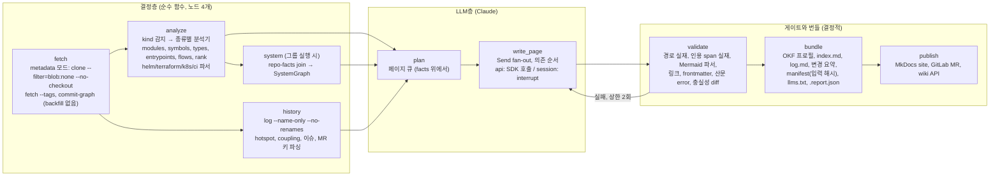

# repowiki PLAN

> 상태: **초안 3판**, 작성 2026-09-08. 2판(Codex 리뷰 18건 반영)에 사이트 생성기, 설정, 인프라 레포, 멀티 레포 시스템, 갱신 이력, 커밋, MR 활용, 2차 질의를 더했다. 근거는 리서치 `01–12`(현재 `docs/research/`, Phase 0 뒤 `docs/reports/research/`로 옮기며 참조 갱신은 Phase 0 완료 조건). 라벨: [실측] 이 세션의 로컬 실행, [코드] 대상 저장소 코드 정독, [웹] 웹 문서와 이슈, [it] syntopicon KB 검토 페이지, [문면] 벤더 문서.
> 진행 상태는 이 문서가 적지 않는다. 정본은 `scripts/gate_chain.sh` 출력과 `tests/acceptance/` 통과 여부, 게이트 완주 기록은 `scripts/RUNLOG.md`다(C-REC-1).

## 0. 한 줄 정의와 판정

**repowiki**는 GitLab 그룹 또는 저장소 URL을 받아 레포 종류(코드, Helm, Terraform, k8s, CI)를 가리고, 모듈 분해, 모듈과 타입 수준의 결합, 진입점과 교차 모듈 흐름, 변경 핫스팟, 그리고 레포 사이의 관계(시스템 그래프)를 결정적으로 추출한 뒤, LLM이 그 사실 위에서만 Markdown+Mermaid 위키를 쓰게 하는 Python CLI다. 목적은 하나다. **새 코드베이스(레포 하나 또는 레포 여럿으로 된 시스템)를 처음 보는 사람이 다이어그램으로 구조와 결합을 파악한다.** 1차 대상은 Apache 오픈소스(레포 4개 + SkyWalking 13개 레포 시스템), 2차 대상은 사내 self-hosted GitLab 프로젝트 20개(오프라인 반입).

| 판정 | 결론 | 근거 |
|---|---|---|
| `agentic-project-tpl` 채용 | **채용** (전체) | 리서치 04 |
| OKF | **repowiki OKF 호환 프로필**: 필수 `type` + 고정 `title/description/tags/generated/sources/status`; `verified`는 사람 또는 결정적 검사만; `Attested Computation`, `usage_count`, `resource` 미채택 | 리서치 03 §4 |
| altera-rules | **적용**: `rev: rules-v0.10.0`, 표면 `common`, `lang/python`, `lang/bash`, `review` | 규약 저장소 정독 |
| 조율 | **LangGraph 그래프 하나**(결정층과 LLM층 전부), 드라이버 둘(API, 세션) | syntopicon 재감사, §2.1 |
| 산문 | fluent-korean 핵심 조항(프롬프트) + hanlint 검토된 오류 규칙(게이트). 나머지는 경고 리포트 | 리서치 09 |
| 사이트 | **재검증 중** (2026-09-08). 1차 조사(리서치 11)는 air-gap 비용을 1순위로 두어 MkDocs Material을 골랐으나, 목적(읽기 UX)을 1순위, air-gap을 통과/불통과 제약으로 다시 재는 실측을 진행 중이다. 결과 전까지 사이트 관련 행(§3, §7, §8, §11)은 잠정이다 | 리서치 11, 13(예정) |
| 설정, 인프라 레포 | Serena, ast-grep이 아니라 `helm template`+PyYAML, python-hcl2, dockerfile-parse, jproperties | 리서치 10 [실측] |
| 멀티 레포 | `SystemGraph`: 다섯 증거 계열(declared > artifact > contract > config > text), span 없는 엣지 금지 | 리서치 12 [실측] |
| 갱신, 이력 | 위키를 git에 두고 갱신마다 MR 하나, 변경 요약은 manifest diff에서 컴파일 | §2.9 |
| 커밋, MR 본문 | 3층: 전체 이력은 제목, 트레일러만 결정적 파싱, 갱신 창의 MR 설명만 LLM 근거, 토론 스레드는 읽지 않는다 | §2.9 |
| 2차 질의 | 서버 없이 `llms.txt`/`llms-full.txt` + 선택적 로컬 MCP(BM25). 사이트 내 채팅은 사내 서비스 허용 시에만 | 리서치 11 §5 |
| v1 밖 | Claims 사이드카, 이력 LLM 요약, 소유권, 릴리스 페이지, DeepWiki 비교, LEDGER, Serena/LSP, Vale, Fumadocs, 사이트 내 Ask 서비스 | §11 |

## 1. 목표, 비목표, 제약 (SPEC.md의 원천)

**목표**
1. URL 하나로 레포 위키(`wiki/`)를 만든다. 계층형 다이어그램(시스템 → 서브시스템 → 모듈 → 핵심 타입), 모듈 페이지, 교차 모듈 흐름 페이지, 핫스팟 페이지가 있고, 모든 구조 다이어그램은 결정적 facts에서 컴파일된다. 레포 종류가 Helm, Terraform, k8s, CI이면 그 종류의 페이지(차트 객체 그래프, 모듈 그래프, 리소스 인벤토리)를 만든다.
2. 그룹 URL 하나로 시스템 위키(`system/`)를 만든다. 레포를 노드로, 근거 span이 있는 관계만 엣지로 하는 C4-L1/L2 페이지, 관계 표, 계약(contract) 페이지, 미해결 참조 페이지.
3. 중요한 명제는 소스 위치(`path:Lx-Ly`)를 인라인으로 인용하고, 인용 없는 중요 명제는 싣지 않는다. 근거 없는 항목은 `.report.json`에 남는다.
4. 재실행은 증분이다. 페이지의 분석 입력 해시(`PageInput`)가 같으면 다시 쓰지 않는다. 갱신마다 위키가 git MR로 남고, 변경 요약 페이지가 manifest 차이에서 컴파일된다.
5. 산출물은 GitLab, GitHub, MkDocs Material, Obsidian의 **공통 Markdown/Mermaid 문법만** 쓴다.
6. 사람과 에이전트가 2차로 질의할 수 있게 `llms.txt`, `llms-full.txt`를 원문 Markdown으로 낸다.
7. 사내 반입 단위는 OCI 이미지 하나(2차로 tarball 하나)이고, §5 Phase 5의 세 네트워크 프로파일을 통과한다.

**비목표**
- 챗 UI와 웹 앱을 만들지 않는다. 사이트는 정적이고 서빙은 MkDocs와 GitLab Pages가 한다. 사이트 안 "Ask" 패널은 사내 서비스가 허용된 뒤의 별도 항목이다(§11).
- 임베딩과 벡터 DB를 두지 않는다. 2차 질의의 검색은 BM25다.
- 컴파일이 필요한 분석(SCIP, jdeps, CodeQL, `terraform graph`)을 기본 경로에 두지 않는다.
- 호출 그래프의 타입 해석을 하지 않는다. 타입 관계는 import 범위의 정적 근사이고 페이지에 표기한다.
- 레포 사이의 관계를 LLM이 추정하지 않는다. span 없는 엣지는 존재하지 않는다.

**제약**
- Python ≥3.12, uv 고정. 결정층은 순수 Python + 동봉 바이너리(ast-grep, 선택 helm). Node 22는 Mermaid 검증기와 hanlint에만.
- LLM 호출은 `adapters/llm.py` 하나가 소유한다. 사내 게이트웨이는 `base_url`, Bedrock은 `AnthropicBedrockMantle`.
- 토큰과 시크릿은 환경 변수와 `.netrc`만. values 파일의 자격증명 유사 키는 값 마스킹.

## 2. 아키텍처

### 2.1 그래프 하나, 노드는 얇다



- LangGraph 하나. 상태는 Pydantic 타입, 체크포인터 SQLite, 페이지 작업은 `Send` fan-out, 게이트 실패는 재생성 루프(상한 2회). 결정층은 노드 넷(`fetch`, `analyze`, `history`, `system`)으로 묶고 본문은 `analyze/`의 순수 함수다. 체크포인터는 "이번 실행 이어가기", 증분 판정은 `Manifest`가 한다.
- LLM 노드는 facts만 읽는다. API 드라이버는 SDK 입력이 facts 발췌뿐이라 자동으로 성립하고, 세션 드라이버는 §4의 격리로 성립시킨다.
- Langfuse와 LangSmith는 두지 않는다.

### 2.2 계층과 경계 계약 (import-linter)

```
repowiki/
  cli.py        # 진입 층: 종료 상태로 실패를 말한다(C-REPORT-5). 출력 층(T201 면제)
  pipeline/     # 조율 층: LangGraph 그래프 정의, 상태 타입, 드라이버 프로토콜, manifest 증분 판정
  analyze/      # 도메인 층: kind, profile, modules, symbols, imports, types, entrypoints, flows, rank, history,
                #            helm, terraform, k8s, ci, springconfig, system (순수 계산)
  write/        # 도메인 층: plan, page (프롬프트 조립 + 응답 파싱, 순수)
  gate/         # 도메인 층: paths, citations, mermaid, links, frontmatter, prose, fidelity (판정만)
  bundle/       # 도메인 층: okf, index, manifest, changes, report, diagrams(컴파일러), llms, mkdocs_nav
  adapters/     # 기반 층: git, astgrep, helm(subprocess), llm(Anthropic SDK), gitlab, github, node(mermaid, hanlint), mcp_server
  data/         # 도메인 사실(C-DOMAIN-1): 언어 표, 제외 글로브, 모듈 잡음, 프레임워크 패턴, 외부 경계 패턴,
                #            이슈 링크 패턴, 서드파티 proto 네임스페이스, 자격증명 키 패턴, ast-grep 룰, 프롬프트
```

계약: `cli → pipeline → {analyze, write, gate, bundle} → adapters`. 형제 넷 독립. `adapters` 밖에서 `subprocess`, `anthropic`, `gitlab`, `langgraph` 임포트 금지. `.importlinter`를 첫 구현 커밋에서 세우고 위반 0 기록을 RUNLOG에 남긴다.

### 2.3 데이터 모델 (경계를 넘는 자료는 이름 붙은 형태, C-PY-1)

| 이름 | 내용 | 생산자 → 소비자 |
|---|---|---|
| `RepoKind` | `code`, `helm`, `terraform`, `k8s`, `mixed` + `ci-extras` 플래그. 파일 서명으로 결정(§2.7) | analyze → 분석기 선택, plan |
| `RepoProfile` | 언어별 파일과 줄, 토큰 추정, 제외 경로와 사유 | analyze → plan, 비용 추정 |
| `ModuleGraph` | 빌드 파일 경계의 모듈, import 엣지(가중치), SCC, 서브시스템 분할 | analyze → 다이어그램 컴파일러 |
| `Symbol` | 종류, 이름, 시그니처, range, docstring, 모듈 | analyze → 페이지 컨텍스트 |
| `TypeGraph` | 타입 노드와 `extends`, `implements`, `field_type`, `static_call`(import 범위에서 유일하게 풀리는 것만) | analyze → 모듈 페이지, flows |
| `EntryPoint` | main, route, cli, scheduler, listener; 위치; 프레임워크 | analyze → overview, flows |
| `CrossModuleFlow` | 진입점에서 BFS(깊이 ≤4), 모듈 둘 이상, 홉별 span, 외부 경계 | analyze → `overview/flows.md` |
| `ConfigSurface` | Spring `application*` 키, 프로필과 `@ConfigurationProperties` prefix 조인; 자격증명 유사 키 마스킹 | analyze → 모듈 페이지 설정 절 |
| `InfraGraph` | Helm: Chart 의존, values 키, 렌더 객체와 참조 엣지, 이미지, 외부 입력(dangling). Terraform: 스택, 모듈 소스, 리소스, data 인벤토리, backend, remote-state. k8s: 객체 그래프, kustomize 트리. CI: stages, jobs, include, trigger | analyze → helm/terraform/k8s 페이지, SystemGraph 입력 |
| `FileRank` | PageRank ⊕ import fan-in ⊕ churn | analyze → plan |
| `History` | 파일별 revisions(24개월), temporal coupling, 커밋 제목, 트레일러에서 파싱한 이슈, 제안, MR 키(`data/issue-links.yml`) | history → hotspot 페이지, 모듈 페이지 "관련 제안" 목록 |
| `UpdateWindow` | 지난 분석 커밋 이후 커밋과 MR(제목, 설명, URL), 페이지별로 닿는 것만 | history → write_page evidence |
| `RepoFacts` | 레포가 생산, 소비하는 `Coordinate`(maven, gradle, npm, pypi, go, image, proto-pkg, graphql-root, openapi, topic, host), 빌드 지점, 계약 정의 | analyze → system |
| `SystemGraph` | `System{source}`, `RepoRef{kind, containers, systems[]}`, `Edge{kind, class 1..5, scope main/test, evidence[Span], drift, direction known/assumed}`, `Unresolved` | system → `system/` 페이지 |
| `PageJob` / `PageInput` / `Manifest` | 2판과 같다. `PageInput`에 `InfraGraph`, `SystemGraph` 슬라이스 포함 | plan → write → bundle |
| `ChangeSummary` | 두 manifest의 차이: 모듈, 엣지, 진입점, 시스템 엣지의 추가, 삭제, 다시 쓴 페이지와 사유(바뀐 입력 해시), 갱신 창의 MR 목록 | bundle → `changes/<date>-<sha>.md` |

Claims 사이드카는 없다. 인용은 인라인 `path:Lx-Ly`와 페이지 `sources`이고, 게이트는 span 실재와 evidence id 범위만 판정한다.

### 2.4 출력 번들 (repowiki OKF 호환 프로필)

```
wiki/                                # 레포 하나
  index.md, log.md, quickstart.md, llms.txt, llms-full.txt
  overview/architecture.md           # L0 (서브시스템 ≤15)
  overview/flows.md                  # 교차 모듈 흐름 (필수, code 레포)
  subsystems/<subsystem>.md          # L1 (≤25)
  modules/<module>.md                # L2 타입 그래프 + 책임, 경계면 계약, 설정, 실패 모드, 관련 제안, 이슈
  workflows/<flow>.md
  helm/{overview,objects,values,images,external-inputs}.md      # helm 레포
  terraform/{stacks,modules,resources,contracts}.md              # terraform 레포
  k8s/{objects,overlays}.md                                      # k8s 레포
  ci/pipeline.md                                                 # ci-extras
  history/hotspots.md
  changes/<date>-<sha>.md            # 갱신마다 컴파일 (ChangeSummary)
  .manifest.json, .report.json, INSTRUCTIONS.md
system/                              # 그룹 실행
  index.md                           # C4-L1: 시스템, 외부 시스템(집합 밖 대상)
  containers.md                      # C4-L2: 레포, 컨테이너, 쌍당 최고 등급 엣지
  relations.md                       # src, dst, kind, class, scope, drift, 근거 링크
  contracts.md                       # contract 레포별 패키지, root 필드와 소비자 (Published Language)
  unresolved.md                      # 미해결 좌표, 집합 밖 레포, text-only 쌍, 오래된 클라이언트 연산, proto 복사 드리프트
  deployment.md                      # Helm/compose 있을 때
```

frontmatter: `type ∈ {quickstart, architecture-overview, subsystem, module, workflow, flows, helm, terraform, k8s, ci, history, changes, system-context, system-containers, system-relations, system-contracts, system-unresolved}`, `title`, `description`, `tags`, `generated: {by, at}`, `analyzed_commit`, `sources`, `status`, `verified`. 페이지 머리에 "분석 커밋 `<sha>`, 현재 HEAD와의 거리"를 표시한다. 본문 골격은 인터페이스 문서 규정(리서치 06 §8). 레포 위키가 시스템에 속하면 머리에 "Part of system X, upstream: …, downstream: …"를 붙인다.

### 2.5 다이어그램: 계층형 컴파일, LLM은 주석만
2판과 같다(L0 ≤15, L1, L2 ≤25, 흐름 ≤12홉, 핫스팟 `classDef hot`). 추가: `InfraGraph`의 Helm 객체 그래프(≤25, kind별 그룹), Terraform 모듈 그래프, `SystemGraph`의 L1/L2는 class ≤4, `scope=main`만 그리고 실선(1–2), 점선(3–4)으로 등급을 보인다. test, text 엣지는 표에만.

### 2.6 산문 규범
2판과 같다. 필수(프롬프트 + hanlint 검토 규칙 4종 + 충실성 diff), 나머지는 경고 리포트, 수치 목표 없음, Vale 없음.

### 2.7 레포 종류와 분석기 (근거: 리서치 10 [실측])

| kind | 서명(순서대로, 둘 이상이면 mixed) | 분석기 | 하지 않는 것 |
|---|---|---|---|
| helm | `Chart.yaml` + `templates/` | PyYAML(Chart, values) → `helm template`(바이너리 있을 때, 차트별 최소 values 오버라이드 `data/helm-values/`) → 렌더 YAML PyYAML → 객체, 참조 그래프 | 템플릿에 ast-grep(ERROR 98.9%) |
| terraform | `.terraform/` 밖 `*.tf` ≥1 | python-hcl2(문자열 리터럴 따옴표 strip) → 스택, 모듈 소스, 리소스, backend, remote-state | `terraform graph`(init 필수), Serena terraform-ls |
| k8s | `kustomization.y*ml` 또는 `apiVersion`+`kind` YAML(`{{` 없음) | PyYAML + `kubectl kustomize`(있을 때, 로컬 base만) | 원격 base 해석 |
| code | `pom.xml`/`build.gradle*`/`package.json`/`pyproject.toml`/`go.mod` | ast-grep kind 룰(symbols, types, entrypoints, imports) + tree-sitter tags + PyYAML/jproperties(`application*`) + ast-grep `@ConfigurationProperties` 조인 | 텍스트 패턴, Scala outline |
| ci-extras(모든 kind) | `.gitlab-ci.yml`, `Jenkinsfile*`, `Dockerfile*` | PyYAML(jobs, stages, include, trigger), Jenkinsfile 정규식(`stage`, `agent`), dockerfile-parse(FROM → 레지스트리 인벤토리) | ast-grep dockerfile/groovy(문법 없음) |

helm 바이너리가 없으면 values+Chart만 분석하고 페이지에 "템플릿 미렌더"를 표기한다(C-BRANCH-3). Serena는 어느 종류에도 기본 경로에 없다.

### 2.8 시스템 수준: `SystemGraph` (근거: 리서치 12 [실측], KB 컨텍스트 맵 [it])

- **실행**: `repowiki system <gitlab-group-url>`. GitLab API로 그룹, 서브그룹 프로젝트 열거 → 레포별 `RepoFacts`(head_sha로 증분 캐시) → join(생산×소비 → 엣지, 미매칭 → `Unresolved`, 생산자 HEAD vs 소비자 핀 → drift) → `system/` 출력 → 레포 위키에 링크백.
- **증거 계열과 등급**(엣지의 class = 증거 계열, 평균 내지 않음): 1 declared(`.gitmodules`, Backstage `catalog-info.yaml`, GitLab `trigger:/include:/needs: project:`) > 2 artifact(Maven, Gradle, npm, PyPI, Go 좌표) > 3 contract(proto import/copy, GraphQL root 필드, OpenAPI 경로) > 4 config/infra(이미지 참조는 빌드 지점 기반 image→repo 맵으로만, 토픽 리터럴은 `direction: assumed`, host:port) > 5 text(README 링크, `unresolved.md`에만).
- **scope**: test/e2e 경로의 근거는 `scope=test`로 갈라 둔다. SkyWalking에서 Maven 엣지 12 중 11, 이미지 참조 97 중 82가 test였다.
- **시스템 소속 우선순위**(`System.source`에 기록): Backstage `spec.system` → GitLab 그룹 → 공유 parent POM/BOM, 공유 CI 템플릿 → class ≤3 엣지의 연결 성분(제안으로만).
- **레포 kind**(§2.7의 kind와 별도로 시스템 역할): `contract`(스키마 파일 ≥30% 또는 `-proto/-protocol` 접미), `library`(좌표 생산, 이미지 없음), `service`(이미지 빌드 또는 main), `infra`, `docs`. C4 컨테이너 = 빌드된 이미지, 서비스(레포당 0..N). 시스템 경계는 소유권(그룹, CODEOWNERS)이 정한다.
- **DDD 라벨**: 자동은 generic upstream/downstream, Published Language(contract 레포를 ≥2 레포가 소비), Open Host Service만. Shared Kernel, Conformist, ACL, Customer/Supplier, Partnership은 `unresolved.md`의 후보로 사람이 확인한다. 지도는 이상이 아니라 현재를 그린다(Evans, KB [it]).
- **충돌**: 같은 좌표를 두 레포가 생산하면 병합하지 않고 오류 항목. 이미지는 태그 없는 레지스트리 경로로 키, 태그는 drift. 레포는 여러 시스템에 속할 수 있고(`systems[]`) 교차 시스템 엣지는 상대 시스템을 외부로 그린다. 사내 GitLab에서는 `$CI_REGISTRY_IMAGE`가 image→repo 맵을 준다.

### 2.9 갱신과 이력

- **위키는 git에 산다.** 갱신 실행마다 브랜치 하나와 MR 하나(openwiki CI 예제와 같은 패턴). 모든 판이 diff, 되돌리기 가능하고, 이력의 정본은 별도 장치가 아니라 git이다. 주기는 GitLab CI 스케줄이 `repowiki --update`를 돈다.
- **변경 요약은 컴파일한다.** `changes/<date>-<sha>.md`는 두 manifest의 차이(모듈, 엣지, 진입점, 시스템 엣지의 추가와 삭제, 다시 쓴 페이지와 바뀐 입력 해시)와 갱신 창의 MR 목록(제목, URL)만 담는다. LLM 요약이 아니다.
- **커밋과 MR 본문의 3층**:
  1. 전체 이력, 결정적, LLM 0: 커밋 제목, 트레일러에서 이슈 키, 제안 링크(KIP, AIP, ADR), PR/MR 번호, `Co-authored-by`, `Reviewers:`를 파싱해 모듈 페이지의 "관련 제안, 이슈" 목록으로 컴파일한다. 패턴은 `data/issue-links.yml`(Kafka `KAFKA-`, `KIP-`, `(#N)`, Airflow `(#N)`만, 사내 JIRA 키, `!N`은 P-B에서 확인). kafka 18k 커밋 2 s [실측 07].
  2. 갱신 창만, LLM 근거: 지난 분석 커밋 이후 머지된 커밋 본문과 MR 설명(GitLab MR API `read_api`, GitHub `gh api`)을 다시 쓰는 페이지에 닿는 것만 `UpdateWindow`로 `write_page`에 준다. 페이지당 상한 20건. 인용은 MR URL.
  3. 읽지 않는 것: 전체 이력의 본문, MR 설명을 LLM에 넣는 것(kafka 제목만 120만 토큰), MR 토론 스레드.
- 페이지 머리의 "분석 커밋 vs HEAD" 표시로 오래된 페이지를 읽는 사람이 바로 안다.

### 2.10 2차 질의 (근거: 리서치 11 §5)

- **서버 없음이 기본.** `bundle/llms.py`가 `llms.txt`(규격형 인덱스, 페이지 목적 포함)와 `llms-full.txt`(원문 Markdown, Mermaid fence 유지)를 낸다. `AGENTS.md`/`CLAUDE.md`에 "아키텍처 위키: `wiki/llms.txt`부터 읽고 링크를 따라가며 `path:lines`로 인용" 한 줄. Claude Code는 Read/Grep으로 답한다.
- **선택, 로컬 MCP** `repowiki-mcp`(FastMCP, `.mcp.json` 프로젝트 스코프): `read_wiki_structure`, `read_wiki_contents(page)`, `search(query, k)` = `bm25s` + `kiwipiepy` 형태소 분절(bm25s 기본 토크나이저는 조사를 붙여 둔다), 생성 시점 색인, 임베딩 없음. `ask`는 두지 않는다(호출자가 LLM).
- 사이트 내 "Ask" 패널은 사내 소형 서비스(FastAPI `/ask` = BM25 top-k → 게이트웨이)가 허용된 뒤의 항목이다(§11).

## 3. 기술 스택 선정 (채택 판단은 실제 구동으로, C-LIB-4)

| 역할 | 채택 | 실측 근거 | 사각 |
|---|---|---|---|
| 심볼, 타입 관계, 진입점, import | ast-grep 0.45 `kind:` 룰 전용 | kafka 전체 1.1 s, grep 대비 1% 이내 [07] | 타입 해석 없음; Scala outline 미지원 |
| 파일 랭킹 | tree-sitter-language-pack tags + networkx PageRank | aider 알고리즘 [01] | Kotlin/Scala/TS tags 제한 |
| 서브시스템 분할 | 빌드 트리 그룹 → Leiden(networkx) | GraphRAG 구도 [it 06] | 사람 명칭과 다를 수 있음 → `INSTRUCTIONS.md`로 고정 |
| 모듈 경계 | pom `<modules>`, `settings.gradle` include, pyproject/package.json workspaces, `go.mod` | [07] | Gradle 동적 include |
| Helm | PyYAML + `helm template`(선택 바이너리, Apache-2) | 11개 차트 119 객체, 124 엣지, 스팟체크 5/5 [10] | 필수 values 없는 차트는 오버라이드 필요 |
| Terraform | python-hcl2 8.x | 16/16 파싱 0.77 s [10] | 리터럴 따옴표 strip; 동적 표현식은 문자열로 남음 |
| k8s/kustomize | PyYAML + `kubectl kustomize`(선택) | 로컬 base 검증 [10] | 원격 base |
| Dockerfile, properties, TOML, CI | dockerfile-parse, jproperties, tomllib, PyYAML, Jenkinsfile 정규식 | 104/104 Dockerfile [10] | Groovy 정규식의 한계 |
| 시스템 그래프 | `12-scripts/`의 추출기 8종을 `analyze/system`으로 이식(Maven, Go, npm, proto, GraphQL, infra, strings, join) | SkyWalking 13 레포 5 s, span 524, 스팟체크 9/9 [12] | Gradle, Python, OpenAPI, JPA, GitLab CI 키워드 추출기 미실행 → Phase 6에서 실측 |
| 클론 | metadata 모드 기본, `--full-clone`은 numstat 필요 시 | [07 §7] | backfill 없음 |
| 이력 | `git -c core.commitGraph=false log --name-only --no-renames --since=24.months`; revisions, coupling Python 재구현, code-maat 오라클 | [07] | 50파일 초과 커밋 제외 |
| MR, PR 수집 | python-gitlab(`read_api`), `gh api` | [문면 05 §C] | 갱신 창에 한정 |
| 토큰 추정 | tiktoken + `count_tokens` 1회 | [02] | 인코딩 동봉 |
| Mermaid 검증 | `mermaid@11` + `jsdom` | [05 §B3] | node_modules 동봉 |
| 산문 게이트 | hanlint 핀, 채택 규칙만 | [09] | 어린 프로젝트 → 오탐 계수 |
| 사이트 | **MkDocs Material 9.7.7 핀** + `privacy` + `offline` + `mkdocs-llmstxt` 0.5.0(또는 자체 `bundle/llms.py`), `theme.font: false`, `navigation.sections/indexes`, `pymdownx.details` | 오프라인 빌드 검증, 한국어 lunr [11] | EOL 2026-11-05 → 콘텐츠를 생성기 독립으로 유지; `.cache/plugin/privacy`(4 MB) 동봉 없으면 CDN 링크가 조용히 남는다 |
| 2차 질의 검색(선택) | bm25s + kiwipiepy | [11 §5] | kiwipiepy LGPL, 휠 동봉 |
| GitLab | python-gitlab(그룹 토큰; 위키, MR 쓰기만 `api`) | [05 §C] | GitLab <19.0은 Mermaid 10 |
| 조율 | LangGraph + `langgraph-checkpoint-sqlite` | syntopicon 재감사 | `ormsgpack` 네이티브 휠 동봉 |
| LLM | Anthropic SDK, `claude-opus-5`, adaptive thinking, `fallbacks: "default"`, 스트리밍, 캐싱, Batches | claude-api 스킬 | 모델 등급은 비용 측정 후 |

## 4. LLM 층 설계
2판과 같다(드라이버 프로토콜 표, `write_page` 입력 `PageJob` + evidence id, structured outputs, `unverified`는 `.report.json`, 페이지당 60k 토큰, 재시도 2회, `--max-cost`). 추가: `UpdateWindow`의 MR 설명은 evidence id를 받은 span(URL)으로만 인용된다. 시스템 페이지는 LLM이 관계 표를 **요약**만 하고 엣지를 더하거나 빼지 못한다.

## 5. 단계별 계획 (완료 판정은 SPEC 성공 기준으로 옮겨 사람 승인 후 봉인)

| Phase | 산출물 | 완료 판정 |
|---|---|---|
| **0 기반** | 템플릿 인스턴스화, altera-rules, `.importlinter`, SPEC.md, `docs/bootstrap.md` | `install_surfaces.py --check` 0건; `gate_chain.sh` 완주 기록; `grep -n "docs/research" PLAN.md` 0건 |
| **1 결정층(code)** | `repowiki analyze <url>` → facts + L0/L1/L2 | 4개 레포 종료 0; 모듈 수 수동 집계 일치; 선언 골든셋 recall, precision ≥0.98; L0 ≤15, L1, L2 ≤25 전부 충족; 진입점 recall ≥0.95; kafka <5 min |
| **2 이력** | `repowiki history` | code-maat 상위 20건 일치; kafka <60 s; 이슈, 제안 키 파싱이 kafka `KAFKA-` 61.5%, `KIP-` 4.5% 실측과 ±1%p |
| **2b 설정, 인프라 레포** | helm/terraform/k8s/ci 분석기와 페이지 | bdp-eks-charts 11 차트에서 객체 119, 엣지 124 재현, 스팟체크 5/5; aws-infra 16 `.tf` 파싱 16/16; helm 부재 시 "미렌더" 표기 경로 통과; 자격증명 유사 키 0건 노출 |
| **3 LLM층 + 게이트** | `repowiki write` → `wiki/` | 4개 레포 전 페이지 게이트 통과; 페이지당 인용 ≥3; `overview/flows.md` 흐름 ≥5; 사람 표본 판정 50개 중 근거 지지 ≥95%; `llms-full.txt`에 Mermaid fence 원문 유지 |
| **4 사이트, 증분, 갱신** | MkDocs 사이트, `--update`, MR, `changes/` | 소스 무변경 = LLM 0; 변이 세트 10건 재생성 집합 ≥9/10; 이해도 태스크 ≥4/5; **연속 갱신 3회 뒤 `changes/` 3편의 항목이 실제 커밋 diff와 일치**; MkDocs 오프라인 빌드 산출물에 외부 URL 0건 |
| **5 GitLab, 패키징** | `repowiki gitlab <group>`, OCI 이미지, tarball | P-A 설치 무인터넷; P-B 외부 차단 + 사내 GitLab, LLM 허용(20개 e2e, MR 생성); P-C 완전 차단(사전 클론 + 녹화 LLM)에서 analyze, gate, bundle, MkDocs 빌드; lock 전체(langgraph, ormsgpack, hanlint, mkdocs-material, python-hcl2, dockerfile-parse)로 빌드; SBOM, 라이선스 |
| **6 시스템** | `repowiki system <group>` → `system/` | SkyWalking 13 레포에서 비텍스트 엣지 ≥30, 스팟체크 ≥9/10 재현; 사내 20개에서 `unresolved.md`의 미해결 좌표를 사람이 검토해 거짓 엣지 0(class ≤3); 레포 위키 링크백 100% |

Phase 0의 셸 절차는 `docs/bootstrap.md`가 소유한다.

## 6. 게이트와 평가
2판과 같다. 추가: 시스템 엣지 게이트(span 실재, class와 scope 필드 존재, 같은 좌표 이중 생산 → 오류), `changes/` 페이지의 항목 ↔ manifest diff 일치 검사, `llms.txt`의 링크 전부 실재.

## 7. 기각한 선택지 (현재형 사유)

| 선택지 | 기각 사유 |
|---|---|
| Fumadocs | Node 22 + Next 16 + npm 캐시 224 MB, Google Fonts로 오프라인 빌드 하드 실패, 300페이지 산출 210 MB(GitLab Pages 기본 100 MB), `.mdx`가 `Map<K, V>`로 빌드 실패, llms.txt에 JSX 혼입 [11 실측]. UX 우위는 인정하고 검증된 레시피를 §11에 남긴다 |
| Fumadocs 테마 교체 | 기본 Docs 레이아웃 + `neutral.css`로 충분하고 커뮤니티 테마는 의존할 것이 없다(공식 템플릿 2026-08-03 아카이브) |
| Zensical 지금 채택 | 알파, `privacy` 플러그인과 llms.txt 없음 [11] |
| Serena, ast-grep으로 설정 레포 | Helm 템플릿 ERROR 98.9%, terraform-ls는 init 필수, YAML 심볼은 최상위 키 목록 [10] |
| `terraform graph` | init(provider 다운로드) 필수 [10] |
| LLM 추정 레포 간 관계 | 조사한 생성기 어느 것도 하지 않고, 결정적 도구가 살아남은 이유가 추측하지 않아서다 [12] |
| 이미지명, 아티팩트명, proto 경로로 레포 추정 | SkyWalking에서 거짓 엣지의 원인이었다 → 빌드 지점 맵, 네임스페이스 deny-list [12] |
| 전체 이력 커밋 본문, MR 설명의 LLM 입력, MR 토론 스레드 | 비용(kafka 제목만 120만 토큰)과 근거 불확실 |
| 사이트 내 AI 채팅(Fumadocs `ai/*`) | `/api/chat` 서버 라우트가 정적 export와 양립하지 않고 브라우저 직접 호출은 키 노출 [11] |
| 임베딩 검색 | BM25 + 형태소로 충분, 반입 의존 증가 |
| 2판의 기각 전부 | deepwiki-open 포크, OpenWiki 그대로, Serena 기본, SCIP/Joern, mmdc, OKF 전면, `--depth`, backfill, 1M 컨텍스트, Claims 사이드카, 이력 LLM 요약, DeepWiki 비교, LEDGER, LLM 판정자, 탐지기, 화이트리스트, 수치 목표, Vale, deslop, pydoit, 결정층 분리, Langfuse, 자체 린트 |

## 8. 사내 반입 패키징 (근거: 리서치 08, 11 [실측])
2판과 같다. 추가 동봉: `python-hcl2`, `dockerfile-parse`, `jproperties`, `mkdocs-material==9.7.7`, `mkdocs-llmstxt`, `.cache/plugin/privacy`(온라인 1회 빌드 산출, 4 MB), 선택 `helm` 바이너리(Apache-2, ~50 MB)와 `kubectl`, 선택 `bm25s`, `kiwipiepy`(LGPL 표시). Phase 5에서 lock 전체로 이미지를 다시 빌드하고 P-A/P-C 값을 기록한다. Serena와 `optional-lsp/`는 동봉하지 않는다.

## 9. Apache 실측 프로파일
2판과 같다(리서치 07). 추가 실측: SkyWalking 13 레포 shallow 클론 4 s, 추출 5 s, span 524 [12]; bdp-eks-charts 11 차트 렌더 객체 119 [10]; MkDocs 오프라인 빌드 0.4–3 s, Fumadocs 301페이지 7.7 s, 210 MB [11].

## 10. 알려진 사각
2판과 같다. 추가: Kafka 토픽 엣지의 방향은 파일 마커 휴리스틱(`direction: assumed`); Helm 렌더는 차트별 필수 values에 의존; Terraform 동적 표현식은 문자열로만 남는다; MkDocs Material EOL 뒤의 보안 수정은 없다(핀 유지, 콘텐츠 이식성으로 대응); 사내 GitLab CI 키워드(`trigger/include: project:`) 추출기는 P-B에서 처음 실측된다.

## 11. v1 밖으로 낸 것 (현재형 사유)

| 항목 | 지금 넣지 않는 이유 |
|---|---|
| Claims 사이드카, 앵커 재배치 | `PageInput` 해시가 증분 정본 |
| 이력 LLM 요약, 소유권, 릴리스 페이지 | 구조 이해에 직접 기여하지 않고 kafka만 120만 토큰 |
| DeepWiki 비교, LEDGER 근거율 | 평가 장치가 제품과 맞먹는다 |
| Serena/LSP | kafka/dubbo 미측정, +110 MB; `TypeGraph`가 기본 경로 |
| Vale | 영어 부차적, CJK 미검증 |
| Fumadocs 사이트 | air-gap 비용; 검증 레시피(정적 템플릿, `remarkMdxMermaid`, `multilingual`, Google 폰트 제거, `.md` 출력)는 리서치 11 산출물 `fuma-static/`에 있다 |
| 사이트 내 Ask 패널(FastAPI `/ask` + 게이트웨이) | 사내 소형 서비스 허용 여부가 P-B에서 정해진다 |
| Gradle, Python, OpenAPI, JPA, GitLab CI 키워드 시스템 추출기 | SkyWalking에 데이터가 없어 미실측; Phase 6 사내 20개에서 실측 후 넣는다 |
| GitLab 위키 API 발행 자동화의 세부 | P-B에서 사내 GitLab 판을 확인한 뒤 |

## 12. 실행 규약 (사용자 지시, 2026-09-08)

1. **버전 고정.** 외부 라이브러리와 도구는 착수 시점의 최신 안정 버전을 실제로 돌려 확인한 뒤 정확히 핀한다. 정본은 `uv.lock`과 `package-lock.json`이고, 판 올림은 수용 골든셋을 다시 통과시키는 것으로 판정한다. 의존별 최신 판, 라이선스, 정본 문서, `llms.txt` 유무는 `docs/reference/dependency-docs.md`(의존 문서 대장)가 소유한다.
2. **문서 우선 구현.** 도구의 동작을 기억이나 추측으로 흉내 내지 않는다. 그 도구가 `llms.txt`를 내면 그것을, 아니면 정본 문서를 읽고 구현한다. 사내 반입을 위해 정본 문서는 syntopicon docs-mirror에 미러하고(`/docs-query`), 버전이 갈리는 동작은 그 판의 문서로 확인한다.
3. **발산과 검증의 분리.** 산출 코드는 altera-rules 발산 규칙(C-)을 따른다. 테스트와 검증은 코드를 쓴 에이전트가 아니라 별도 에이전트(Codex `codex:codex-rescue` 등)가 검증 규칙(V-)과 테스트 규칙(C-TEST-1/2/3)으로 본다. 수용 테스트는 템플릿의 봉인을 따른다. 코드를 쓴 손이 수용 판정 근거를 만들지 않는다(리서치 06 §2, §3 [it]).
4. **지식은 KB부터.** Phase마다 착수 전에 `/kb-query`로 그 단계의 주제를 뽑고, KB 공백은 공백이라고 적는다(리서치 06 §10).
5. **비용보다 정확성.** 토큰 비용과 구현 비용을 줄이려고 목적 항목(사람이 다이어그램으로 구조와 결합을 파악하는 것)이나 사내 패키징 형태를 깎지 않는다. 대안 비교의 1순위는 목적 적합성이고, air-gap은 순위가 아니라 통과/불통과 제약이다. 사용자가 비용 증가를 사전에 허용했다.
