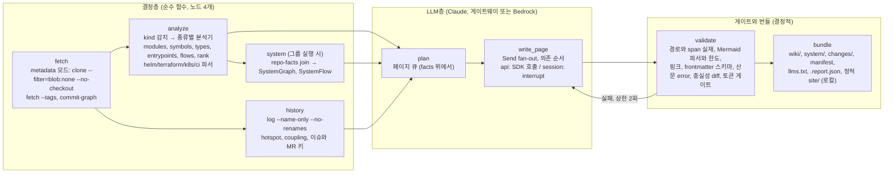

# repowiki PLAN

> 상태: **초안 5판**(사이트 확정 반영), 작성 2026-09-09. 자립 문서다(이전 판 참조 없음). 4판에 Codex 적대 리뷰 2차(치명 3, 중요 10, 사소 5)와 사용자 지시(서빙 범위 밖, GitLab Pages 전면 제거)를 반영했다. 이전 판은 `docs/plan-history/`에 있다. 근거는 리서치 `01–14`(현재 `docs/research/`, Phase 0 뒤 `docs/reports/research/`)와 의존 문서 대장 `docs/reference/dependency-docs.md`. 라벨: [실측] 이 세션의 로컬 실행, [코드] 대상 저장소 정독, [웹] 문서와 이슈, [it] syntopicon KB, [문면] 벤더 문서, [14] 편향 감사, [unverified] 미확인.
> 진행 상태는 이 문서가 적지 않는다. 정본은 `scripts/gate_chain.sh` 출력과 `tests/acceptance/` 통과 여부, 게이트 완주 기록은 `scripts/RUNLOG.md`다(C-REC-1).

## 0. 한 줄 정의와 판정

**repowiki**는 GitLab 그룹 또는 저장소 URL을 받아 레포 종류(코드, Helm, Terraform, k8s, CI)를 가리고, 모듈 분해, 모듈과 타입 수준의 결합, 진입점과 교차 모듈 흐름, 변경 핫스팟, 레포 사이의 관계와 흐름(시스템 그래프)을 결정적으로 추출한 뒤, LLM이 그 사실 위에서만 Markdown+Mermaid 위키를 쓰게 하는 Python CLI다. 산출물은 **로컬 디렉토리**(`wiki/`, `system/`, 정적 사이트 `site/`)이고, 로컬에서 열어 쓴다. 서빙(S3, 사내 정적 호스트, GitLab 위키 API)은 이 계획의 범위 밖이다. 목적은 하나다. **새 코드베이스(레포 하나 또는 여럿으로 된 시스템)를 처음 보는 사람이 다이어그램으로 구조와 결합을 파악한다.** 1차 대상은 Apache 오픈소스(레포 4개 + SkyWalking 13개 레포 시스템), 2차 대상은 사내 self-hosted GitLab 프로젝트 20개(오프라인 반입).

| 판정 | 결론 | 근거 |
|---|---|---|
| `agentic-project-tpl` | 채용(전체) | 리서치 04 |
| OKF | repowiki OKF 호환 프로필: 필수 `type` + 고정 `title/description/tags/generated/sources/status/verified/stale_after`, `.schema/frontmatter.json`으로 CI 검증 | 리서치 03, [14] |
| altera-rules | 적용: `rev: rules-v0.10.0`, 표면 `common`, `lang/python`, `lang/bash`, `review` | 규약 저장소 정독 |
| 조율 | LangGraph 잠정. Phase 0 하네스(§5)가 판정한다 | syntopicon 재감사, [14] #8 |
| 다이어그램 | Mermaid 11. 게이트에 GitLab 실제 한도(페이지당 소스 2,000자, 50블록), 가독성 사다리(§2.5)로 상한과 레이아웃을 결정 | [14] #1, #2 |
| 심볼, 타입, 호출 | ast-grep 0.45.3 kind 룰, 언어별 문법 휠, 타입 관계와 호출 엣지는 분리된 채택 조건(§2.3) | [14] #3 |
| 랭킹, 서브시스템 | PageRank(권위) + 역PageRank/HITS(허브), RRF; 빌드 트리 우선, networkx Louvain, scikit-network Leiden 도전자. networkx Leiden은 CPU에 없다 | [14] #4, #5 |
| 이력 | git CLI, blobless에서 핫스팟 = 수정 횟수, 오라클 code-maat(Docker, 테스트 전용) + codelore | [14] #6 |
| 토큰 | `count_tokens` 하드 게이트, 네트워크 불가 시 벤더링 보정표 p95 로컬 게이트로 결정적 전환 | [14] #7 |
| 산문 | fluent-korean 조항 + 자체 정규식 + hanlint(강등) | [14] #10 |
| 사이트 | **MkDocs Material 9.7.7**(offline 플러그인, self-host Mermaid, mkdocs-panzoom-plugin), 후계 Zensical 검증됨. 결정 측정은 `file://` 동작: MkDocs와 Zensical만 통과, Starlight는 Pagefind가 죽고, Fumadocs는 절대 경로로 실패. HTTP 서빙 조건에서는 Starlight가 읽기 UX 1위(42 vs 32)이고 전환 비용은 emitter뿐이다. 서빙은 범위 밖이므로 현재 판정은 `file://` 조건의 결과다 | 리서치 13 [실측] |
| 설정, 인프라 레포 | PyYAML `compose_all`, Helm 4.2.4 + kustomize 5.8.1(standalone) 핀, python-hcl2 `parses_to_tree` + tfparse, dockerfile-parse, 자체 properties 파서 | 리서치 10, [14] #12, 의존 대장 |
| 멀티 레포 | `SystemGraph` + `SystemFlow`(근거 있는 홉 체인만) | 리서치 12 |
| 2차 질의 | CLI + `SKILL.md` + `AGENTS.md`가 1차, MCP(`mcp==2.2.0` `MCPServer`) 2차, 검색 bm25s 기본 | [14] #11, #15 |
| 시크릿 | `GIT_ASKPASS` + 환경 변수 | [14] #17a |
| 서빙 | **범위 밖.** 로컬 정적 파일이 산출물이다 | 사용자 지시 2026-09-09 |
| v1 밖 | §11 | |

## 1. 목표, 비목표, 제약 (SPEC.md의 원천)

**목표**
1. URL 하나로 레포 위키(`wiki/`)를 만든다. 계층형 다이어그램(시스템 → 서브시스템 → 모듈 → 핵심 타입), 모듈 페이지, 교차 모듈 흐름 페이지, 핫스팟 페이지가 있고, 모든 구조 다이어그램은 결정적 facts에서 컴파일된다. Helm, Terraform, k8s, CI 레포는 그 종류의 페이지를 만든다.
2. 그룹 URL 하나로 시스템 위키(`system/`)를 만든다. 레포를 노드로, 근거 span이 있는 관계만 엣지로 하는 C4-L1/L2 페이지, 관계 표, 계약 페이지, 근거 있는 교차 레포 흐름 페이지, 미해결 참조 페이지.
3. 중요한 명제는 `path:Lx-Ly`를 인라인으로 인용하고 인용 없는 중요 명제는 싣지 않는다. 인용 span은 줄 번호를 주는 파서에서만 나온다(§2.7). 근거 없는 항목은 `.report.json`에 남는다.
4. 재실행은 증분이고 정확하다. 페이지 입력 계약(§2.9)이 바뀐 페이지는 반드시 다시 쓰고, 안 바뀐 페이지는 다시 쓰지 않는다. 갱신마다 위키가 git 커밋(선택적으로 MR)으로 남고 변경 요약이 manifest 차이에서 컴파일된다.
5. 산출물은 로컬에서 쓴다. Markdown은 GitLab 저장소 뷰, GitHub, Obsidian, 채택 생성기의 공통 문법만 쓰고, 정적 사이트 `site/`는 `file://`로 열어 동작한다.
6. `llms.txt`와 `llms-full.txt`(shard 계약 §2.4)를 원문 Markdown으로 낸다.
7. 사내 반입 단위는 OCI 이미지 하나(2차로 tarball)이며 §5 Phase 5의 네트워크 프로파일을 통과한다.

**비목표**
- 서빙을 하지 않는다. GitLab Pages, S3, 사내 정적 호스트, GitLab 위키 API 발행은 이 계획 밖이다(§11).
- 챗 UI와 웹 앱을 만들지 않는다.
- 임베딩 기반 검색은 기본이 아니다(§2.10의 임계를 넘을 때만).
- 컴파일이 필요한 분석(SCIP, jdeps, CodeQL, `terraform graph`)을 기본 경로에 두지 않는다.
- 레포 사이의 관계와 흐름을 LLM이 추정하지 않는다. span 없는 엣지와 홉은 존재하지 않는다.
- **완전 네트워크 차단 런타임에서 새 위키를 LLM으로 생성하는 것은 지원하지 않는다.** LLM 추론은 사내 게이트웨이 또는 Bedrock을 전제한다. 완전 차단에서 동작하는 것은 결정층, 게이트, 번들, 재생(녹화 응답)이다(§5 P-C).

**제약**
- Python ≥3.12, uv 고정. Node 22는 Mermaid 검증기, hanlint, 채택 생성기 빌드에만.
- LLM 호출은 `adapters/llm.py` 하나가 소유한다. 게이트웨이는 `base_url`, Bedrock은 `AnthropicBedrockMantle`. Bedrock 경로에는 Batches와 Files API가 없다.
- 시크릿은 환경 변수와 `GIT_ASKPASS`. values 파일의 자격증명 유사 키는 값 마스킹.
- 라이선스 정책은 산출물별이다(§8). 런타임 배포물에 GPL 계열(SPDX `GPL-*`, `AGPL-*`) 0건, LGPL은 목록에 표시, 테스트 전용 이미지의 GPL 오라클은 별도 SBOM.

## 2. 아키텍처

### 2.1 그래프 하나, 노드는 얇다



- 조율은 그래프 하나다. LangGraph 1.2.11이 잠정이고 Phase 0 하네스(§5)가 자작 러너(asyncio + SQLite jobs 테이블 + Pydantic, 약 300줄)와 비교해 판정한다. 어느 쪽이든 계약: (1) `write_page`의 LLM 호출은 interrupt 뒤에 두거나 멱등이다. (2) 재개 id 불일치는 명시적 실패다. (3) `LANGSMITH_TRACING=false`를 진입점에서 고정한다. (4) 상태는 Pydantic 타입, 체크포인트는 SQLite, 페이지 작업은 fan-out(상한 있는 동시성), 게이트 실패는 재생성 루프 상한 2회.
- LLM 노드는 facts만 읽는다. API 드라이버는 SDK 입력이 facts 발췌뿐이라 자동 성립, 세션 드라이버는 §4의 격리로 성립.
- Langfuse와 LangSmith는 두지 않는다.

### 2.2 계층과 경계 계약 (import-linter)

```
repowiki/
  cli.py        # 진입 층: 종료 상태로 실패를 말한다(C-REPORT-5). 출력 층(T201 면제)
  pipeline/     # 조율 층: 그래프 정의, 상태 타입, 드라이버 프로토콜, manifest 증분 판정
  analyze/      # 도메인 층: kind, profile, modules, symbols, imports, types, entrypoints, flows, rank, history,
                #            helm, terraform, k8s, ci, springconfig, system (순수 계산)
  write/        # 도메인 층: plan, page (프롬프트 조립 + 응답 파싱, 순수)
  gate/         # 도메인 층: paths, citations, mermaid, links, frontmatter, prose, fidelity, tokens (판정만)
  bundle/       # 도메인 층: okf, index, manifest, changes, report, diagrams(컴파일러), llms, site_nav(채택 생성기 어댑터)
  adapters/     # 기반 층: git, astgrep, cbm(조건부), tfparse, helm, kustomize, llm(Anthropic SDK), gitlab, github,
                #            node(mermaid, hanlint, 생성기 빌드), mcp_server
  data/         # 도메인 사실(C-DOMAIN-1): 언어 표, 제외 글로브, 모듈 잡음, 프레임워크 패턴, 외부 경계 패턴, 이슈 링크 패턴,
                #            서드파티 proto 네임스페이스, 자격증명 키 패턴, ast-grep 룰, tags.scm, 프롬프트, calibration.json, helm-values/
```

계약: `cli → pipeline → {analyze, write, gate, bundle} → adapters`. 형제 넷 독립. `adapters` 밖에서 `subprocess`, `anthropic`, `gitlab`, `langgraph` 임포트 금지. `.importlinter`를 첫 구현 커밋에서 세우고 위반 0 기록을 RUNLOG에 남긴다.

### 2.3 데이터 모델 (경계를 넘는 자료는 이름 붙은 형태, C-PY-1)

| 이름 | 내용 | 생산자 → 소비자 |
|---|---|---|
| `RepoKind` | `code`, `helm`, `terraform`, `k8s`, `mixed` + `ci-extras` 플래그 (§2.7) | analyze → 분석기 선택, plan |
| `RepoProfile` | 언어별 파일과 줄, 토큰 추정, 제외 경로와 사유 | analyze → plan, 비용 추정 |
| `ModuleGraph` | 빌드 파일 경계의 모듈, import 엣지(가중치), SCC, 서브시스템 분할(`source: build-tree|louvain|sknetwork-leiden|instructions`) | analyze → 다이어그램 컴파일러 |
| `Symbol` | 종류, 이름, 시그니처, range, docstring, 모듈 | analyze → 페이지 컨텍스트 |
| `TypeGraph` | 타입 노드와 엣지 `extends`, `implements`, `field_type`, `param_type`, `static_call`, `call`. 엣지마다 `resolution: static|cbm`, `confidence`. **채택 조건이 둘로 갈린다.** 타입 관계(cbm): 상속과 구현 엣지가 ast-grep 정적 집합과 ≥0.95 일치하고 필드와 파라미터 타입이 해석될 때 채택. 호출 엣지(cbm): Kafka 호출 지점 200개 층화 표본(정적, 인스턴스, 교차 모듈) 대비 precision ≥0.85 **그리고** recall ≥0.70, 언어별(Java, Scala, Python, TS) 결과를 따로 기록. 미달 언어에서는 `call` 엣지를 제공하지 않고 흐름 페이지에 "정적 근사, 호출 미해석" 표기 | analyze → 모듈 페이지, flows |
| `EntryPoint` | main, route, cli, scheduler, listener; 위치; 프레임워크 | analyze → overview, flows |
| `CrossModuleFlow` | 진입점에서 `TypeGraph`와 import를 따라 BFS(깊이 ≤4), 모듈 둘 이상, 홉별 span, 외부 경계. `call` 엣지가 없는 언어에서는 import와 타입 관계 홉만 | analyze → `overview/flows.md` |
| `ConfigSurface` | Spring `application*` 키와 프로필, `@ConfigurationProperties` prefix 조인, 자격증명 유사 키 마스킹 | analyze → 모듈 페이지 |
| `InfraGraph` | Helm(Chart 의존, values 키, 렌더 객체와 참조 엣지, 이미지, 외부 입력), Terraform(스택, 모듈 소스, 리소스와 data, backend, remote-state), k8s(객체, kustomize 트리), CI(stages, jobs, include, trigger) | analyze → 종류별 페이지, SystemGraph |
| `FileRank` | `authority`(PageRank, aider 승수), `hub`(역PageRank 또는 HITS), `fused`(RRF k=60). churn은 시각 채널 | analyze → plan |
| `History` | 파일별 revisions(24개월), temporal coupling, 이슈와 제안과 MR 키 | history → hotspot, 모듈 페이지 |
| `UpdateWindow` | 지난 분석 커밋 이후 커밋과 MR(제목, 설명, URL), 페이지별 닿는 것만, 상한 20 | history → write_page evidence |
| `RepoFacts` | 생산과 소비 `Coordinate`, 빌드 지점, 계약 정의 | analyze → system |
| `SystemGraph` | `System{source}`, `RepoRef{kind, containers, systems[]}`, `Edge{kind, class 1..5, scope, evidence[Span], drift, direction}`, `Unresolved` | system → `system/` |
| `SystemFlow` | 레포 안 `CrossModuleFlow`의 외부 경계(토픽, API, contract)를 다른 레포의 진입점과 class ≤3 엣지로 이어 만든 홉 체인. 홉마다 span. 이어지지 않는 경계는 `unresolved_hop` | system → `system/flows.md` |
| `PageJob` | path, type, title, purpose, 입력 슬라이스 id 목록, evidence 목록(id → span), budget | plan → write |
| `PageInput` | §2.9의 입력 계약 전체의 해시 | analyze → manifest |
| `Manifest` | 페이지별 `{gitHead, pageInputHash, pageHash, analyzerVersion, promptHash}` | bundle → 증분 판정 |
| `ChangeSummary` | 두 manifest의 차이와 갱신 창 MR 목록 | bundle → `changes/` |
| `TokenCalibration` | 모델 id × 콘텐츠 종류별 `claude/tiktoken` p50과 p95 | `data/calibration.json` |

### 2.4 출력 번들

```
wiki/                                # 레포 하나
  index.md, log.md, quickstart.md
  llms.txt                           # 인덱스
  llms-full.txt 또는 llms-full/NN-<section>.md + llms-full/index.md   # 2 MB 초과 시 결정적 shard, 루트 인덱스가 전부를 링크, 내용 손실 0
  overview/architecture.md, overview/flows.md
  subsystems/<subsystem>.md, modules/<module>.md, workflows/<flow>.md
  helm/{overview,objects,values,images,external-inputs}.md
  terraform/{stacks,modules,resources,contracts}.md
  k8s/{objects,overlays}.md, ci/pipeline.md
  history/hotspots.md
  changes/<date>-<sha>.md
  graph.json                         # 검증된 그래프(대화형 페이지와 D2 2차 출력의 유일한 입력)
  .manifest.json, .report.json, .schema/frontmatter.json, INSTRUCTIONS.md, wiki.base(선택)
system/                              # 그룹 실행
  index.md, containers.md, relations.md, contracts.md, flows.md, unresolved.md, deployment.md
site/                                # 채택 생성기가 wiki/와 system/에서 빌드한 정적 파일. file://로 연다
```

frontmatter 고정 필드는 §0 표. 페이지 머리에 "분석 커밋 `<sha>`, 현재 HEAD와의 거리". 시스템에 속한 레포 위키는 "Part of system X, upstream, downstream". 본문 골격은 인터페이스 문서 규정(리서치 06 §8 [it]): 책임, 단위가 나타내는 것, 한계와 불변식, 경계면 계약, 핵심 흐름, 설정, 실패 모드, 관련. 소스 트리 나열과 메서드 목록 반복 금지.

### 2.5 다이어그램: 계층형 컴파일과 가독성 사다리

- 소스 언어 Mermaid 11 다섯 종(flowchart, classDiagram, sequenceDiagram, stateDiagram-v2, erDiagram) + timeline. LLM은 라벨과 그룹 이름만 제안한다. 게이트는 jsdom `mermaid.parse`(11.17.2와 대상 GitLab 판 11.13.0 둘 다).
- 한도 게이트: 페이지당 Mermaid 소스 ≤2,000자, ≤50블록(GitLab이 초과 시 클릭 렌더로 바꾼다 [14]).
- **가독성 사다리(사전 등록, Phase 1 판정)**: 1440px 폭에서 L0(서브시스템)와 L1(모듈) 다이어그램마다 (a) 엣지 교차 ≤10, (b) 라벨 잘림 0, (c) 가로 스크롤 없음을 dagre로 만족하면 확정. 실패하면 순서대로 `layout: elk`(정적 사이트 프로필) → 서브시스템 분할로 노드 감축 → 표 + `graph.json` 대화형 페이지로 강등하고 페이지에 강등 사유를 적는다. 노드 상한은 이 사다리를 통과한 값으로 4개 레포에서 확정하고 `data/diagram-limits.yml`에 기록한다. 이해도 하한은 Phase 4 태스크(§5)가 잰다.
- L2(모듈 안 타입)는 fan-in 상위 25개, `extends/implements` 실선, `field_type/param_type` 점선, `call` 가중 화살표. 흐름은 sequence 골격(participant = 모듈, 메시지 = 홉, ≤12홉).
- 핫스팟은 `classDef hot`. 정적 사이트에는 `graph.json`을 읽는 대화형 페이지 하나(sigma 3 + graphology, 벤더링). GitLab과 GitHub 저장소 뷰에서는 스크립트가 돌지 않으므로 그곳의 1차 산출은 정적 Mermaid다.

### 2.6 산문 규범
세 층. (1) 프롬프트: fluent-korean 핵심 조항(문장은 서술어와 종결어미로, 조사와 어미 생략 금지, 명사 셋 이상 조사 없이 잇지 않기, 비유와 구어 동사 대신 일반 동사, 정착 번역어 우선), 서식(이모지 금지, 엠대시와 가운뎃점 금지, 볼드는 경고 라벨과 UI 요소만, 헤딩은 명사구, 한 문체, 기본 합니다체), 관용구 금지(`A가 아니라 B` 문서당 1회 이하, 도입구와 분열문과 결산구 금지), 빈도 규칙(`에 대해`, `통해`, `할 수 있다`, `위해` 문단당 2회까지, 금지 아님), 문장 길이와 어미 분포에 수치 목표 없음. (2) 자체 정규식 error: 코드 밖 엠대시, 이모지, 이중 피동, 본문 문장의 명사형 종결. (3) hanlint 0.0.10(핀, 규칙 4개 복사): 30문장 픽스처(번역투 10, 정상 10, 식별자 10)에서 오탐 0일 때만 차단, 그전에는 경고. 충실성 diff: 다듬기 전후 숫자, 코드 span, 식별자, 링크, 인용문 변경 시 error. arm64 import 테스트(kiwipiepy CoNg 커널은 x86-64 전용). 영어 페이지는 프롬프트 규칙만.

### 2.7 레포 종류와 분석기

감지(순서대로, 둘 이상이면 mixed): helm = `Chart.yaml` + `templates/`; terraform = `.terraform/` 밖 `*.tf`; k8s = `kustomization.y*ml` 또는 `apiVersion`+`kind` YAML(`{{` 없음); code = `pom.xml`, `build.gradle*`, `package.json`, `pyproject.toml`, `go.mod`; ci-extras(모든 종류) = `.gitlab-ci.yml`, `Jenkinsfile*`, `Dockerfile*`.

| kind | 파서(핀은 의존 대장) | span 출처 | 하지 않는 것 |
|---|---|---|---|
| YAML 전반 | PyYAML 6.0.3 `compose_all`(`CSafeLoader`) | 노드 `start_mark`, `end_mark` | `safe_load_all`(마크를 버린다) |
| Helm 렌더 | **Helm 4.2.4** 바이너리 → 원문에서 `# Source: <chart>/templates/<file>` 파싱 → `compose_all`. 차트별 최소 values는 `data/helm-values/` | 템플릿 파일(키 grep 스팬) + `values.yaml` 스팬, `rendered: true` | 템플릿에 ast-grep, 렌더 줄→템플릿 줄 매핑(존재하지 않는다) |
| Terraform | python-hcl2 8.1.4 `parses_to_tree()`(블록 `meta.line/end_line`), 속성 스팬은 tree-sitter-hcl 1.2.0, 평가 그래프는 tfparse 0.6.21(`allow_downloads=False`) 스파이크 통과 시 | 위 | `hcl2.load(with_meta=True)`(8.x no-op), `terraform graph` |
| k8s/kustomize | PyYAML + **kustomize 5.8.1 standalone** 바이너리 | base 파일 스팬(kind+name) | 원격 base |
| Dockerfile | dockerfile-parse 2.0.1(`structure.startline/endline`) + heredoc 골든 케이스, 실패 시 tree-sitter-dockerfile 0.2.0 | 위 | ast-grep |
| `.properties` | 자체 파서(`key, value, line`, 연속 줄) | 위 | jproperties |
| Spring 설정 조인 | ast-grep java `@ConfigurationProperties` + 위 파서 | 위 | 없음 |
| code | ast-grep-cli 0.45.3 kind 룰; tree-sitter 0.26 API + 언어별 문법 휠 7종(java 0.23.5, python 0.25.0, typescript 0.23.2, go 0.25.0, javascript 0.25.0, kotlin 1.1.0, scala 0.26.2) + `data/tags.scm/`(aider에서 복사, 커밋 SHA 기록) | ast-grep range | tree-sitter-language-pack |

`outline` 교체 규칙: 3개 레포에서 심볼 identity(kind, name, range)의 precision과 recall이 kind 룰 대비 ≥0.98이고 Scala outline이 존재할 때만 교체한다(개수 동수는 조건이 아니다). 게이트: `InfraGraph`와 `ConfigSurface`의 모든 사실은 `path:Lx-Ly`를 갖거나 `rendered: true`다.

### 2.8 시스템 수준
- `repowiki system <gitlab-group-url>`: 프로젝트 열거 → 레포별 `RepoFacts`(head_sha 증분) → join → `system/`.
- 증거 계열과 등급(평균 내지 않음): 1 declared(`.gitmodules`, Backstage `catalog-info.yaml`, GitLab `trigger:/include:/needs: project:`) > 2 artifact(Maven, Gradle, npm, PyPI, Go 좌표) > 3 contract(proto import와 copy, GraphQL root 필드, OpenAPI 경로) > 4 config/infra(빌드 지점 기반 image→repo 맵, 토픽 리터럴 `direction: assumed`, host:port) > 5 text. `scope=test` 분리. 다이어그램은 class ≤4, `scope=main`만.
- 시스템 소속: Backstage `spec.system` → GitLab 그룹 → 공유 parent POM/BOM과 CI 템플릿 → 연결 성분(제안). 레포 역할: contract, library, service, infra, docs. 시스템 경계는 소유권이 정한다.
- DDD 라벨 자동은 generic upstream/downstream, Published Language, Open Host Service만. 나머지는 `unresolved.md` 후보.
- **`SystemFlow`**: 레포 흐름의 외부 경계가 다른 레포의 진입점과 class ≤3 엣지로 이어질 때만 홉을 잇는다(예: java-agent Kafka 리포터 → 토픽 `skywalking-segments` → OAP `KafkaFetcherConfig`). 이어지지 않으면 `unresolved_hop`으로 표기하고 추정하지 않는다.
- 충돌: 같은 좌표를 두 레포가 생산하면 오류 항목. 이미지는 태그 없는 경로로 키. 레포는 여러 시스템에 속할 수 있다. 사내 GitLab에서는 `$CI_REGISTRY_IMAGE`가 image→repo 맵을 준다.

### 2.9 갱신, 이력, 증분 입력 계약

**`PageInput` 계약(닫힌 목록).** 페이지의 입력 해시는 다음 전부의 정렬된 해시다.
1. 페이지가 속한 모듈 집합과 각 모듈의 소스 파일 내용 해시(테스트와 생성물 제외 글로브 적용 후).
2. `ModuleGraph` 슬라이스: 그 모듈들의 in/out 엣지와 가중치, 서브시스템 배정.
3. `TypeGraph` 슬라이스: 그 모듈들의 타입 노드와 엣지(`resolution` 포함).
4. 진입점 목록과 `CrossModuleFlow`(홉 span 포함) 중 그 모듈을 지나는 것.
5. `FileRank`의 그 모듈 내 상위 N 파일 id 목록(순서 포함).
6. `ConfigSurface`와 `InfraGraph` 슬라이스.
7. 시스템 실행 시 그 레포에 닿는 `SystemGraph` 엣지와 `SystemFlow`.
8. `History` 핫스팟 상위 N(그 모듈).
9. `analyzerVersion`(repowiki 판 + ast-grep + 문법 휠 + 파서 판), `promptHash`(프롬프트 템플릿 + 작성 규약), `diagram-limits.yml` 해시.
10. `INSTRUCTIONS.md` 해시.
11. 상위 페이지(개요, 서브시스템)는 하위 페이지의 `pageHash` 목록.

**역의존 전파 규칙.** 파일 삭제와 rename은 그 파일이 속했던 모듈의 (1)을 바꾼다. 모듈 이동은 양쪽 모듈과 서브시스템 배정을 바꾼다. 공유 타입 변경은 그 타입을 참조하는 모든 모듈의 (3)을 바꾼다. 랭킹 변화는 (5)로, 분석기와 프롬프트 판 변화는 (9)로 **모든** 페이지를 무효화한다. 교차 레포 계약 변화는 (7)로 닿는 페이지를 무효화한다. 페이지 사이의 요약 공유(공유 메모리)는 입력에 넣지 않는다(순환 방지). 상위 페이지는 (11)로 하위 변경에 따라 무효화된다.

**변이 오라클(Phase 4).** 레포당 12건: 파일 내용 변경, 파일 삭제, rename, 모듈 이동, 공유 타입 시그니처 변경, 진입점 추가, 랭킹을 바꾸는 대량 참조 추가, 분석기 판 bump, 프롬프트 변경, `INSTRUCTIONS.md` 변경, 교차 레포 계약 변경(시스템 실행), 무변경. 각 건에 대해 "반드시 재생성되어야 하는 페이지 집합"을 사람이 적어 봉인한다. 판정: 필수 집합 재생성 12/12(누락 0), 불필요 재생성은 전체 페이지의 ≤10%.

**위키는 git에 산다.** 갱신 실행마다 커밋 하나(선택적으로 브랜치와 MR). 이력의 정본은 git이다. `changes/<date>-<sha>.md`는 manifest 차이(모듈, 엣지, 진입점, 시스템 엣지의 추가와 삭제, 다시 쓴 페이지와 바뀐 입력 항목 번호)와 갱신 창 MR 목록만 담는다.

**이력 명령.** `git log --name-only --no-renames --since=24.months`(blobless, kafka 0.27 s). 핫스팟은 수정 횟수 기준. 줄 churn은 풀 클론이거나 상위 20개 파일을 `git backfill`한 경우만. `--no-renames`의 엔티티 분열을 페이지에 표기. 오라클: code-maat v1.0.4를 Docker에서 정확한 기본값으로 풀 클론에 1회 돌려 픽스처 CSV 커밋. **불일치 규칙**: code-maat가 기준이고, codelore가 다르면 그 항목을 사람이 소스로 확인해 픽스처에 판정 사유를 남긴다. 커밋과 MR 본문 3층: 전체 이력은 제목과 트레일러만 결정적 파싱(`data/issue-links.yml`), 갱신 창의 MR 설명만 LLM 근거, 토론 스레드는 읽지 않는다.

### 2.10 2차 질의
- 1차 인터페이스: `repowiki structure`, `repowiki read <page>`, `repowiki query <text>` + `skills/repowiki/SKILL.md` + `AGENTS.md` 관리 블록.
- 2차: `mcp==2.2.0` `MCPServer`(스펙 2026-07-28) stdio, 같은 세 연산.
- 검색: bm25s 0.3.11 + kiwipiepy 0.23.2 분절이 기본. Phase 4에서 50문항 한국어 qrels(개념 25, 식별자 25, 독립 검토자 2인 라벨)로 R@5와 MRR. **규칙**: SQLite FTS5 trigram을 두 번째 lexical 다리로 더했을 때 식별자 R@5가 +0.05 이상 오르고 개념 R@5가 후퇴하지 않으면 채택, 아니면 제거. 하이브리드(KURE-v2 또는 bge-m3 벤더링, RRF)는 개념 R@5 +0.08 이상이고 식별자 후퇴 없을 때만 채택하며, 채택 시 §8의 모델 동봉 체크리스트가 필수다.

## 3. 기술 스택 선정 (버전은 `docs/reference/dependency-docs.md`와 락 파일이 정본)

| 역할 | 채택 | 감사 [14] | 결정 측정 |
|---|---|---|---|
| 심볼, import, 진입점 | ast-grep-cli 0.45.3 kind 룰 | KEEP, `outline` 재측정 | identity precision과 recall ≥0.98, Scala outline 존재 |
| 타입 관계 | ast-grep 정적 근사 → codebase-memory-mcp 0.10.8 | RE-MEASURE | 상속과 구현 일치 ≥0.95, 필드와 파라미터 타입 해석 |
| 호출 엣지 | codebase-memory-mcp | RE-MEASURE | 200지점 precision ≥0.85, recall ≥0.70, 언어별, 오프라인 색인 |
| def/ref 태그 | tree-sitter 0.26 + 문법 휠 7종 + `tags.scm` | REPLACE | 태그 수 동일, `--network none` 설치 |
| 랭킹 | PageRank 권위 + 역PageRank/HITS 허브, RRF | KEEP+ | 문서화된 모듈 목록 대비 precision@15 ≥0.6, MRR 기록 |
| 서브시스템 | 빌드 트리 → networkx 3.6.1 `louvain_communities`(seed, 비연결 분할, 허브 고정); scikit-network 0.33.5 Leiden 도전자 | REPLACE(기제) | MoJoFM ≥ 빌드 트리 단독, 10시드 안정성 |
| 클론, 이력 | metadata 모드, `git log --name-only --no-renames` | KEEP+ | 없음 |
| 이력 오라클 | code-maat Docker(기준) + codelore(대조) | KEEP+ | 불일치 항목 사람 판정 |
| 토큰 | `count_tokens` 하드 게이트; 불가 시 `calibration.json` p95 로컬 게이트 | REPLACE(정책) | 모델×종류 ≥30표본 |
| YAML/HCL/Dockerfile/properties | §2.7 | REPLACE 3건 | span 게이트 |
| Helm/kustomize | Helm 4.2.4, kustomize 5.8.1(SHA256 고정) | KEEP+ | 골든 렌더 |
| Mermaid 검증 | mermaid 11.17.2 + 11.13.0, jsdom 30.0.1 | KEEP+ | 2,000자, 50블록, 가독성 사다리 |
| 산문 | fluent-korean + 정규식 + hanlint 0.0.10(강등) | KEEP(강등) | 30문장 오탐 0 |
| 검색 | bm25s 0.3.11 + kiwipiepy 0.23.2 | RE-MEASURE | 50문항 qrels |
| MCP | mcp 2.2.0 `MCPServer` | REPLACE | inspector 스모크 |
| GitLab | python-gitlab 8.5.0 `[graphql]`(읽기 GraphQL, 쓰기 REST) | KEEP+ | 요청 수 |
| 사이트 생성기 | MkDocs Material 9.7.7 + `offline` + panzoom, mermaid 직접 벤더링(`privacy.assets_exclude: unpkg.com/*`, `extra_javascript`, iframe-worker shim), `font: false`; Zensical 동일 트리 빌드 유지 | 리서치 13 [실측] | `file://` 라운드트립, 한국어 검색은 `search.separator` 완화 실측 |
| 조율 | LangGraph 1.2.11 잠정 | RE-MEASURE | §5 Phase 0 하네스 |
| LLM | anthropic 1.4.0, `claude-opus-5`, adaptive thinking, `fallbacks: "default"`, 캐싱, Batches(게이트웨이 경로), structured outputs | KEEP+ | §4 |
| 패키징 | OCI + wheelhouse | KEEP+ | `podman run --network=none` |
| 시크릿 | `GIT_ASKPASS` + 환경 변수 | REPLACE | 없음 |

## 4. LLM 층 설계

**드라이버 프로토콜.** `write_page` 입력 `PageJob`, 출력 `{frontmatter, body_markdown, diagram_annotations[]}`.

| 항목 | `--driver api` | `--driver session` |
|---|---|---|
| 호출 | SDK 동기 호출 또는 Batches(게이트웨이 경로만) | `interrupt(job)` → MCP `next_page` → `submit_page`가 `Command(resume=page)` |
| 재시도 | 게이트 실패 시 오류 첨부 재호출, 상한 2회 | 같은 job 재반환, 상한 2회 |
| 재개 | 체크포인트에서 노드 단위 | interrupt 상태에서 `next_page`로 |
| 격리 | SDK 입력이 facts 발췌뿐 | `.repowiki/jobs/<id>/`(facts 발췌와 출력 tmp만) 안에서 세션, 인용이 evidence id 밖이면 게이트 거부 |
| Batch | 지원 | 비지원 |

- 호출 형태 둘: `plan`(1회, `effort: medium`), `write_page`(페이지당 1회, `effort: high`). 이력 LLM 요약은 없다.
- 프롬프트 배치: 고정 prefix(작성 규약 + 레포 개요 + L0 요약 + 하위 페이지 요약) → cache breakpoint → 소스 발췌 → 페이지 브리프는 mid-conversation system message(Opus 5) → job과 출력 스키마. Opus 5 캐시 최소 512토큰. Batches는 1시간 TTL.
- 출력 스키마: structured outputs. 근거 없는 항목은 `unverified` 배열로 `.report.json`에.
- **토큰 게이트**: 예산은 `calibration.json` p95로 잡고, 호출 직전 `count_tokens`(무료, 별도 RPM 풀)로 확인해 초과 시 잘라 다시 센다. `count_tokens`가 불가한 환경(P-C, 게이트웨이가 막은 경우)에서는 p95 로컬 추정을 결정적 게이트로 쓰고 `.report.json`에 `token_gate: local`을 남긴다. 실제 `usage.input_tokens`로 보정표를 갱신한다.
- **인용 A/B(Phase 3, 20페이지)**: 자유 서술 `path:Lx-Ly` + 게이트 vs custom-content document 블록 + 네이티브 citations(structured outputs와 비호환이라 frontmatter는 별도 소형 호출). **판정 순서**: (1) 무효 인용 0(pass/fail), (2) 사람 표본 근거 지지율과 페이지 완전성 rubric 점수(높은 쪽), (3) 동률일 때만 토큰과 지연. 맵 단계 모델(Opus 5 `low` vs Sonnet 5)도 같은 순서로 정한다.

## 5. 단계별 계획 (완료 판정은 SPEC 성공 기준으로 옮겨 사람 승인 후 봉인)

**공통 판정 규약.** 사람 판정은 고정 픽스처, 표본 크기, 독립 검토자 2인(코드를 쓴 에이전트 제외), 채점 rubric, 불일치 시 제3자 판정을 명시한다. 이해도 태스크는 레포당 10문항(모듈 소유, 의존 방향, 진입점, 흐름 순서, 설정 키), 검토자 2인이 위키만 보고 답한다.

| Phase | 산출물 | 완료 판정 |
|---|---|---|
| **0 기반** | 템플릿, altera-rules, `.importlinter`, SPEC.md, `docs/bootstrap.md`, 조율 하네스, 토큰 보정표 | `install_surfaces.py --check` 0건; `gate_chain.sh` 완주; 참조 갱신 0건. **조율 하네스**(LangGraph vs 자작 러너), 세 시나리오 모두 pass/fail: (a) kill -9 후 재개에서 페이지 누락 0과 중복 LLM 호출 0, (b) 동시 interrupt 5개를 순서 뒤섞어 재개하고 stale id 1개를 섞었을 때 stale id는 명시적 실패, 조용한 누락 0, (c) 게이트 실패 루프 2회 뒤 정상 종료. 둘 다 통과하면 벤더링 네이티브 휠 수와 glue 줄 수가 적은 쪽, 동률이면 LangGraph(사용자 선행 결정). **보정표**: `claude-opus-5`(+ 맵 후보 모델) × 6종류 × ≥30표본 |
| **1 결정층(code)** | facts + L0/L1/L2 + `graph.json` | 4개 레포 종료 0; 선언 골든셋(레포당 30파일 사람 라벨) recall과 precision ≥0.98; `outline` identity 판정 기록; 서브시스템 MoJoFM ≥ 빌드 트리 단독, 10시드 안정; 랭킹 precision@15 ≥0.6; 가독성 사다리 결과와 `diagram-limits.yml` 확정; 페이지당 Mermaid ≤2,000자, ≤50블록; cbm 타입 관계와 호출 엣지 판정(§2.3 조건, 언어별) 기록 |
| **2 이력** | hotspot, coupling | code-maat 픽스처 상위 20 집합 일치, codelore 불일치 항목 사람 판정 기록; kafka <60 s; 이슈 키 파싱 ±1%p |
| **2b 설정, 인프라** | helm/terraform/k8s/ci | bdp-eks-charts 119객체, 124엣지 재현; aws-infra 16/16; 모든 사실 span 또는 `rendered: true`; tfparse 스파이크(모듈 소스 2, backend 3, `--network none`); 자격증명 노출 0 |
| **3 LLM층 + 게이트** | `wiki/` | 게이트 100%; 페이지당 인용 ≥3; 흐름 페이지는 홉별 precision ≥0.9(레포당 흐름 5개 표본, 검토자 2인); 사람 표본 판정 50명제 근거 지지 ≥95%; 인용 A/B 판정 기록; hanlint 30문장 오탐 0 뒤 차단 전환 |
| **4 사이트, 증분, 갱신, 질의** | `site/`, `--update`, `changes/`, CLI+SKILL.md, MCP, 검색 | 소스 무변경 = LLM 호출 0; 변이 오라클 필수 집합 12/12, 불필요 재생성 ≤10%; 이해도 태스크 정답 ≥8/10(검토자 2인 평균); 연속 갱신 3회 `changes/` 일치; `site/` 오프라인 빌드, 외부 URL 0, **`file://`로 열어 탐색, 검색, Mermaid, 다크 모드 동작**; 대화형 그래프 페이지 렌더; 50문항 qrels 결과와 채택 규칙 적용 기록; MCP inspector 스모크 |
| **5 패키징** | OCI(UBI9 타깃 포함), tarball, 자산 manifest | **P-A** 설치 무인터넷(`podman load`, `install.sh`, `--network none`); **P-B** 외부 차단 + 사내 GitLab과 LLM 게이트웨이 허용: 20개 프로젝트 end-to-end 생성; **P-C** 완전 차단(사전 클론 + 녹화 LLM 응답)에서 analyze, gate(토큰 게이트 local), bundle, `site/` 빌드. 플랫폼별 자산 manifest(휠 전체, ast-grep 바이너리, 문법 휠, tiktoken 캐시, kiwipiepy 모델, tfparse cffi, cbm 바이너리(채택 시), helm과 kustomize SHA256, node와 node_modules, sigma와 graphology, 채택 시 임베딩 모델 revision과 checksum) + import와 실행 smoke test; syft CycloneDX SBOM; 런타임 SBOM GPL 0건, LGPL 표시 |
| **6 시스템** | `system/` | SkyWalking 비텍스트 엣지 ≥30, 스팟체크 ≥9/10; `SystemFlow` 대표 흐름 3개(agent→Kafka→OAP, cli→GraphQL→OAP, helm→image→repo) 홉별 span 정확 100%; 사내 20개 class ≤3 거짓 엣지 0(검토자 2인); 링크백 100% |

Phase 0의 셸 절차는 `docs/bootstrap.md`가 소유한다.

## 6. 게이트와 평가
1. 커밋 게이트(altera-rules): ruff base, ast-grep 룰, shellcheck, 표면 드리프트, 봉인 커밋.
2. 파이프라인 게이트(결정적): 경로와 span 실재, evidence id 범위, Mermaid 파서와 한도, 링크, frontmatter JSON Schema, 산문 error, 충실성 diff, 토큰 게이트, 시스템 엣지(span, class, scope, 이중 생산 오류), `changes/` ↔ manifest 일치, `llms.txt` 링크 실재, shard 인덱스 완전성.
3. 수용 테스트(`tests/acceptance`, 봉인): §5의 완료 판정 1:1. 골든셋과 변이 오라클과 qrels는 봉인 경로 안.
4. 회귀: `tests/regression` facts 스냅샷, `evals/regression` LLM 판단 결함.
5. 비교 대상은 openwiki 0.5.0 하나(repowiki 자기 저장소). LLM 판정자는 쓰지 않는다.
6. 렌더 라운드트립: 생성 위키를 GitLab 저장소 뷰(Mermaid 11.13.0), Obsidian, 채택 생성기 `file://`에서 여는 테스트.

## 7. 기각한 선택지 (현재형 사유)

| 선택지 | 기각 사유 |
|---|---|
| GitLab Pages 서빙, 서빙 일반 | 사내 GitLab이 Pages를 제공하지 않고, 산출물은 로컬 정적 파일로 쓴다. 서빙은 별도 결정(§11) |
| deepwiki-open 포크 | 페이지별 독립 RAG 구조의 불일치 측정(리서치 01) |
| OpenWiki 그대로 | 구조 사전 분석 없음(리서치 03) |
| 임베딩 기본 검색 | qrels 임계를 넘을 때만(§2.10) |
| Serena 기본 경로, SCIP/Joern 기본, CodeQL | LSP 선형 색인, 빌드 필요, 라이선스(리서치 02, 07) |
| `mmdc` | Chromium 의존 |
| `--depth`, 기본 backfill | 이력 불가, 불필요 |
| 전체 레포 1M 컨텍스트 | 중간 손실, 증분 불가 |
| Claims 사이드카 | `PageInput` 계약이 증분 정본 |
| 이력 LLM 요약, 소유권과 릴리스 페이지 | 목적 기여 낮음, 비용 |
| DeepWiki 비교, LEDGER 재현 | 평가 장치가 제품과 맞먹음 |
| LLM 판정자, AI 탐지기 | 비일관성, 자기 편향(리서치 06) |
| 어휘 화이트리스트, 문장 길이 수치 목표 | 사람 글에서 멀어짐(리서치 09) |
| Vale, deslop, pydoit, 결정층 분리, Langfuse, 자체 린트 | 이전 판과 같은 사유 |
| networkx Leiden | CPU 구현 없음 [실측] |
| leidenalg, igraph, infomap, graph-tool 동봉 | GPL |
| tiktoken 단독 예산 | Claude 4.7+ 토크나이저 과소 계산 |
| tree-sitter-language-pack 1.x | 지연 다운로드, ABI 불일치 |
| python-hcl2 `with_meta` | 8.x no-op |
| jproperties | 줄 정보 없음 |
| `FastMCP` | mcp SDK 2.x에서 제거 |
| `.netrc` | 평문, git 문서가 권하지 않음 |
| stack-graphs, tree-sitter-graph, scip-syntax, GitNexus, `anthropic-tokenizer`, `gitoxide-py` | 아카이브, 휴면, 비상업 라이선스, 출처 미검증 |
| 사이트를 air-gap 비용 1순위로 판정 | 목적이 1순위(§12) |

## 8. 사내 반입 패키징 (근거: 리서치 08, 11, 14)

- 1차 산출물 OCI 이미지(기본 python:3.12-slim, RHEL 정책 대비 UBI9 `python-312` 타깃 병행), 2차 tarball. 같은 `uv.lock`에서 둘을 만든다. 설치는 `uv pip install --no-index --find-links wheels --require-hashes -r requirements.lock.txt`(`uv sync --no-index`는 실패, uv#15519).
- **자산 manifest(플랫폼별, Phase 5 산출물)**: Python 휠 전체(네이티브 포함: ast-grep-cli 바이너리 휠, tree-sitter 코어와 문법 휠 7종, tiktoken, ormsgpack, xxhash, uuid-utils, sqlite-vec, tfparse cffi, kiwipiepy와 kiwipiepy_model, pydantic-core, PyYAML C 확장), `o200k_base.tiktoken`, `calibration.json`, Helm 4.2.4와 kustomize 5.8.1 바이너리(SHA256), Node 22 바이너리와 `node_modules`(mermaid 11.17.2, jsdom 30.0.1, hanlint, 채택 생성기), sigma와 graphology, cbm 바이너리(채택 시), 임베딩 모델(채택 시: revision, 파일 목록, checksum, 라이선스, cache 경로, offline 환경 변수, 빈 캐시 `--network=none` 질의 테스트).
- CI 게이트 `podman run --network=none`으로 설치와 P-C 실행. syft CycloneDX SBOM + cosign attest.
- **라이선스 정책(산출물별)**: 런타임 이미지와 tarball의 SBOM에 SPDX `GPL-*`, `AGPL-*` 0건, `LGPL-*`(python-gitlab, kiwipiepy) 목록 표시. 테스트 이미지(code-maat, codelore)는 별도 SBOM, 배포하지 않는다. pygit2는 쓰지 않는다.
- 금지: 오프라인 `uv sync`, 반입 환경 안 `uv build`, `pyright` pip 래퍼, `mermaid-cli`, language-pack, Serena와 `optional-lsp/`.

## 9. 실측 프로파일 (리서치 07, 10, 11, 12, 14)
commons-cli, dubbo, kafka, airflow 클론과 크기(kafka 소스 16.2M 토큰, 테스트 57%); kafka blobless `git log` 0.27 s(0 fetch), `--name-status -M` 145.7 s, `--numstat` 44.1 s; bdp-eks-charts 11 차트 렌더 객체 119, 엣지 124; aws-infra 16/16; SkyWalking 13 레포 클론 4 s, 추출 5 s, span 524; networkx Leiden NotImplementedError; python-hcl2 `with_meta` 출력 동일; PyYAML compose 마크 확인; 사이트 재검증(리서치 13): 오프라인 빌드 넷 다 통과(Fumadocs 10.4 s, Starlight 5.0 s, MkDocs 3.7 s, Zensical 2.3 s); `file://`는 MkDocs와 Zensical만 통과; 페이지 무게 MkDocs 1,114 KB vs Starlight 324 KB; MkDocs lunr 한국어 조사 처리 실패(`컴포넌트` 0건); Fumadocs 300페이지 217 MB.

## 10. 알려진 사각
`static_call`과 cbm 미채택 언어의 호출 미해석(페이지 표기); Leiden/Louvain이 사람의 서브시스템 명칭과 다를 수 있음(`INSTRUCTIONS.md`로 고정); Gradle 동적 include, Bazel, sbt; `--no-renames` 엔티티 분열; blobless 줄 churn 불가; tfparse 평가값은 원문이 아님; Helm 렌더 줄→템플릿 줄 매핑 부재; hanlint 오탐률은 사내 문체에서 P-B에 처음 측정; cbm의 kafka 규모 오프라인 색인 [unverified]; o200k→Opus 5 비율은 보정표가 확정; GitLab 19.4+가 11.16.1을 번들한다는 것은 [unverified]; Kafka 토픽 방향은 휴리스틱; KB에 코드 이력 채굴 지식 없음; MkDocs lunr가 한국어 조사를 처리하지 못해 사이트 내 검색은 `search.separator` 완화 실측 전까지 CLI `repowiki query`(kiwipiepy 분절)가 정본이다.

## 11. v1 밖으로 낸 것 (현재형 사유)

| 항목 | 지금 넣지 않는 이유 |
|---|---|
| 서빙(S3, 사내 정적 호스트, GitLab 위키 API) | 로컬 정적 파일이 산출물이고 사내 GitLab에 Pages가 없다. 서빙은 별도 결정이다 |
| Claims 사이드카 | `PageInput` 계약이 증분 정본 |
| 이력 LLM 요약, 소유권과 릴리스 페이지 | 목적 기여 낮음 |
| DeepWiki 비교, LEDGER | 평가 장치가 제품과 맞먹음 |
| Serena/LSP | `TypeGraph`와 cbm이 기본 경로 |
| Vale | 영어 부차적 |
| D2 SVG 2차 출력 | `graph.json`에서 만들 수 있으나 렌더 경로(Kroki, 사전 렌더)가 로컬 산출 범위 밖 |
| 하이브리드 검색 | §2.10 임계 미달 시 |
| 사이트 내 Ask 패널 | 서빙과 사내 서비스가 전제 |
| 시간 감쇠 결합 지표 | 2025–26 문헌 미조사 |
| Starlight 전환 | HTTP 서빙 조건에서 읽기 UX 1위이나 `file://`에서 Pagefind가 죽는다. 서빙이 범위에 들어오는 결정과 함께 다룬다(전환 비용은 emitter) |

## 12. 실행 규약 (사용자 지시, 2026-09-08)
1. 버전 고정: 락 파일이 정본, 의존 문서 대장이 판과 문서와 llms.txt를 소유. 판 올림은 골든셋 재통과.
2. 문서 우선 구현: 도구의 llms.txt 또는 정본 문서를 읽고 구현, docs-mirror에 미러.
3. 발산과 검증 분리: 코드는 altera-rules C-, 검증은 별도 에이전트(Codex)가 V-와 C-TEST-*로, 수용 테스트는 봉인.
4. Phase 착수 전 `/kb-query`.
5. 비용보다 정확성: 대안 비교 1순위는 목적 적합성, air-gap은 통과/불통과 제약, 비용은 동률 시 tie-breaker.

## 13. 정정한 사실 (감사 14, Codex 2차)
1. networkx에 CPU Leiden 구현은 없다.
2. GitLab은 18.11부터 Mermaid 11.13.0을 렌더하고 19.2부터 ELK를 지원한다. 실제 한도는 페이지당 소스 2,000자와 50블록이다. "19.4+ = 11.16.1"은 [unverified].
3. python-hcl2 8.x `with_meta=True`는 줄 메타를 내지 않는다.
4. `git log -c core.commitGraph=false`는 효과가 없고, blobless 클론에서 `--numstat`은 air-gap에서 쓸 수 없다.
5. tiktoken은 Claude 4.7+ 계열 토큰을 체계적으로 과소 계산한다.
6. 완전 네트워크 차단 런타임에서 LLM으로 새 위키를 생성하는 것은 지원 범위가 아니다(§1 비목표).
7. 사내 GitLab은 Pages를 제공하지 않으며 서빙은 이 계획의 범위 밖이다.
8. "air-gap 비용 때문에 MkDocs"는 틀린 논거였다. 넷 다 오프라인 빌드가 되고 MkDocs가 우회가 가장 많다. 사이트 판정을 가른 것은 `file://` 동작이다(리서치 13).
