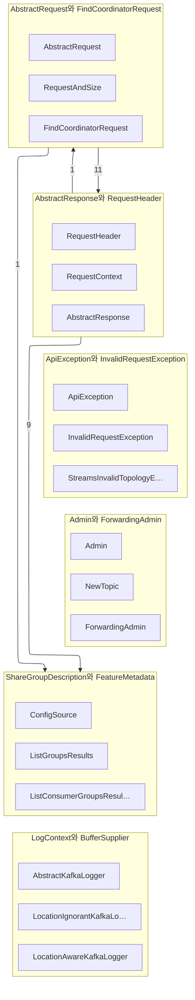

근거 소스 6개

- [`clients/src/main/java/org/apache/kafka/common/errors/ApiException.java`](https://github.com/apache/kafka/blob/a6d66b7403389bc77ac00651c2fead6fee141b04/clients/src/main/java/org/apache/kafka/common/errors/ApiException.java#L1-L1)
- [`clients/src/main/java/org/apache/kafka/clients/admin/KafkaAdminClient.java`](https://github.com/apache/kafka/blob/a6d66b7403389bc77ac00651c2fead6fee141b04/clients/src/main/java/org/apache/kafka/clients/admin/KafkaAdminClient.java#L1-L1)
- [`clients/src/main/java/org/apache/kafka/common/requests/AbstractResponse.java`](https://github.com/apache/kafka/blob/a6d66b7403389bc77ac00651c2fead6fee141b04/clients/src/main/java/org/apache/kafka/common/requests/AbstractResponse.java#L1-L1)
- [`clients/src/main/java/org/apache/kafka/clients/admin/Admin.java`](https://github.com/apache/kafka/blob/a6d66b7403389bc77ac00651c2fead6fee141b04/clients/src/main/java/org/apache/kafka/clients/admin/Admin.java#L1-L1)
- [`clients/src/main/java/org/apache/kafka/clients/admin/AbstractOptions.java`](https://github.com/apache/kafka/blob/a6d66b7403389bc77ac00651c2fead6fee141b04/clients/src/main/java/org/apache/kafka/clients/admin/AbstractOptions.java#L1-L1)
- [`clients/src/main/java/org/apache/kafka/clients/admin/AdminClient.java`](https://github.com/apache/kafka/blob/a6d66b7403389bc77ac00651c2fead6fee141b04/clients/src/main/java/org/apache/kafka/clients/admin/AdminClient.java#L1-L1)

`clients` 모듈은 kafka에서 **브로커 밖에 있는 쪽**이 쓰는 것 전부를 담는다. 생산자와 소비자와 관리 도구가 이 모듈 하나를 의존한다. 브로커 자신도 이것을 쓴다 [^E5].

그래서 이 모듈의 성격은 다른 모듈과 다르다. 여기 있는 것은 **공개 계약**이다. `@InterfaceAudience.Public`이 붙은 타입이 많고 [^E1] [^E5], 그것은 한 번 내보내면 판을 넘어 유지해야 한다는 뜻이다.

## 여섯 갈래로 나뉜다

- **[요청의 형태](../concepts/1-1-abstractrequest-findcoordinatorrequest.md)**: `AbstractRequest`와 그 하위들. 브로커에 보내는 것 하나하나가 여기 타입 하나다
- **[응답의 형태](../concepts/1-2-abstractresponse-requestheader.md)**: `AbstractResponse`와 머리말. 요청과 짝을 이룬다 [^E4]
- **[오류 계층](../concepts/1-3-apiexception-invalidrequestexception.md)**: `ApiException`을 뿌리로 하는 예외들. 브로커가 돌려준 오류 코드가 여기서 자바 예외가 된다 [^E1]
- **[관리 표면](../concepts/1-4-admin-forwardingadmin.md)**: `Admin` 인터페이스와 그 구현. 토픽과 설정과 소비자 묶음을 다루는 자리다 [^E5]
- **[묶음과 판 정보](../concepts/1-5-sharegroupdescription-featuremetadata.md)**: 공유 묶음의 상태와 클러스터가 지원하는 기능
- **[공통 도구](../concepts/1-6-logcontext-buffersupplier.md)**: 로그 맥락과 버퍼 공급 같은 밑바닥 것들

**clients이 담은 타입**

| 타입 | 종류 | 근거 |
| --- | --- | --- |
| `AbortTransactionOptions` | class | [`clients/src/main/java/org/apache/kafka/clients/admin/AbortTransactionOptions.java:L22-L32`](https://github.com/apache/kafka/blob/a6d66b7403389bc77ac00651c2fead6fee141b04/clients/src/main/java/org/apache/kafka/clients/admin/AbortTransactionOptions.java#L22-L32) |
| `AbortTransactionSpec` | class | [`clients/src/main/java/org/apache/kafka/clients/admin/AbortTransactionSpec.java:L25-L86`](https://github.com/apache/kafka/blob/a6d66b7403389bc77ac00651c2fead6fee141b04/clients/src/main/java/org/apache/kafka/clients/admin/AbortTransactionSpec.java#L25-L86) |
| `AbstractOptions` | class | [`clients/src/main/java/org/apache/kafka/clients/admin/AbstractOptions.java:L25-L50`](https://github.com/apache/kafka/blob/a6d66b7403389bc77ac00651c2fead6fee141b04/clients/src/main/java/org/apache/kafka/clients/admin/AbstractOptions.java#L25-L50) |
| `AddRaftVoterOptions` | class | [`clients/src/main/java/org/apache/kafka/clients/admin/AddRaftVoterOptions.java:L36-L49`](https://github.com/apache/kafka/blob/a6d66b7403389bc77ac00651c2fead6fee141b04/clients/src/main/java/org/apache/kafka/clients/admin/AddRaftVoterOptions.java#L36-L49) |
| `Admin` | interface | [`clients/src/main/java/org/apache/kafka/clients/admin/Admin.java:L126-L2210`](https://github.com/apache/kafka/blob/a6d66b7403389bc77ac00651c2fead6fee141b04/clients/src/main/java/org/apache/kafka/clients/admin/Admin.java#L126-L2210) |
| `AdminClient` | class | [`clients/src/main/java/org/apache/kafka/clients/admin/AdminClient.java:L32-L54`](https://github.com/apache/kafka/blob/a6d66b7403389bc77ac00651c2fead6fee141b04/clients/src/main/java/org/apache/kafka/clients/admin/AdminClient.java#L32-L54) |
| `AlterClientQuotasOptions` | class | [`clients/src/main/java/org/apache/kafka/clients/admin/AlterClientQuotasOptions.java:L27-L46`](https://github.com/apache/kafka/blob/a6d66b7403389bc77ac00651c2fead6fee141b04/clients/src/main/java/org/apache/kafka/clients/admin/AlterClientQuotasOptions.java#L27-L46) |
| `AlterConfigsOptions` | class | [`clients/src/main/java/org/apache/kafka/clients/admin/AlterConfigsOptions.java:L27-L57`](https://github.com/apache/kafka/blob/a6d66b7403389bc77ac00651c2fead6fee141b04/clients/src/main/java/org/apache/kafka/clients/admin/AlterConfigsOptions.java#L27-L57) |
| `AlterConsumerGroupOffsetsOptions` | class | [`clients/src/main/java/org/apache/kafka/clients/admin/AlterConsumerGroupOffsetsOptions.java:L27-L29`](https://github.com/apache/kafka/blob/a6d66b7403389bc77ac00651c2fead6fee141b04/clients/src/main/java/org/apache/kafka/clients/admin/AlterConsumerGroupOffsetsOptions.java#L27-L29) |
| `AlterConsumerGroupOffsetsResult` | class | [`clients/src/main/java/org/apache/kafka/clients/admin/AlterConsumerGroupOffsetsResult.java:L32-L85`](https://github.com/apache/kafka/blob/a6d66b7403389bc77ac00651c2fead6fee141b04/clients/src/main/java/org/apache/kafka/clients/admin/AlterConsumerGroupOffsetsResult.java#L32-L85) |
| `AlterPartitionReassignmentsOptions` | class | [`clients/src/main/java/org/apache/kafka/clients/admin/AlterPartitionReassignmentsOptions.java:L27-L50`](https://github.com/apache/kafka/blob/a6d66b7403389bc77ac00651c2fead6fee141b04/clients/src/main/java/org/apache/kafka/clients/admin/AlterPartitionReassignmentsOptions.java#L27-L50) |
| `AlterReplicaLogDirsOptions` | class | [`clients/src/main/java/org/apache/kafka/clients/admin/AlterReplicaLogDirsOptions.java:L27-L30`](https://github.com/apache/kafka/blob/a6d66b7403389bc77ac00651c2fead6fee141b04/clients/src/main/java/org/apache/kafka/clients/admin/AlterReplicaLogDirsOptions.java#L27-L30) |
| `AlterShareGroupOffsetsOptions` | class | [`clients/src/main/java/org/apache/kafka/clients/admin/AlterShareGroupOffsetsOptions.java:L27-L29`](https://github.com/apache/kafka/blob/a6d66b7403389bc77ac00651c2fead6fee141b04/clients/src/main/java/org/apache/kafka/clients/admin/AlterShareGroupOffsetsOptions.java#L27-L29) |
| `AlterStreamsGroupOffsetsOptions` | class | [`clients/src/main/java/org/apache/kafka/clients/admin/AlterStreamsGroupOffsetsOptions.java:L30-L33`](https://github.com/apache/kafka/blob/a6d66b7403389bc77ac00651c2fead6fee141b04/clients/src/main/java/org/apache/kafka/clients/admin/AlterStreamsGroupOffsetsOptions.java#L30-L33) |
| `AlterStreamsGroupOffsetsResult` | class | [`clients/src/main/java/org/apache/kafka/clients/admin/AlterStreamsGroupOffsetsResult.java:L31-L54`](https://github.com/apache/kafka/blob/a6d66b7403389bc77ac00651c2fead6fee141b04/clients/src/main/java/org/apache/kafka/clients/admin/AlterStreamsGroupOffsetsResult.java#L31-L54) |
| `AlterUserScramCredentialsOptions` | class | [`clients/src/main/java/org/apache/kafka/clients/admin/AlterUserScramCredentialsOptions.java:L27-L29`](https://github.com/apache/kafka/blob/a6d66b7403389bc77ac00651c2fead6fee141b04/clients/src/main/java/org/apache/kafka/clients/admin/AlterUserScramCredentialsOptions.java#L27-L29) |
| `ClientMetricsResourceListing` | class | [`clients/src/main/java/org/apache/kafka/clients/admin/ClientMetricsResourceListing.java:L21-L52`](https://github.com/apache/kafka/blob/a6d66b7403389bc77ac00651c2fead6fee141b04/clients/src/main/java/org/apache/kafka/clients/admin/ClientMetricsResourceListing.java#L21-L52) |
| `ConfigEntry.ConfigSource` | enum | [`clients/src/main/java/org/apache/kafka/clients/admin/ConfigEntry.java:L218-L228`](https://github.com/apache/kafka/blob/a6d66b7403389bc77ac00651c2fead6fee141b04/clients/src/main/java/org/apache/kafka/clients/admin/ConfigEntry.java#L218-L228) |
| `ConfigEntry.ConfigSynonym` | class | [`clients/src/main/java/org/apache/kafka/clients/admin/ConfigEntry.java:L233-L295`](https://github.com/apache/kafka/blob/a6d66b7403389bc77ac00651c2fead6fee141b04/clients/src/main/java/org/apache/kafka/clients/admin/ConfigEntry.java#L233-L295) |
| `ConfigEntry.ConfigType` | enum | [`clients/src/main/java/org/apache/kafka/clients/admin/ConfigEntry.java:L202-L213`](https://github.com/apache/kafka/blob/a6d66b7403389bc77ac00651c2fead6fee141b04/clients/src/main/java/org/apache/kafka/clients/admin/ConfigEntry.java#L202-L213) |
| `ConsumerGroupListing` | class | [`clients/src/main/java/org/apache/kafka/clients/admin/ConsumerGroupListing.java:L31-L180`](https://github.com/apache/kafka/blob/a6d66b7403389bc77ac00651c2fead6fee141b04/clients/src/main/java/org/apache/kafka/clients/admin/ConsumerGroupListing.java#L31-L180) |
| `CreateAclsOptions` | class | [`clients/src/main/java/org/apache/kafka/clients/admin/CreateAclsOptions.java:L27-L41`](https://github.com/apache/kafka/blob/a6d66b7403389bc77ac00651c2fead6fee141b04/clients/src/main/java/org/apache/kafka/clients/admin/CreateAclsOptions.java#L27-L41) |
| `CreateDelegationTokenOptions` | class | [`clients/src/main/java/org/apache/kafka/clients/admin/CreateDelegationTokenOptions.java:L30-L79`](https://github.com/apache/kafka/blob/a6d66b7403389bc77ac00651c2fead6fee141b04/clients/src/main/java/org/apache/kafka/clients/admin/CreateDelegationTokenOptions.java#L30-L79) |
| `CreatePartitionsOptions` | class | [`clients/src/main/java/org/apache/kafka/clients/admin/CreatePartitionsOptions.java:L27-L65`](https://github.com/apache/kafka/blob/a6d66b7403389bc77ac00651c2fead6fee141b04/clients/src/main/java/org/apache/kafka/clients/admin/CreatePartitionsOptions.java#L27-L65) |
| `CreateTopicsOptions` | class | [`clients/src/main/java/org/apache/kafka/clients/admin/CreateTopicsOptions.java:L27-L74`](https://github.com/apache/kafka/blob/a6d66b7403389bc77ac00651c2fead6fee141b04/clients/src/main/java/org/apache/kafka/clients/admin/CreateTopicsOptions.java#L27-L74) |
| `DeleteAclsOptions` | class | [`clients/src/main/java/org/apache/kafka/clients/admin/DeleteAclsOptions.java:L27-L41`](https://github.com/apache/kafka/blob/a6d66b7403389bc77ac00651c2fead6fee141b04/clients/src/main/java/org/apache/kafka/clients/admin/DeleteAclsOptions.java#L27-L41) |
| `DeleteAclsResult` | class | [`clients/src/main/java/org/apache/kafka/clients/admin/DeleteAclsResult.java:L35-L124`](https://github.com/apache/kafka/blob/a6d66b7403389bc77ac00651c2fead6fee141b04/clients/src/main/java/org/apache/kafka/clients/admin/DeleteAclsResult.java#L35-L124) |
| `DeleteAclsResult.FilterResult` | class | [`clients/src/main/java/org/apache/kafka/clients/admin/DeleteAclsResult.java:L41-L63`](https://github.com/apache/kafka/blob/a6d66b7403389bc77ac00651c2fead6fee141b04/clients/src/main/java/org/apache/kafka/clients/admin/DeleteAclsResult.java#L41-L63) |
| `DeleteAclsResult.FilterResults` | class | [`clients/src/main/java/org/apache/kafka/clients/admin/DeleteAclsResult.java:L68-L81`](https://github.com/apache/kafka/blob/a6d66b7403389bc77ac00651c2fead6fee141b04/clients/src/main/java/org/apache/kafka/clients/admin/DeleteAclsResult.java#L68-L81) |
| `DeleteConsumerGroupOffsetsOptions` | class | [`clients/src/main/java/org/apache/kafka/clients/admin/DeleteConsumerGroupOffsetsOptions.java:L27-L30`](https://github.com/apache/kafka/blob/a6d66b7403389bc77ac00651c2fead6fee141b04/clients/src/main/java/org/apache/kafka/clients/admin/DeleteConsumerGroupOffsetsOptions.java#L27-L30) |

타입 485개 중 앞 30개다.

## 이 모듈의 뼈대

**요청과 응답이 대칭이다.** `AbstractResponse`가 `ApiKeys`를 필드로 들고 있다 [^E4]. 응답 하나가 자기가 어느 API의 답인지를 안다는 뜻이고, 그래서 상관 id로만 짝을 맞추지 않아도 된다.

**직렬화는 타입이 스스로 하지 않는다.** `AbstractResponse.toSend`가 `SendBuilder.buildResponseSend`에 넘긴다 [^E4]. 바이트로 바꾸는 규칙이 한 자리에 모여 있고, 판마다 다른 형태를 그 자리가 안다.

**`Admin`은 인터페이스이고 만드는 것은 정적 메서드다.** `Admin.create`가 `KafkaAdminClient.createInternal`을 부른다 [^E5]. 쓰는 쪽은 구현 이름을 모른 채 쓰고, 그래서 구현을 갈아도 부르는 코드가 안 바뀐다.

**`AdminClient`는 추상 클래스로 남아 있다** [^E10]. `Admin` 인터페이스가 나중에 생겼고 옛 이름을 지우지 않았다.

**관리 호출의 선택 인자는 한 뿌리를 쓴다.** `AbstractOptions`가 `timeoutMs` 하나를 들고, 자기 타입을 돌려주어 이어 부를 수 있게 한다 [^E8]. 그래서 `ListTopicsOptions`와 `AlterConfigsOptions`가 같은 모양이 된다.

**여러 브로커에 흩어진 답을 모으는 자리가 있다.** `ListGroupsResults`가 오류 목록과 결과 표와 아직 안 온 노드 집합을 함께 든다 [^E2]. 관리 호출 하나가 브로커 여럿에 가고 일부만 실패할 수 있기 때문이다.

## 오류를 어떻게 다루는가

`ApiException`이 `KafkaException`을 물려받는다 [^E1]. 그 아래에 브로커가 돌려주는 오류 코드마다 타입이 하나씩 선다.

계층이 깊은 까닭이 있다. 부르는 쪽이 **무엇을 다시 해 볼 수 있는지**를 타입으로 가르기 때문이다. 잠깐의 문제와 영영 안 되는 것을 같은 예외로 던지면 재시도 판단을 메시지 문자열로 해야 한다.

`ApiException`의 생성자가 넷이다 [^E1]. 메시지만, 원인만, 둘 다, 아무것도 없는 것. 오류가 어디서 오느냐에 따라 손에 든 것이 다르기 때문이다.

## 이 모듈을 읽을 때 걸리는 것

- **타입 수가 많다.** 요청과 응답이 API마다 하나씩이라 그 둘만으로도 수백 개다. 하나하나가 아니라 `AbstractRequest`와 `AbstractResponse`의 계약을 먼저 본다
- **공개 계약이라 못 지운다.** `@InterfaceAudience.Public`이 붙은 것은 판을 넘어 남는다 [^E1] [^E5]. 낡아 보이는 이름이 남아 있는 까닭이다
- **브로커도 이 모듈을 쓴다.** `clients`가 클라이언트 전용이 아니다. [서버 모듈](5-server.md)과 [코어](10-core.md)가 여기 정의된 요청과 응답으로 말한다

다른 자리는 [kafka 구조 개요](../overview/architecture.md)에서 본다.

[^E1]: [`clients/src/main/java/org/apache/kafka/common/errors/ApiException.java:L27-L54`](https://github.com/apache/kafka/blob/a6d66b7403389bc77ac00651c2fead6fee141b04/clients/src/main/java/org/apache/kafka/common/errors/ApiException.java#L27-L54)
[^E2]: [`clients/src/main/java/org/apache/kafka/clients/admin/KafkaAdminClient.java:L3545-L3585`](https://github.com/apache/kafka/blob/a6d66b7403389bc77ac00651c2fead6fee141b04/clients/src/main/java/org/apache/kafka/clients/admin/KafkaAdminClient.java#L3545-L3585)
[^E4]: [`clients/src/main/java/org/apache/kafka/common/requests/AbstractResponse.java:L34-L337`](https://github.com/apache/kafka/blob/a6d66b7403389bc77ac00651c2fead6fee141b04/clients/src/main/java/org/apache/kafka/common/requests/AbstractResponse.java#L34-L337)
[^E5]: [`clients/src/main/java/org/apache/kafka/clients/admin/Admin.java:L126-L2210`](https://github.com/apache/kafka/blob/a6d66b7403389bc77ac00651c2fead6fee141b04/clients/src/main/java/org/apache/kafka/clients/admin/Admin.java#L126-L2210)
[^E8]: [`clients/src/main/java/org/apache/kafka/clients/admin/AbstractOptions.java:L25-L50`](https://github.com/apache/kafka/blob/a6d66b7403389bc77ac00651c2fead6fee141b04/clients/src/main/java/org/apache/kafka/clients/admin/AbstractOptions.java#L25-L50)
[^E10]: [`clients/src/main/java/org/apache/kafka/clients/admin/AdminClient.java:L32-L54`](https://github.com/apache/kafka/blob/a6d66b7403389bc77ac00651c2fead6fee141b04/clients/src/main/java/org/apache/kafka/clients/admin/AdminClient.java#L32-L54)
