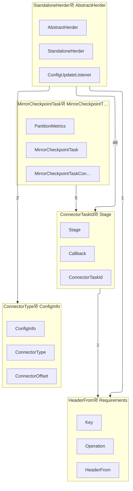

근거 소스 15개

- [`connect/runtime/src/main/java/org/apache/kafka/connect/runtime/standalone/StandaloneHerder.java`](https://github.com/apache/kafka/blob/a6d66b7403389bc77ac00651c2fead6fee141b04/connect/runtime/src/main/java/org/apache/kafka/connect/runtime/standalone/StandaloneHerder.java#L1-L1)
- [`connect/runtime/src/main/java/org/apache/kafka/connect/runtime/AbstractHerder.java`](https://github.com/apache/kafka/blob/a6d66b7403389bc77ac00651c2fead6fee141b04/connect/runtime/src/main/java/org/apache/kafka/connect/runtime/AbstractHerder.java#L1-L1)
- [`connect/runtime/src/main/java/org/apache/kafka/connect/util/ConnectorTaskId.java`](https://github.com/apache/kafka/blob/a6d66b7403389bc77ac00651c2fead6fee141b04/connect/runtime/src/main/java/org/apache/kafka/connect/util/ConnectorTaskId.java#L1-L1)
- [`connect/runtime/src/main/java/org/apache/kafka/connect/runtime/standalone/HealthCheckThread.java`](https://github.com/apache/kafka/blob/a6d66b7403389bc77ac00651c2fead6fee141b04/connect/runtime/src/main/java/org/apache/kafka/connect/runtime/standalone/HealthCheckThread.java#L1-L1)
- [`connect/runtime/src/main/java/org/apache/kafka/connect/util/Stage.java`](https://github.com/apache/kafka/blob/a6d66b7403389bc77ac00651c2fead6fee141b04/connect/runtime/src/main/java/org/apache/kafka/connect/util/Stage.java#L1-L1)
- [`connect/mirror/src/main/java/org/apache/kafka/connect/mirror/MirrorCheckpointTask.java`](https://github.com/apache/kafka/blob/a6d66b7403389bc77ac00651c2fead6fee141b04/connect/mirror/src/main/java/org/apache/kafka/connect/mirror/MirrorCheckpointTask.java#L1-L1)
- [`connect/mirror/src/main/java/org/apache/kafka/connect/mirror/MirrorHeartbeatTask.java`](https://github.com/apache/kafka/blob/a6d66b7403389bc77ac00651c2fead6fee141b04/connect/mirror/src/main/java/org/apache/kafka/connect/mirror/MirrorHeartbeatTask.java#L1-L1)
- [`connect/transforms/src/main/java/org/apache/kafka/connect/transforms/HeaderFrom.java`](https://github.com/apache/kafka/blob/a6d66b7403389bc77ac00651c2fead6fee141b04/connect/transforms/src/main/java/org/apache/kafka/connect/transforms/HeaderFrom.java#L1-L1)
- [`connect/mirror/src/main/java/org/apache/kafka/connect/mirror/OffsetSyncStore.java`](https://github.com/apache/kafka/blob/a6d66b7403389bc77ac00651c2fead6fee141b04/connect/mirror/src/main/java/org/apache/kafka/connect/mirror/OffsetSyncStore.java#L1-L1)
- [`connect/mirror/src/main/java/org/apache/kafka/connect/mirror/MirrorCheckpointLegacyMetrics.java`](https://github.com/apache/kafka/blob/a6d66b7403389bc77ac00651c2fead6fee141b04/connect/mirror/src/main/java/org/apache/kafka/connect/mirror/MirrorCheckpointLegacyMetrics.java#L1-L1)
- [`connect/transforms/src/main/java/org/apache/kafka/connect/transforms/util/Requirements.java`](https://github.com/apache/kafka/blob/a6d66b7403389bc77ac00651c2fead6fee141b04/connect/transforms/src/main/java/org/apache/kafka/connect/transforms/util/Requirements.java#L1-L1)
- [`connect/mirror/src/main/java/org/apache/kafka/connect/mirror/MirrorHeartbeatConnector.java`](https://github.com/apache/kafka/blob/a6d66b7403389bc77ac00651c2fead6fee141b04/connect/mirror/src/main/java/org/apache/kafka/connect/mirror/MirrorHeartbeatConnector.java#L1-L1)
- [`connect/transforms/src/main/java/org/apache/kafka/connect/transforms/field/SingleFieldPath.java`](https://github.com/apache/kafka/blob/a6d66b7403389bc77ac00651c2fead6fee141b04/connect/transforms/src/main/java/org/apache/kafka/connect/transforms/field/SingleFieldPath.java#L1-L1)
- [`connect/transforms/src/main/java/org/apache/kafka/connect/transforms/Flatten.java`](https://github.com/apache/kafka/blob/a6d66b7403389bc77ac00651c2fead6fee141b04/connect/transforms/src/main/java/org/apache/kafka/connect/transforms/Flatten.java#L1-L1)
- [`connect/transforms/src/main/java/org/apache/kafka/connect/transforms/ValueToKey.java`](https://github.com/apache/kafka/blob/a6d66b7403389bc77ac00651c2fead6fee141b04/connect/transforms/src/main/java/org/apache/kafka/connect/transforms/ValueToKey.java#L1-L1)

`connect` 모듈은 kafka와 **바깥 시스템 사이에 데이터를 옮기는 틀**이다. 커넥터가 작업을 낳고, 작업이 레코드를 읽거나 쓰며, 그 사이에 변환이 끼고, 이 전부를 목자(herder)가 관리한다 [^E3] [^E1] [^E11]. 브로커 안에 있는 코드가 아니라 브로커 밖에서 도는 별도의 워커 프로세스다. 워커는 [클라이언트 모듈](1-clients.md)의 생산자와 소비자와 관리 클라이언트로 브로커와 말한다 [^E7] [^E17].

## 다섯 갈래로 나뉜다

- **[변환과 필드 경로](../concepts/3-1-headerfrom-requirements.md)**: 레코드 하나를 고치는 `Transformation` 구현들이다. `HeaderFrom`이 필드를 헤더로 옮기거나 복사하고 [^E11], `Requirements`가 스키마와 맵과 구조체를 요구한다 [^E20]. 점으로 이어진 필드 경로는 `SingleFieldPath`가 푼다 [^E22]
- **[작업 id와 단계](../concepts/3-2-connectortaskid-stage.md)**: 커넥터 이름과 작업 번호의 쌍인 `ConnectorTaskId` [^E4], 워커가 지금 무엇을 하는지 적는 `Stage` [^E6], 내부 토픽을 만들고 읽는 `TopicAdmin`과 `KafkaBasedLog`가 있다 [^E17]
- **[REST 표현](../concepts/3-3-connectortype-configinfo.md)**: 커넥터 종류, 설정 검증 결과, 커넥터와 작업의 상태를 REST API가 돌려주는 모양이다
- **[MirrorMaker 2](../concepts/3-4-mirrorcheckpointtask-mirrorcheckpointtaskconfig.md)**: 클러스터 사이의 복제다. `MirrorCheckpointTask`가 소비자 묶음 오프셋을 옮기고 [^E7], `MirrorHeartbeatTask`가 주기적으로 심장 박동을 낸다 [^E10]. 오프셋 대응은 `OffsetSyncStore`가 든다 [^E17]
- **[목자](../concepts/3-5-standaloneherder-abstractherder.md)**: 커넥터와 작업의 생애를 관리한다. `AbstractHerder`가 공통 뼈대이고 [^E3], `StandaloneHerder`가 워커 하나짜리 구현이다 [^E1]

**connect이 담은 타입**

| 타입 | 종류 | 근거 |
| --- | --- | --- |
| `CheckpointStore` | class | [`connect/mirror/src/main/java/org/apache/kafka/connect/mirror/CheckpointStore.java:L47-L203`](https://github.com/apache/kafka/blob/a6d66b7403389bc77ac00651c2fead6fee141b04/connect/mirror/src/main/java/org/apache/kafka/connect/mirror/CheckpointStore.java#L47-L203) |
| `MirrorCheckpointLegacyMetrics.GroupMetrics` | class | [`connect/mirror/src/main/java/org/apache/kafka/connect/mirror/MirrorCheckpointLegacyMetrics.java:L97-L109`](https://github.com/apache/kafka/blob/a6d66b7403389bc77ac00651c2fead6fee141b04/connect/mirror/src/main/java/org/apache/kafka/connect/mirror/MirrorCheckpointLegacyMetrics.java#L97-L109) |
| `MirrorCheckpointLegacyMetrics` | class | [`connect/mirror/src/main/java/org/apache/kafka/connect/mirror/MirrorCheckpointLegacyMetrics.java:L44-L110`](https://github.com/apache/kafka/blob/a6d66b7403389bc77ac00651c2fead6fee141b04/connect/mirror/src/main/java/org/apache/kafka/connect/mirror/MirrorCheckpointLegacyMetrics.java#L44-L110) |
| `MirrorCheckpointMetrics.GroupMetrics` | class | [`connect/mirror/src/main/java/org/apache/kafka/connect/mirror/MirrorCheckpointMetrics.java:L63-L79`](https://github.com/apache/kafka/blob/a6d66b7403389bc77ac00651c2fead6fee141b04/connect/mirror/src/main/java/org/apache/kafka/connect/mirror/MirrorCheckpointMetrics.java#L63-L79) |
| `MirrorCheckpointMetrics` | class | [`connect/mirror/src/main/java/org/apache/kafka/connect/mirror/MirrorCheckpointMetrics.java:L32-L90`](https://github.com/apache/kafka/blob/a6d66b7403389bc77ac00651c2fead6fee141b04/connect/mirror/src/main/java/org/apache/kafka/connect/mirror/MirrorCheckpointMetrics.java#L32-L90) |
| `MirrorCheckpointTask` | class | [`connect/mirror/src/main/java/org/apache/kafka/connect/mirror/MirrorCheckpointTask.java:L54-L418`](https://github.com/apache/kafka/blob/a6d66b7403389bc77ac00651c2fead6fee141b04/connect/mirror/src/main/java/org/apache/kafka/connect/mirror/MirrorCheckpointTask.java#L54-L418) |
| `MirrorCheckpointTaskConfig` | class | [`connect/mirror/src/main/java/org/apache/kafka/connect/mirror/MirrorCheckpointTaskConfig.java:L26-L66`](https://github.com/apache/kafka/blob/a6d66b7403389bc77ac00651c2fead6fee141b04/connect/mirror/src/main/java/org/apache/kafka/connect/mirror/MirrorCheckpointTaskConfig.java#L26-L66) |
| `MirrorConnectorConfig` | class | [`connect/mirror/src/main/java/org/apache/kafka/connect/mirror/MirrorConnectorConfig.java:L67-L341`](https://github.com/apache/kafka/blob/a6d66b7403389bc77ac00651c2fead6fee141b04/connect/mirror/src/main/java/org/apache/kafka/connect/mirror/MirrorConnectorConfig.java#L67-L341) |
| `MirrorHeartbeatConfig` | class | [`connect/mirror/src/main/java/org/apache/kafka/connect/mirror/MirrorHeartbeatConfig.java:L24-L88`](https://github.com/apache/kafka/blob/a6d66b7403389bc77ac00651c2fead6fee141b04/connect/mirror/src/main/java/org/apache/kafka/connect/mirror/MirrorHeartbeatConfig.java#L24-L88) |
| `MirrorHeartbeatConnector` | class | [`connect/mirror/src/main/java/org/apache/kafka/connect/mirror/MirrorHeartbeatConnector.java:L37-L124`](https://github.com/apache/kafka/blob/a6d66b7403389bc77ac00651c2fead6fee141b04/connect/mirror/src/main/java/org/apache/kafka/connect/mirror/MirrorHeartbeatConnector.java#L37-L124) |
| `MirrorHeartbeatTask` | class | [`connect/mirror/src/main/java/org/apache/kafka/connect/mirror/MirrorHeartbeatTask.java:L31-L84`](https://github.com/apache/kafka/blob/a6d66b7403389bc77ac00651c2fead6fee141b04/connect/mirror/src/main/java/org/apache/kafka/connect/mirror/MirrorHeartbeatTask.java#L31-L84) |
| `MirrorSourceLegacyMetrics.PartitionMetrics` | class | [`connect/mirror/src/main/java/org/apache/kafka/connect/mirror/MirrorSourceLegacyMetrics.java:L146-L179`](https://github.com/apache/kafka/blob/a6d66b7403389bc77ac00651c2fead6fee141b04/connect/mirror/src/main/java/org/apache/kafka/connect/mirror/MirrorSourceLegacyMetrics.java#L146-L179) |
| `MirrorSourceMetrics.PartitionMetrics` | class | [`connect/mirror/src/main/java/org/apache/kafka/connect/mirror/MirrorSourceMetrics.java:L93-L139`](https://github.com/apache/kafka/blob/a6d66b7403389bc77ac00651c2fead6fee141b04/connect/mirror/src/main/java/org/apache/kafka/connect/mirror/MirrorSourceMetrics.java#L93-L139) |
| `OffsetSync` | record | [`connect/mirror/src/main/java/org/apache/kafka/connect/mirror/OffsetSync.java:L28-L105`](https://github.com/apache/kafka/blob/a6d66b7403389bc77ac00651c2fead6fee141b04/connect/mirror/src/main/java/org/apache/kafka/connect/mirror/OffsetSync.java#L28-L105) |
| `OffsetSyncStore` | class | [`connect/mirror/src/main/java/org/apache/kafka/connect/mirror/OffsetSyncStore.java:L58-L340`](https://github.com/apache/kafka/blob/a6d66b7403389bc77ac00651c2fead6fee141b04/connect/mirror/src/main/java/org/apache/kafka/connect/mirror/OffsetSyncStore.java#L58-L340) |
| `CheckpointFormatter` | class | [`connect/mirror/src/main/java/org/apache/kafka/connect/mirror/formatters/CheckpointFormatter.java:L25-L31`](https://github.com/apache/kafka/blob/a6d66b7403389bc77ac00651c2fead6fee141b04/connect/mirror/src/main/java/org/apache/kafka/connect/mirror/formatters/CheckpointFormatter.java#L25-L31) |
| `HeartbeatFormatter` | class | [`connect/mirror/src/main/java/org/apache/kafka/connect/mirror/formatters/HeartbeatFormatter.java:L25-L31`](https://github.com/apache/kafka/blob/a6d66b7403389bc77ac00651c2fead6fee141b04/connect/mirror/src/main/java/org/apache/kafka/connect/mirror/formatters/HeartbeatFormatter.java#L25-L31) |
| `OffsetSyncFormatter` | class | [`connect/mirror/src/main/java/org/apache/kafka/connect/mirror/formatters/OffsetSyncFormatter.java:L25-L31`](https://github.com/apache/kafka/blob/a6d66b7403389bc77ac00651c2fead6fee141b04/connect/mirror/src/main/java/org/apache/kafka/connect/mirror/formatters/OffsetSyncFormatter.java#L25-L31) |
| `InternalMirrorResource` | class | [`connect/mirror/src/main/java/org/apache/kafka/connect/mirror/rest/resources/InternalMirrorResource.java:L33-L69`](https://github.com/apache/kafka/blob/a6d66b7403389bc77ac00651c2fead6fee141b04/connect/mirror/src/main/java/org/apache/kafka/connect/mirror/rest/resources/InternalMirrorResource.java#L33-L69) |
| `AbstractHerder` | class | [`connect/runtime/src/main/java/org/apache/kafka/connect/runtime/AbstractHerder.java:L133-L1340`](https://github.com/apache/kafka/blob/a6d66b7403389bc77ac00651c2fead6fee141b04/connect/runtime/src/main/java/org/apache/kafka/connect/runtime/AbstractHerder.java#L133-L1340) |
| `AbstractStatus` | class | [`connect/runtime/src/main/java/org/apache/kafka/connect/runtime/AbstractStatus.java:L21-L122`](https://github.com/apache/kafka/blob/a6d66b7403389bc77ac00651c2fead6fee141b04/connect/runtime/src/main/java/org/apache/kafka/connect/runtime/AbstractStatus.java#L21-L122) |
| `CachedConnectors` | class | [`connect/runtime/src/main/java/org/apache/kafka/connect/runtime/CachedConnectors.java:L30-L81`](https://github.com/apache/kafka/blob/a6d66b7403389bc77ac00651c2fead6fee141b04/connect/runtime/src/main/java/org/apache/kafka/connect/runtime/CachedConnectors.java#L30-L81) |
| `ConnectorStatus` | class | [`connect/runtime/src/main/java/org/apache/kafka/connect/runtime/ConnectorStatus.java:L20-L88`](https://github.com/apache/kafka/blob/a6d66b7403389bc77ac00651c2fead6fee141b04/connect/runtime/src/main/java/org/apache/kafka/connect/runtime/ConnectorStatus.java#L20-L88) |
| `Herder.Created` | record | [`connect/runtime/src/main/java/org/apache/kafka/connect/runtime/Herder.java:L394-L395`](https://github.com/apache/kafka/blob/a6d66b7403389bc77ac00651c2fead6fee141b04/connect/runtime/src/main/java/org/apache/kafka/connect/runtime/Herder.java#L394-L395) |
| `Herder` | interface | [`connect/runtime/src/main/java/org/apache/kafka/connect/runtime/Herder.java:L62-L396`](https://github.com/apache/kafka/blob/a6d66b7403389bc77ac00651c2fead6fee141b04/connect/runtime/src/main/java/org/apache/kafka/connect/runtime/Herder.java#L62-L396) |
| `RestartPlan` | class | [`connect/runtime/src/main/java/org/apache/kafka/connect/runtime/RestartPlan.java:L30-L144`](https://github.com/apache/kafka/blob/a6d66b7403389bc77ac00651c2fead6fee141b04/connect/runtime/src/main/java/org/apache/kafka/connect/runtime/RestartPlan.java#L30-L144) |
| `RestartRequest` | record | [`connect/runtime/src/main/java/org/apache/kafka/connect/runtime/RestartRequest.java:L33-L93`](https://github.com/apache/kafka/blob/a6d66b7403389bc77ac00651c2fead6fee141b04/connect/runtime/src/main/java/org/apache/kafka/connect/runtime/RestartRequest.java#L33-L93) |
| `SessionKey` | record | [`connect/runtime/src/main/java/org/apache/kafka/connect/runtime/SessionKey.java:L28-L33`](https://github.com/apache/kafka/blob/a6d66b7403389bc77ac00651c2fead6fee141b04/connect/runtime/src/main/java/org/apache/kafka/connect/runtime/SessionKey.java#L28-L33) |
| `TaskStatus` | class | [`connect/runtime/src/main/java/org/apache/kafka/connect/runtime/TaskStatus.java:L21-L78`](https://github.com/apache/kafka/blob/a6d66b7403389bc77ac00651c2fead6fee141b04/connect/runtime/src/main/java/org/apache/kafka/connect/runtime/TaskStatus.java#L21-L78) |
| `WorkerConnector.ConnectorMetricsGroup` | class | [`connect/runtime/src/main/java/org/apache/kafka/connect/runtime/WorkerConnector.java:L450-L582`](https://github.com/apache/kafka/blob/a6d66b7403389bc77ac00651c2fead6fee141b04/connect/runtime/src/main/java/org/apache/kafka/connect/runtime/WorkerConnector.java#L450-L582) |

타입 126개 중 앞 30개다.

## 이 모듈의 뼈대

**목자가 워커를 들고, 워커가 목자를 안다.** `AbstractHerder` 생성자가 `worker.herder = this`를 쓴다 [^E3]. 둘은 상호 참조이고, 목자가 서비스를 시작할 때 워커와 상태 저장소와 설정 저장소를 차례로 켠다 [^E3].

**단독 모드는 조율이 없다.** `StandaloneHerder`는 메모리 저장소 둘로 시작하고, 멈출 때 커넥터마다 작업을 지우고 워커를 기다린다. 주석이 "넘겨줄 상대가 없으니 그냥 정리한다"고 적었다 [^E1]. 설정이 바뀌면 리스너가 스냅샷을 다시 뜨고, 목표 상태가 `STARTED`가 되면 작업 갱신을 실행기에 넣는다 [^E2].

**살아 있음의 기준은 잠기지 않았다는 것이다.** `HealthCheckThread`는 콜백을 큐에 받아 목자 잠금을 잡은 채 부른다. 단독 모드에서 살아 있음의 유일한 기준이 "워커가 교착되지 않았다"는 것이라고 주석이 적었다 [^E5]. 종료 중이면 남은 콜백을 `ConnectException`으로 끝낸다 [^E5].

**변환은 키와 값으로 갈라진다.** `HeaderFrom`, `Flatten`, `ExtractField`가 모두 `Key`와 `Value` 내부 클래스를 갖는다. 어느 쪽 스키마와 값을 다루는지만 다르고 나머지는 같다 [^E13] [^E14] [^E23] [^E24]. `ValueToKey`는 값의 필드 일부로 키를 새로 만든다 [^E25].

**미러는 소스 커넥터다.** `MirrorCheckpointTask`와 `MirrorHeartbeatTask`가 `SourceTask`를 물려받는다 [^E7] [^E10]. 다른 클러스터에서 읽어 이 클러스터에 쓰는 것이 소스의 정의이기 때문이다. 심장 박동 간격이 음수면 작업을 하나도 만들지 않는다 [^E21].

## 무엇이 실패할 수 있는가

- **`Stage.complete`**는 시작보다 앞선 시각이나 두 번째 완료를 경고만 남기고 무시한다 [^E6]
- **`Requirements`**는 스키마가 없거나 타입이 맞지 않으면 `DataException`을 던지고 메시지에 목적과 실제 클래스 이름을 넣는다 [^E20]
- **`OffsetSyncStore` 생성자**는 소비자나 관리 클라이언트를 만들다 실패하면 둘 다 조용히 닫고 다시 던진다 [^E17]
- **`HeaderFrom.Operation.fromName`**은 `move`와 `copy` 밖의 이름에 `IllegalArgumentException`이다 [^E12]
- **낡은 계측 이름**: `MirrorCheckpointLegacyMetrics`와 새 계측이 함께 있고, 설정의 `metric.names.formats`가 어느 쪽을 켤지 정한다 [^E7] [^E18]

## 이 모듈을 읽을 때 걸리는 것

- **런타임과 API가 나뉜다.** 사용자가 구현하는 `Connector`와 `Task`와 `Transformation`은 API이고, 목자와 워커는 런타임이다. 이 위키는 런타임 쪽을 주로 다룬다
- **분산 모드는 여기 없다.** 이 분석은 `StandaloneHerder`까지만 실었다 [^E1]. 분산 목자는 같은 `AbstractHerder`를 물려받는다 [^E3]
- **미러는 별도 서브모듈이다.** `connect/mirror`는 커넥터 셋으로 짜인 응용이지 틀의 일부가 아니다 [^E7] [^E21]

관리 클라이언트의 계약은 [클라이언트 모듈](1-clients.md)에서, 워커가 붙는 브로커 쪽은 [서버](5-server.md)에서 본다. 다른 자리는 [kafka 구조 개요](../overview/architecture.md)에 있다.

[^E1]: [`connect/runtime/src/main/java/org/apache/kafka/connect/runtime/standalone/StandaloneHerder.java:L72-L635`](https://github.com/apache/kafka/blob/a6d66b7403389bc77ac00651c2fead6fee141b04/connect/runtime/src/main/java/org/apache/kafka/connect/runtime/standalone/StandaloneHerder.java#L72-L635)
[^E2]: [`connect/runtime/src/main/java/org/apache/kafka/connect/runtime/standalone/StandaloneHerder.java:L548-L606`](https://github.com/apache/kafka/blob/a6d66b7403389bc77ac00651c2fead6fee141b04/connect/runtime/src/main/java/org/apache/kafka/connect/runtime/standalone/StandaloneHerder.java#L548-L606)
[^E3]: [`connect/runtime/src/main/java/org/apache/kafka/connect/runtime/AbstractHerder.java:L133-L1340`](https://github.com/apache/kafka/blob/a6d66b7403389bc77ac00651c2fead6fee141b04/connect/runtime/src/main/java/org/apache/kafka/connect/runtime/AbstractHerder.java#L133-L1340)
[^E4]: [`connect/runtime/src/main/java/org/apache/kafka/connect/util/ConnectorTaskId.java:L28-L59`](https://github.com/apache/kafka/blob/a6d66b7403389bc77ac00651c2fead6fee141b04/connect/runtime/src/main/java/org/apache/kafka/connect/util/ConnectorTaskId.java#L28-L59)
[^E5]: [`connect/runtime/src/main/java/org/apache/kafka/connect/runtime/standalone/HealthCheckThread.java:L32-L136`](https://github.com/apache/kafka/blob/a6d66b7403389bc77ac00651c2fead6fee141b04/connect/runtime/src/main/java/org/apache/kafka/connect/runtime/standalone/HealthCheckThread.java#L32-L136)
[^E6]: [`connect/runtime/src/main/java/org/apache/kafka/connect/util/Stage.java:L24-L83`](https://github.com/apache/kafka/blob/a6d66b7403389bc77ac00651c2fead6fee141b04/connect/runtime/src/main/java/org/apache/kafka/connect/util/Stage.java#L24-L83)
[^E7]: [`connect/mirror/src/main/java/org/apache/kafka/connect/mirror/MirrorCheckpointTask.java:L54-L418`](https://github.com/apache/kafka/blob/a6d66b7403389bc77ac00651c2fead6fee141b04/connect/mirror/src/main/java/org/apache/kafka/connect/mirror/MirrorCheckpointTask.java#L54-L418)
[^E10]: [`connect/mirror/src/main/java/org/apache/kafka/connect/mirror/MirrorHeartbeatTask.java:L31-L84`](https://github.com/apache/kafka/blob/a6d66b7403389bc77ac00651c2fead6fee141b04/connect/mirror/src/main/java/org/apache/kafka/connect/mirror/MirrorHeartbeatTask.java#L31-L84)
[^E11]: [`connect/transforms/src/main/java/org/apache/kafka/connect/transforms/HeaderFrom.java:L44-L253`](https://github.com/apache/kafka/blob/a6d66b7403389bc77ac00651c2fead6fee141b04/connect/transforms/src/main/java/org/apache/kafka/connect/transforms/HeaderFrom.java#L44-L253)
[^E12]: [`connect/transforms/src/main/java/org/apache/kafka/connect/transforms/HeaderFrom.java:L78-L99`](https://github.com/apache/kafka/blob/a6d66b7403389bc77ac00651c2fead6fee141b04/connect/transforms/src/main/java/org/apache/kafka/connect/transforms/HeaderFrom.java#L78-L99)
[^E13]: [`connect/transforms/src/main/java/org/apache/kafka/connect/transforms/HeaderFrom.java:L193-L210`](https://github.com/apache/kafka/blob/a6d66b7403389bc77ac00651c2fead6fee141b04/connect/transforms/src/main/java/org/apache/kafka/connect/transforms/HeaderFrom.java#L193-L210)
[^E14]: [`connect/transforms/src/main/java/org/apache/kafka/connect/transforms/HeaderFrom.java:L212-L229`](https://github.com/apache/kafka/blob/a6d66b7403389bc77ac00651c2fead6fee141b04/connect/transforms/src/main/java/org/apache/kafka/connect/transforms/HeaderFrom.java#L212-L229)
[^E17]: [`connect/mirror/src/main/java/org/apache/kafka/connect/mirror/OffsetSyncStore.java:L58-L340`](https://github.com/apache/kafka/blob/a6d66b7403389bc77ac00651c2fead6fee141b04/connect/mirror/src/main/java/org/apache/kafka/connect/mirror/OffsetSyncStore.java#L58-L340)
[^E18]: [`connect/mirror/src/main/java/org/apache/kafka/connect/mirror/MirrorCheckpointLegacyMetrics.java:L44-L110`](https://github.com/apache/kafka/blob/a6d66b7403389bc77ac00651c2fead6fee141b04/connect/mirror/src/main/java/org/apache/kafka/connect/mirror/MirrorCheckpointLegacyMetrics.java#L44-L110)
[^E20]: [`connect/transforms/src/main/java/org/apache/kafka/connect/transforms/util/Requirements.java:L27-L75`](https://github.com/apache/kafka/blob/a6d66b7403389bc77ac00651c2fead6fee141b04/connect/transforms/src/main/java/org/apache/kafka/connect/transforms/util/Requirements.java#L27-L75)
[^E21]: [`connect/mirror/src/main/java/org/apache/kafka/connect/mirror/MirrorHeartbeatConnector.java:L37-L124`](https://github.com/apache/kafka/blob/a6d66b7403389bc77ac00651c2fead6fee141b04/connect/mirror/src/main/java/org/apache/kafka/connect/mirror/MirrorHeartbeatConnector.java#L37-L124)
[^E22]: [`connect/transforms/src/main/java/org/apache/kafka/connect/transforms/field/SingleFieldPath.java:L41-L247`](https://github.com/apache/kafka/blob/a6d66b7403389bc77ac00651c2fead6fee141b04/connect/transforms/src/main/java/org/apache/kafka/connect/transforms/field/SingleFieldPath.java#L41-L247)
[^E23]: [`connect/transforms/src/main/java/org/apache/kafka/connect/transforms/Flatten.java:L265-L280`](https://github.com/apache/kafka/blob/a6d66b7403389bc77ac00651c2fead6fee141b04/connect/transforms/src/main/java/org/apache/kafka/connect/transforms/Flatten.java#L265-L280)
[^E24]: [`connect/transforms/src/main/java/org/apache/kafka/connect/transforms/Flatten.java:L282-L297`](https://github.com/apache/kafka/blob/a6d66b7403389bc77ac00651c2fead6fee141b04/connect/transforms/src/main/java/org/apache/kafka/connect/transforms/Flatten.java#L282-L297)
[^E25]: [`connect/transforms/src/main/java/org/apache/kafka/connect/transforms/ValueToKey.java:L42-L135`](https://github.com/apache/kafka/blob/a6d66b7403389bc77ac00651c2fead6fee141b04/connect/transforms/src/main/java/org/apache/kafka/connect/transforms/ValueToKey.java#L42-L135)
