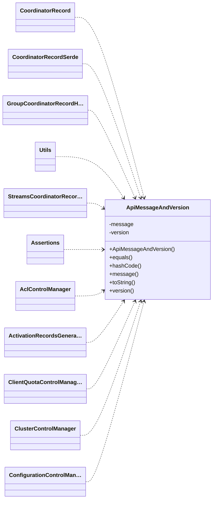

근거 소스 19개

- [`server-common/src/main/java/org/apache/kafka/server/common/ApiMessageAndVersion.java`](https://github.com/apache/kafka/blob/a6d66b7403389bc77ac00651c2fead6fee141b04/server-common/src/main/java/org/apache/kafka/server/common/ApiMessageAndVersion.java#L1-L1)
- [`server-common/src/main/java/org/apache/kafka/server/common/OffsetAndEpoch.java`](https://github.com/apache/kafka/blob/a6d66b7403389bc77ac00651c2fead6fee141b04/server-common/src/main/java/org/apache/kafka/server/common/OffsetAndEpoch.java#L1-L1)
- [`server-common/src/main/java/org/apache/kafka/server/common/TopicIdPartition.java`](https://github.com/apache/kafka/blob/a6d66b7403389bc77ac00651c2fead6fee141b04/server-common/src/main/java/org/apache/kafka/server/common/TopicIdPartition.java#L1-L1)
- [`server-common/src/main/java/org/apache/kafka/server/common/CheckpointFile.java`](https://github.com/apache/kafka/blob/a6d66b7403389bc77ac00651c2fead6fee141b04/server-common/src/main/java/org/apache/kafka/server/common/CheckpointFile.java#L1-L1)
- [`server-common/src/main/java/org/apache/kafka/server/common/ControllerRequestCompletionHandler.java`](https://github.com/apache/kafka/blob/a6d66b7403389bc77ac00651c2fead6fee141b04/server-common/src/main/java/org/apache/kafka/server/common/ControllerRequestCompletionHandler.java#L1-L1)
- [`server-common/src/main/java/org/apache/kafka/server/common/DirectoryEventHandler.java`](https://github.com/apache/kafka/blob/a6d66b7403389bc77ac00651c2fead6fee141b04/server-common/src/main/java/org/apache/kafka/server/common/DirectoryEventHandler.java#L1-L1)
- [`server-common/src/main/java/org/apache/kafka/server/common/NodeToControllerChannelManager.java`](https://github.com/apache/kafka/blob/a6d66b7403389bc77ac00651c2fead6fee141b04/server-common/src/main/java/org/apache/kafka/server/common/NodeToControllerChannelManager.java#L1-L1)
- [`server-common/src/main/java/org/apache/kafka/server/common/ProducerIdsBlock.java`](https://github.com/apache/kafka/blob/a6d66b7403389bc77ac00651c2fead6fee141b04/server-common/src/main/java/org/apache/kafka/server/common/ProducerIdsBlock.java#L1-L1)
- [`server-common/src/main/java/org/apache/kafka/server/common/RequestLocal.java`](https://github.com/apache/kafka/blob/a6d66b7403389bc77ac00651c2fead6fee141b04/server-common/src/main/java/org/apache/kafka/server/common/RequestLocal.java#L1-L1)
- [`server-common/src/main/java/org/apache/kafka/server/common/StopPartition.java`](https://github.com/apache/kafka/blob/a6d66b7403389bc77ac00651c2fead6fee141b04/server-common/src/main/java/org/apache/kafka/server/common/StopPartition.java#L1-L1)
- [`server-common/src/main/java/org/apache/kafka/server/common/UnitTestFeatureVersion.java`](https://github.com/apache/kafka/blob/a6d66b7403389bc77ac00651c2fead6fee141b04/server-common/src/main/java/org/apache/kafka/server/common/UnitTestFeatureVersion.java#L1-L1)
- [`server-common/src/main/java/org/apache/kafka/server/common/serialization/AbstractApiMessageSerde.java`](https://github.com/apache/kafka/blob/a6d66b7403389bc77ac00651c2fead6fee141b04/server-common/src/main/java/org/apache/kafka/server/common/serialization/AbstractApiMessageSerde.java#L1-L1)
- [`server-common/src/main/java/org/apache/kafka/server/common/serialization/BytesApiMessageSerde.java`](https://github.com/apache/kafka/blob/a6d66b7403389bc77ac00651c2fead6fee141b04/server-common/src/main/java/org/apache/kafka/server/common/serialization/BytesApiMessageSerde.java#L1-L1)
- [`server-common/src/main/java/org/apache/kafka/server/common/serialization/MetadataParseException.java`](https://github.com/apache/kafka/blob/a6d66b7403389bc77ac00651c2fead6fee141b04/server-common/src/main/java/org/apache/kafka/server/common/serialization/MetadataParseException.java#L1-L1)
- [`server-common/src/main/java/org/apache/kafka/server/common/serialization/RecordSerde.java`](https://github.com/apache/kafka/blob/a6d66b7403389bc77ac00651c2fead6fee141b04/server-common/src/main/java/org/apache/kafka/server/common/serialization/RecordSerde.java#L1-L1)
- [`coordinator-common/src/main/java/org/apache/kafka/coordinator/common/runtime/CoordinatorRecord.java`](https://github.com/apache/kafka/blob/a6d66b7403389bc77ac00651c2fead6fee141b04/coordinator-common/src/main/java/org/apache/kafka/coordinator/common/runtime/CoordinatorRecord.java#L1-L1)
- [`core/src/main/java/kafka/server/TierStateMachine.java`](https://github.com/apache/kafka/blob/a6d66b7403389bc77ac00651c2fead6fee141b04/core/src/main/java/kafka/server/TierStateMachine.java#L1-L1)
- [`core/src/main/scala/kafka/server/BrokerServer.scala`](https://github.com/apache/kafka/blob/a6d66b7403389bc77ac00651c2fead6fee141b04/core/src/main/scala/kafka/server/BrokerServer.scala#L1-L1)
- [`core/src/main/scala/kafka/server/ControllerServer.scala`](https://github.com/apache/kafka/blob/a6d66b7403389bc77ac00651c2fead6fee141b04/core/src/main/scala/kafka/server/ControllerServer.scala#L1-L1)

`server-common/common` 패키지는 **브로커와 컨트롤러와 코디네이터가 함께 쓰는 작은 값 타입과 계약**을 모아 둔 자리다. 메타데이터 레코드 하나를 나타내는 `ApiMessageAndVersion`, 그것을 바이트로 바꾸는 직렬화기, 오프셋과 에포크의 쌍, 체크포인트 파일, 생산자 id 블록, 그리고 컨트롤러 채널과 디렉토리 이벤트의 인터페이스가 여기 있다 [^E1] [^E15] [^E2] [^E4] [^E11] [^E10]. 여기 있는 것은 전부 자기 혼자서는 아무것도 하지 않는다. [래프트 클라이언트](../concepts/12-1-kafkaraftclient-kafkaraftclientdriver.md)가 이 레코드를 로그에 쓰고, [메타데이터 이미지와 델타](../concepts/4-5-metadataimage-metadatadelta.md)가 이것을 재생한다.

## 레코드 하나는 메시지와 판의 쌍이다

- **`ApiMessageAndVersion`**: 생성된 `ApiMessage`와 `short` 판을 든다. 같음과 해시는 둘을 함께 본다 [^E1] [^E22] [^E23]
- **`OffsetAndEpoch`**: 오프셋과 에포크의 레코드다. 비교는 **에포크가 먼저**이고 같을 때만 오프셋이다 [^E2] [^E24]
- **`TopicIdPartition`**: 토픽 id와 파티션 번호이고 `id:번호`로 찍힌다 [^E3] [^E25]

판을 메시지 곁에 붙여 두는 까닭이 직렬화기에서 드러난다. 같은 메시지 타입도 판에 따라 필드가 다르고, 로그에 남은 레코드는 쓴 당시의 판으로 읽어야 한다 [^E15]. `CoordinatorRecord`는 값의 `apiKey`가 음수이거나 키의 것과 다르면 거부한다 [^E52] [^E53]. `OffsetAndEpoch`의 비교 순서는 래프트의 규칙이다. 에포크가 높은 쪽이 항상 나중이고, 오프셋은 같은 에포크 안에서만 뜻이 있다 [^E24].

**ApiMessageAndVersion와 OffsetAndEpoch이 담은 타입**

| 타입 | 종류 | 근거 |
| --- | --- | --- |
| `ApiMessageAndVersion` | class | [`server-common/src/main/java/org/apache/kafka/server/common/ApiMessageAndVersion.java:L27-L62`](https://github.com/apache/kafka/blob/a6d66b7403389bc77ac00651c2fead6fee141b04/server-common/src/main/java/org/apache/kafka/server/common/ApiMessageAndVersion.java#L27-L62) |
| `CheckpointFile` | class | [`server-common/src/main/java/org/apache/kafka/server/common/CheckpointFile.java:L51-L213`](https://github.com/apache/kafka/blob/a6d66b7403389bc77ac00651c2fead6fee141b04/server-common/src/main/java/org/apache/kafka/server/common/CheckpointFile.java#L51-L213) |
| `CheckpointFile.CheckpointReadBuffer` | class | [`server-common/src/main/java/org/apache/kafka/server/common/CheckpointFile.java:L128-L191`](https://github.com/apache/kafka/blob/a6d66b7403389bc77ac00651c2fead6fee141b04/server-common/src/main/java/org/apache/kafka/server/common/CheckpointFile.java#L128-L191) |
| `CheckpointFile.CheckpointWriteBuffer` | class | [`server-common/src/main/java/org/apache/kafka/server/common/CheckpointFile.java:L98-L126`](https://github.com/apache/kafka/blob/a6d66b7403389bc77ac00651c2fead6fee141b04/server-common/src/main/java/org/apache/kafka/server/common/CheckpointFile.java#L98-L126) |
| `CheckpointFile.EntryFormatter` | interface | [`server-common/src/main/java/org/apache/kafka/server/common/CheckpointFile.java:L198-L212`](https://github.com/apache/kafka/blob/a6d66b7403389bc77ac00651c2fead6fee141b04/server-common/src/main/java/org/apache/kafka/server/common/CheckpointFile.java#L198-L212) |
| `ControllerRequestCompletionHandler` | interface | [`server-common/src/main/java/org/apache/kafka/server/common/ControllerRequestCompletionHandler.java:L22-L30`](https://github.com/apache/kafka/blob/a6d66b7403389bc77ac00651c2fead6fee141b04/server-common/src/main/java/org/apache/kafka/server/common/ControllerRequestCompletionHandler.java#L22-L30) |
| `DirectoryEventHandler` | interface | [`server-common/src/main/java/org/apache/kafka/server/common/DirectoryEventHandler.java:L24-L55`](https://github.com/apache/kafka/blob/a6d66b7403389bc77ac00651c2fead6fee141b04/server-common/src/main/java/org/apache/kafka/server/common/DirectoryEventHandler.java#L24-L55) |
| `NodeToControllerChannelManager` | interface | [`server-common/src/main/java/org/apache/kafka/server/common/NodeToControllerChannelManager.java:L25-L39`](https://github.com/apache/kafka/blob/a6d66b7403389bc77ac00651c2fead6fee141b04/server-common/src/main/java/org/apache/kafka/server/common/NodeToControllerChannelManager.java#L25-L39) |
| `OffsetAndEpoch` | record | [`server-common/src/main/java/org/apache/kafka/server/common/OffsetAndEpoch.java:L19-L26`](https://github.com/apache/kafka/blob/a6d66b7403389bc77ac00651c2fead6fee141b04/server-common/src/main/java/org/apache/kafka/server/common/OffsetAndEpoch.java#L19-L26) |
| `ProducerIdsBlock` | class | [`server-common/src/main/java/org/apache/kafka/server/common/ProducerIdsBlock.java:L29-L114`](https://github.com/apache/kafka/blob/a6d66b7403389bc77ac00651c2fead6fee141b04/server-common/src/main/java/org/apache/kafka/server/common/ProducerIdsBlock.java#L29-L114) |
| `RequestLocal` | class | [`server-common/src/main/java/org/apache/kafka/server/common/RequestLocal.java:L28-L72`](https://github.com/apache/kafka/blob/a6d66b7403389bc77ac00651c2fead6fee141b04/server-common/src/main/java/org/apache/kafka/server/common/RequestLocal.java#L28-L72) |
| `StopPartition` | class | [`server-common/src/main/java/org/apache/kafka/server/common/StopPartition.java:L26-L65`](https://github.com/apache/kafka/blob/a6d66b7403389bc77ac00651c2fead6fee141b04/server-common/src/main/java/org/apache/kafka/server/common/StopPartition.java#L26-L65) |
| `TopicIdPartition` | record | [`server-common/src/main/java/org/apache/kafka/server/common/TopicIdPartition.java:L26-L34`](https://github.com/apache/kafka/blob/a6d66b7403389bc77ac00651c2fead6fee141b04/server-common/src/main/java/org/apache/kafka/server/common/TopicIdPartition.java#L26-L34) |
| `UnitTestFeatureVersion` | class | [`server-common/src/main/java/org/apache/kafka/server/common/UnitTestFeatureVersion.java:L24-L360`](https://github.com/apache/kafka/blob/a6d66b7403389bc77ac00651c2fead6fee141b04/server-common/src/main/java/org/apache/kafka/server/common/UnitTestFeatureVersion.java#L24-L360) |
| `AbstractApiMessageSerde` | class | [`server-common/src/main/java/org/apache/kafka/server/common/serialization/AbstractApiMessageSerde.java:L43-L120`](https://github.com/apache/kafka/blob/a6d66b7403389bc77ac00651c2fead6fee141b04/server-common/src/main/java/org/apache/kafka/server/common/serialization/AbstractApiMessageSerde.java#L43-L120) |
| `BytesApiMessageSerde` | class | [`server-common/src/main/java/org/apache/kafka/server/common/serialization/BytesApiMessageSerde.java:L36-L68`](https://github.com/apache/kafka/blob/a6d66b7403389bc77ac00651c2fead6fee141b04/server-common/src/main/java/org/apache/kafka/server/common/serialization/BytesApiMessageSerde.java#L36-L68) |
| `MetadataParseException` | class | [`server-common/src/main/java/org/apache/kafka/server/common/serialization/MetadataParseException.java:L22-L36`](https://github.com/apache/kafka/blob/a6d66b7403389bc77ac00651c2fead6fee141b04/server-common/src/main/java/org/apache/kafka/server/common/serialization/MetadataParseException.java#L22-L36) |
| `RecordSerde` | interface | [`server-common/src/main/java/org/apache/kafka/server/common/serialization/RecordSerde.java:L28-L58`](https://github.com/apache/kafka/blob/a6d66b7403389bc77ac00651c2fead6fee141b04/server-common/src/main/java/org/apache/kafka/server/common/serialization/RecordSerde.java#L28-L58) |

## 바이트 틀: 프레임 판, 종류, 판, 본문

`AbstractApiMessageSerde`가 메타데이터 레코드의 바이트 틀을 정한다 [^E15].

- **쓰기**: 프레임 판 `1`, 메시지 종류, 메시지 판을 부호 없는 가변 정수로 쓰고, 그 뒤에 본문을 쓴다 [^E15]
- **크기**: 같은 넷의 크기를 더한다. `RecordSerde` 계약이 `recordSize`를 `write`보다 먼저, 같은 직렬화 캐시로 불러야 한다고 적었다 [^E15] [^E18]
- **읽기**: 프레임 판이 `0`이면 2.8의 KRaft 미리보기에서 올라오는 것은 지원하지 않는다는 메시지로 거부하고, `1`이 아니면 모르는 판이라고 거부한다 [^E15]
- **`apiMessageFor(apiKey)`**: 종류에서 빈 메시지를 만드는 것은 하위 클래스가 맡는다 [^E15] [^E16]

가변 정수가 `short` 범위를 넘으면 `MetadataParseException`이다. 읽다가 난 어떤 예외도 같은 타입으로 감싼다 [^E15] [^E45] [^E46] [^E17]. `BytesApiMessageSerde`는 이것을 `byte[]` 왕복으로 감싼다. 크기를 먼저 재서 그만큼만 할당한다 [^E16] [^E51].

## 체크포인트 파일

`CheckpointFile<T>`는 항목 목록을 텍스트 파일에 적고 읽는 틀이다. 형식은 첫 줄에 판, 둘째 줄에 항목 수, 그 뒤 한 줄에 항목 하나다 [^E5].

- **쓰기**: 임시 파일에 쓰고 `flush`와 `sync`를 거친 뒤 원자적으로 옮긴다. 잠금 하나로 읽기와 쓰기를 직렬화한다 [^E27] [^E4]
- **읽기**: 판이 다르면 `IOException`이고, 항목 수가 둘째 줄과 다르면 `IOException`이다. 파싱할 수 없는 줄도 `IOException`이다 [^E6]
- **빈 파일**은 빈 목록이다 [^E6]
- **`EntryFormatter<T>`**: 항목을 문자열로, 문자열을 `Optional` 항목으로 바꾼다. 빈 `Optional`이 "이 줄은 항목이 아니다"의 뜻이다 [^E7]

생성자가 파일을 만들되 이미 있으면 무시한다 [^E26]. 계층 저장소의 리더 에포크 체크포인트가 이 읽기 버퍼를 쓴다 [^E54].

## 생산자 id 블록

컨트롤러가 브로커에게 생산자 id를 1000개 단위 블록으로 준다 [^E11].

- **`claimNextId`**: 원자 카운터를 올리고, 블록의 마지막 id를 넘으면 빈 `Optional`이다 [^E40]
- **`lastProducerId`**: 첫 id 더하기 크기 빼기 1이다 [^E11]
- **`EMPTY`**: 브로커 `-1`에 크기 0이다 [^E11]

**ProducerIdsBlock의 멤버**

| 이름 | 종류 | 근거 |
| --- | --- | --- |
| `ProducerIdsBlock` | constructor | [`server-common/src/main/java/org/apache/kafka/server/common/ProducerIdsBlock.java:L39-L44`](https://github.com/apache/kafka/blob/a6d66b7403389bc77ac00651c2fead6fee141b04/server-common/src/main/java/org/apache/kafka/server/common/ProducerIdsBlock.java#L39-L44) |
| `EMPTY` | field | [`server-common/src/main/java/org/apache/kafka/server/common/ProducerIdsBlock.java:L32-L32`](https://github.com/apache/kafka/blob/a6d66b7403389bc77ac00651c2fead6fee141b04/server-common/src/main/java/org/apache/kafka/server/common/ProducerIdsBlock.java#L32-L32) |
| `PRODUCER_ID_BLOCK_SIZE` | field | [`server-common/src/main/java/org/apache/kafka/server/common/ProducerIdsBlock.java:L30-L30`](https://github.com/apache/kafka/blob/a6d66b7403389bc77ac00651c2fead6fee141b04/server-common/src/main/java/org/apache/kafka/server/common/ProducerIdsBlock.java#L30-L30) |
| `assignedBrokerId` | field | [`server-common/src/main/java/org/apache/kafka/server/common/ProducerIdsBlock.java:L34-L34`](https://github.com/apache/kafka/blob/a6d66b7403389bc77ac00651c2fead6fee141b04/server-common/src/main/java/org/apache/kafka/server/common/ProducerIdsBlock.java#L34-L34) |
| `blockSize` | field | [`server-common/src/main/java/org/apache/kafka/server/common/ProducerIdsBlock.java:L36-L36`](https://github.com/apache/kafka/blob/a6d66b7403389bc77ac00651c2fead6fee141b04/server-common/src/main/java/org/apache/kafka/server/common/ProducerIdsBlock.java#L36-L36) |
| `firstProducerId` | field | [`server-common/src/main/java/org/apache/kafka/server/common/ProducerIdsBlock.java:L35-L35`](https://github.com/apache/kafka/blob/a6d66b7403389bc77ac00651c2fead6fee141b04/server-common/src/main/java/org/apache/kafka/server/common/ProducerIdsBlock.java#L35-L35) |
| `producerIdCounter` | field | [`server-common/src/main/java/org/apache/kafka/server/common/ProducerIdsBlock.java:L37-L37`](https://github.com/apache/kafka/blob/a6d66b7403389bc77ac00651c2fead6fee141b04/server-common/src/main/java/org/apache/kafka/server/common/ProducerIdsBlock.java#L37-L37) |
| `assignedBrokerId` | method | [`server-common/src/main/java/org/apache/kafka/server/common/ProducerIdsBlock.java:L61-L63`](https://github.com/apache/kafka/blob/a6d66b7403389bc77ac00651c2fead6fee141b04/server-common/src/main/java/org/apache/kafka/server/common/ProducerIdsBlock.java#L61-L63) |
| `claimNextId` | method | [`server-common/src/main/java/org/apache/kafka/server/common/ProducerIdsBlock.java:L50-L56`](https://github.com/apache/kafka/blob/a6d66b7403389bc77ac00651c2fead6fee141b04/server-common/src/main/java/org/apache/kafka/server/common/ProducerIdsBlock.java#L50-L56) |
| `equals` | method | [`server-common/src/main/java/org/apache/kafka/server/common/ProducerIdsBlock.java:L102-L108`](https://github.com/apache/kafka/blob/a6d66b7403389bc77ac00651c2fead6fee141b04/server-common/src/main/java/org/apache/kafka/server/common/ProducerIdsBlock.java#L102-L108) |
| `firstProducerId` | method | [`server-common/src/main/java/org/apache/kafka/server/common/ProducerIdsBlock.java:L68-L70`](https://github.com/apache/kafka/blob/a6d66b7403389bc77ac00651c2fead6fee141b04/server-common/src/main/java/org/apache/kafka/server/common/ProducerIdsBlock.java#L68-L70) |
| `hashCode` | method | [`server-common/src/main/java/org/apache/kafka/server/common/ProducerIdsBlock.java:L110-L113`](https://github.com/apache/kafka/blob/a6d66b7403389bc77ac00651c2fead6fee141b04/server-common/src/main/java/org/apache/kafka/server/common/ProducerIdsBlock.java#L110-L113) |
| `lastProducerId` | method | [`server-common/src/main/java/org/apache/kafka/server/common/ProducerIdsBlock.java:L82-L84`](https://github.com/apache/kafka/blob/a6d66b7403389bc77ac00651c2fead6fee141b04/server-common/src/main/java/org/apache/kafka/server/common/ProducerIdsBlock.java#L82-L84) |
| `nextBlockFirstId` | method | [`server-common/src/main/java/org/apache/kafka/server/common/ProducerIdsBlock.java:L89-L91`](https://github.com/apache/kafka/blob/a6d66b7403389bc77ac00651c2fead6fee141b04/server-common/src/main/java/org/apache/kafka/server/common/ProducerIdsBlock.java#L89-L91) |
| `size` | method | [`server-common/src/main/java/org/apache/kafka/server/common/ProducerIdsBlock.java:L75-L77`](https://github.com/apache/kafka/blob/a6d66b7403389bc77ac00651c2fead6fee141b04/server-common/src/main/java/org/apache/kafka/server/common/ProducerIdsBlock.java#L75-L77) |
| `toString` | method | [`server-common/src/main/java/org/apache/kafka/server/common/ProducerIdsBlock.java:L93-L100`](https://github.com/apache/kafka/blob/a6d66b7403389bc77ac00651c2fead6fee141b04/server-common/src/main/java/org/apache/kafka/server/common/ProducerIdsBlock.java#L93-L100) |

빈 `Optional`이 "블록이 바닥났다"는 신호다. 부르는 쪽은 그때 새 블록을 요청한다 [^E40]. 카운터는 블록을 넘어서도 계속 오르므로, 바닥난 뒤의 호출은 전부 비어 있다 [^E40].

## 인터페이스: 컨트롤러 채널과 디렉토리 이벤트

- **`NodeToControllerChannelManager`**: 시작과 종료, 컨트롤러의 API 판, 요청 보내기, 시한의 다섯이다 [^E10] [^E37] [^E38]. 브로커와 컨트롤러가 시동과 종료에서 각각 부른다 [^E55] [^E56] [^E57] [^E58]
- **`ControllerRequestCompletionHandler`**: 보통 완료 처리기에 `onTimeout`을 더한다. 주석이 이 시한을 재시도를 포함한 채널 큐의 총 대기 시간이라 적었다 [^E8] [^E28]
- **`DirectoryEventHandler`**: 파티션의 디렉토리 배정, 디렉토리 고장, 격리 설정 갱신의 셋이고, 아무것도 안 하는 `NOOP`이 딸려 있다 [^E9] [^E32] [^E33]

`NOOP`이 있는 까닭은 디렉토리 이벤트를 받을 상대가 없는 자리에서도 `null` 검사 없이 부르기 위해서다 [^E9]. 이 인터페이스의 실제 구현이 이벤트를 어디로 보내는지는 [브로커 생애 관리자](../concepts/5-5-brokerlifecyclemanager.md)에서 본다.

## 나머지

- **`RequestLocal`**: 요청 하나에 붙는 버퍼 공급자다. 캐시 없는 공용 인스턴스와, 스레드 하나에 가둬야 하는 캐시 인스턴스의 둘이다 [^E12] [^E49] [^E50]
- **`StopPartition`**: 파티션과 세 불리언이다. 로컬 로그를 지울지, 원격 로그를 지울지, 원격 로그 메타데이터 관리자를 멈출지다 [^E13]
- **`UnitTestFeatureVersion`**: 시험용 기능 판이다. 최신 운영 판이 기본값보다 뒤처지는 경우 같은 상황을 흉내 낸다 [^E14]

**ApiMessageAndVersion을 부르는 자리**

| 불리는 멤버 | 부르는 자리 | 수신자 종류 | 근거 |
| --- | --- | --- | --- |
| `message` | `AbstractApiMessageSerde.recordSize` | param | [`server-common/src/main/java/org/apache/kafka/server/common/serialization/AbstractApiMessageSerde.java:L64-L64`](https://github.com/apache/kafka/blob/a6d66b7403389bc77ac00651c2fead6fee141b04/server-common/src/main/java/org/apache/kafka/server/common/serialization/AbstractApiMessageSerde.java#L64-L64) |
| `message` | `AbstractApiMessageSerde.write` | param | [`server-common/src/main/java/org/apache/kafka/server/common/serialization/AbstractApiMessageSerde.java:L75-L75`](https://github.com/apache/kafka/blob/a6d66b7403389bc77ac00651c2fead6fee141b04/server-common/src/main/java/org/apache/kafka/server/common/serialization/AbstractApiMessageSerde.java#L75-L75) |
| `message` | `Assertions.assertApiMessageAndVersionEquals` | param | [`group-coordinator/src/testFixtures/java/org/apache/kafka/coordinator/group/Assertions.java:L250-L250`](https://github.com/apache/kafka/blob/a6d66b7403389bc77ac00651c2fead6fee141b04/group-coordinator/src/testFixtures/java/org/apache/kafka/coordinator/group/Assertions.java#L250-L250) |
| `message` | `ClusterMetadataLogMessageParser.parse` | local | [`tools/src/main/java/org/apache/kafka/tools/DumpLogSegments.java:L756-L756`](https://github.com/apache/kafka/blob/a6d66b7403389bc77ac00651c2fead6fee141b04/tools/src/main/java/org/apache/kafka/tools/DumpLogSegments.java#L756-L756) |
| `message` | `CoordinatorRecord.CoordinatorRecord` | param | [`coordinator-common/src/main/java/org/apache/kafka/coordinator/common/runtime/CoordinatorRecord.java:L74-L74`](https://github.com/apache/kafka/blob/a6d66b7403389bc77ac00651c2fead6fee141b04/coordinator-common/src/main/java/org/apache/kafka/coordinator/common/runtime/CoordinatorRecord.java#L74-L74) |
| `message` | `ImageReWriter.write` | param | [`metadata/src/main/java/org/apache/kafka/image/writer/ImageReWriter.java:L44-L44`](https://github.com/apache/kafka/blob/a6d66b7403389bc77ac00651c2fead6fee141b04/metadata/src/main/java/org/apache/kafka/image/writer/ImageReWriter.java#L44-L44) |
| `message` | `MetadataBatchLoader.replay` | param | [`metadata/src/main/java/org/apache/kafka/image/loader/MetadataBatchLoader.java:L227-L227`](https://github.com/apache/kafka/blob/a6d66b7403389bc77ac00651c2fead6fee141b04/metadata/src/main/java/org/apache/kafka/image/loader/MetadataBatchLoader.java#L227-L227) |
| `message` | `RecordTestUtils.recordAtIndexAs` | local | [`metadata/src/testFixtures/java/org/apache/kafka/metadata/RecordTestUtils.java:L101-L101`](https://github.com/apache/kafka/blob/a6d66b7403389bc77ac00651c2fead6fee141b04/metadata/src/testFixtures/java/org/apache/kafka/metadata/RecordTestUtils.java#L101-L101) |
| `message` | `RemoteLogMetadataSerde.deserialize` | local | [`storage/src/main/java/org/apache/kafka/server/log/remote/metadata/storage/serialization/RemoteLogMetadataSerde.java:L93-L93`](https://github.com/apache/kafka/blob/a6d66b7403389bc77ac00651c2fead6fee141b04/storage/src/main/java/org/apache/kafka/server/log/remote/metadata/storage/serialization/RemoteLogMetadataSerde.java#L93-L93) |
| `message` | `RemoteLogSegmentMetadataSnapshotTransform.fromApiMessageAndVersion` | param | [`storage/src/main/java/org/apache/kafka/server/log/remote/metadata/storage/serialization/RemoteLogSegmentMetadataSnapshotTransform.java:L59-L59`](https://github.com/apache/kafka/blob/a6d66b7403389bc77ac00651c2fead6fee141b04/storage/src/main/java/org/apache/kafka/server/log/remote/metadata/storage/serialization/RemoteLogSegmentMetadataSnapshotTransform.java#L59-L59) |
| `message` | `RemoteLogSegmentMetadataTransform.fromApiMessageAndVersion` | param | [`storage/src/main/java/org/apache/kafka/server/log/remote/metadata/storage/serialization/RemoteLogSegmentMetadataTransform.java:L73-L73`](https://github.com/apache/kafka/blob/a6d66b7403389bc77ac00651c2fead6fee141b04/storage/src/main/java/org/apache/kafka/server/log/remote/metadata/storage/serialization/RemoteLogSegmentMetadataTransform.java#L73-L73) |
| `message` | `RemoteLogSegmentMetadataUpdateTransform.fromApiMessageAndVersion` | param | [`storage/src/main/java/org/apache/kafka/server/log/remote/metadata/storage/serialization/RemoteLogSegmentMetadataUpdateTransform.java:L44-L44`](https://github.com/apache/kafka/blob/a6d66b7403389bc77ac00651c2fead6fee141b04/storage/src/main/java/org/apache/kafka/server/log/remote/metadata/storage/serialization/RemoteLogSegmentMetadataUpdateTransform.java#L44-L44) |
| `message` | `RemotePartitionDeleteMetadataTransform.fromApiMessageAndVersion` | param | [`storage/src/main/java/org/apache/kafka/server/log/remote/metadata/storage/serialization/RemotePartitionDeleteMetadataTransform.java:L46-L46`](https://github.com/apache/kafka/blob/a6d66b7403389bc77ac00651c2fead6fee141b04/storage/src/main/java/org/apache/kafka/server/log/remote/metadata/storage/serialization/RemotePartitionDeleteMetadataTransform.java#L46-L46) |
| `message` | `ReplicationControlManager.generateLeaderAndIsrUpdates` | local | [`metadata/src/main/java/org/apache/kafka/controller/ReplicationControlManager.java:L2146-L2146`](https://github.com/apache/kafka/blob/a6d66b7403389bc77ac00651c2fead6fee141b04/metadata/src/main/java/org/apache/kafka/controller/ReplicationControlManager.java#L2146-L2146) |
| `message` | `ShareCoordinatorShard.messageOrNull` | param | [`share-coordinator/src/main/java/org/apache/kafka/coordinator/share/ShareCoordinatorShard.java:L1056-L1056`](https://github.com/apache/kafka/blob/a6d66b7403389bc77ac00651c2fead6fee141b04/share-coordinator/src/main/java/org/apache/kafka/coordinator/share/ShareCoordinatorShard.java#L1056-L1056) |
| `message` | `Utils.messageOrNull` | param | [`group-coordinator/src/main/java/org/apache/kafka/coordinator/group/Utils.java:L332-L332`](https://github.com/apache/kafka/blob/a6d66b7403389bc77ac00651c2fead6fee141b04/group-coordinator/src/main/java/org/apache/kafka/coordinator/group/Utils.java#L332-L332) |
| `version` | `AbstractApiMessageSerde.recordSize` | param | [`server-common/src/main/java/org/apache/kafka/server/common/serialization/AbstractApiMessageSerde.java:L65-L65`](https://github.com/apache/kafka/blob/a6d66b7403389bc77ac00651c2fead6fee141b04/server-common/src/main/java/org/apache/kafka/server/common/serialization/AbstractApiMessageSerde.java#L65-L65) |
| `version` | `AbstractApiMessageSerde.write` | param | [`server-common/src/main/java/org/apache/kafka/server/common/serialization/AbstractApiMessageSerde.java:L76-L76`](https://github.com/apache/kafka/blob/a6d66b7403389bc77ac00651c2fead6fee141b04/server-common/src/main/java/org/apache/kafka/server/common/serialization/AbstractApiMessageSerde.java#L76-L76) |
| `version` | `Assertions.assertApiMessageAndVersionEquals` | param | [`group-coordinator/src/testFixtures/java/org/apache/kafka/coordinator/group/Assertions.java:L248-L248`](https://github.com/apache/kafka/blob/a6d66b7403389bc77ac00651c2fead6fee141b04/group-coordinator/src/testFixtures/java/org/apache/kafka/coordinator/group/Assertions.java#L248-L248) |
| `version` | `ClusterMetadataLogMessageParser.parse` | local | [`tools/src/main/java/org/apache/kafka/tools/DumpLogSegments.java:L757-L757`](https://github.com/apache/kafka/blob/a6d66b7403389bc77ac00651c2fead6fee141b04/tools/src/main/java/org/apache/kafka/tools/DumpLogSegments.java#L757-L757) |

수신자를 스코프에서 푼 호출만이다. 체인 표현식과 상속받은 멤버는 빠진다.

## 무엇이 실패할 수 있는가

- **프레임 판 0**은 지원하지 않는 업그레이드 경로다 [^E15]
- **체크포인트의 판 불일치와 줄 수 불일치**는 `IOException`이다 [^E6]
- **바닥난 블록**은 예외가 아니라 빈 `Optional`이다 [^E40]
- **`RequestLocal.withThreadConfinedCaching`**을 여러 스레드에서 쓰면 안 된다는 것이 주석의 계약이다 [^E12]

기능 판의 정의는 [메타데이터 판과 기능 판](6-4-metadataversion-featureversion.md)에서, 공통 도구는 [명령행과 스케줄링 도구](6-1-commanddefaultoptions-scheduler.md)에서 본다.

[^E1]: [`server-common/src/main/java/org/apache/kafka/server/common/ApiMessageAndVersion.java:L27-L62`](https://github.com/apache/kafka/blob/a6d66b7403389bc77ac00651c2fead6fee141b04/server-common/src/main/java/org/apache/kafka/server/common/ApiMessageAndVersion.java#L27-L62)
[^E2]: [`server-common/src/main/java/org/apache/kafka/server/common/OffsetAndEpoch.java:L19-L26`](https://github.com/apache/kafka/blob/a6d66b7403389bc77ac00651c2fead6fee141b04/server-common/src/main/java/org/apache/kafka/server/common/OffsetAndEpoch.java#L19-L26)
[^E3]: [`server-common/src/main/java/org/apache/kafka/server/common/TopicIdPartition.java:L26-L34`](https://github.com/apache/kafka/blob/a6d66b7403389bc77ac00651c2fead6fee141b04/server-common/src/main/java/org/apache/kafka/server/common/TopicIdPartition.java#L26-L34)
[^E4]: [`server-common/src/main/java/org/apache/kafka/server/common/CheckpointFile.java:L51-L213`](https://github.com/apache/kafka/blob/a6d66b7403389bc77ac00651c2fead6fee141b04/server-common/src/main/java/org/apache/kafka/server/common/CheckpointFile.java#L51-L213)
[^E5]: [`server-common/src/main/java/org/apache/kafka/server/common/CheckpointFile.java:L98-L126`](https://github.com/apache/kafka/blob/a6d66b7403389bc77ac00651c2fead6fee141b04/server-common/src/main/java/org/apache/kafka/server/common/CheckpointFile.java#L98-L126)
[^E6]: [`server-common/src/main/java/org/apache/kafka/server/common/CheckpointFile.java:L128-L191`](https://github.com/apache/kafka/blob/a6d66b7403389bc77ac00651c2fead6fee141b04/server-common/src/main/java/org/apache/kafka/server/common/CheckpointFile.java#L128-L191)
[^E7]: [`server-common/src/main/java/org/apache/kafka/server/common/CheckpointFile.java:L198-L212`](https://github.com/apache/kafka/blob/a6d66b7403389bc77ac00651c2fead6fee141b04/server-common/src/main/java/org/apache/kafka/server/common/CheckpointFile.java#L198-L212)
[^E8]: [`server-common/src/main/java/org/apache/kafka/server/common/ControllerRequestCompletionHandler.java:L22-L30`](https://github.com/apache/kafka/blob/a6d66b7403389bc77ac00651c2fead6fee141b04/server-common/src/main/java/org/apache/kafka/server/common/ControllerRequestCompletionHandler.java#L22-L30)
[^E9]: [`server-common/src/main/java/org/apache/kafka/server/common/DirectoryEventHandler.java:L24-L55`](https://github.com/apache/kafka/blob/a6d66b7403389bc77ac00651c2fead6fee141b04/server-common/src/main/java/org/apache/kafka/server/common/DirectoryEventHandler.java#L24-L55)
[^E10]: [`server-common/src/main/java/org/apache/kafka/server/common/NodeToControllerChannelManager.java:L25-L39`](https://github.com/apache/kafka/blob/a6d66b7403389bc77ac00651c2fead6fee141b04/server-common/src/main/java/org/apache/kafka/server/common/NodeToControllerChannelManager.java#L25-L39)
[^E11]: [`server-common/src/main/java/org/apache/kafka/server/common/ProducerIdsBlock.java:L29-L114`](https://github.com/apache/kafka/blob/a6d66b7403389bc77ac00651c2fead6fee141b04/server-common/src/main/java/org/apache/kafka/server/common/ProducerIdsBlock.java#L29-L114)
[^E12]: [`server-common/src/main/java/org/apache/kafka/server/common/RequestLocal.java:L28-L72`](https://github.com/apache/kafka/blob/a6d66b7403389bc77ac00651c2fead6fee141b04/server-common/src/main/java/org/apache/kafka/server/common/RequestLocal.java#L28-L72)
[^E13]: [`server-common/src/main/java/org/apache/kafka/server/common/StopPartition.java:L26-L65`](https://github.com/apache/kafka/blob/a6d66b7403389bc77ac00651c2fead6fee141b04/server-common/src/main/java/org/apache/kafka/server/common/StopPartition.java#L26-L65)
[^E14]: [`server-common/src/main/java/org/apache/kafka/server/common/UnitTestFeatureVersion.java:L24-L360`](https://github.com/apache/kafka/blob/a6d66b7403389bc77ac00651c2fead6fee141b04/server-common/src/main/java/org/apache/kafka/server/common/UnitTestFeatureVersion.java#L24-L360)
[^E15]: [`server-common/src/main/java/org/apache/kafka/server/common/serialization/AbstractApiMessageSerde.java:L43-L120`](https://github.com/apache/kafka/blob/a6d66b7403389bc77ac00651c2fead6fee141b04/server-common/src/main/java/org/apache/kafka/server/common/serialization/AbstractApiMessageSerde.java#L43-L120)
[^E16]: [`server-common/src/main/java/org/apache/kafka/server/common/serialization/BytesApiMessageSerde.java:L36-L68`](https://github.com/apache/kafka/blob/a6d66b7403389bc77ac00651c2fead6fee141b04/server-common/src/main/java/org/apache/kafka/server/common/serialization/BytesApiMessageSerde.java#L36-L68)
[^E17]: [`server-common/src/main/java/org/apache/kafka/server/common/serialization/MetadataParseException.java:L22-L36`](https://github.com/apache/kafka/blob/a6d66b7403389bc77ac00651c2fead6fee141b04/server-common/src/main/java/org/apache/kafka/server/common/serialization/MetadataParseException.java#L22-L36)
[^E18]: [`server-common/src/main/java/org/apache/kafka/server/common/serialization/RecordSerde.java:L28-L58`](https://github.com/apache/kafka/blob/a6d66b7403389bc77ac00651c2fead6fee141b04/server-common/src/main/java/org/apache/kafka/server/common/serialization/RecordSerde.java#L28-L58)
[^E22]: [`server-common/src/main/java/org/apache/kafka/server/common/ApiMessageAndVersion.java:L44-L51`](https://github.com/apache/kafka/blob/a6d66b7403389bc77ac00651c2fead6fee141b04/server-common/src/main/java/org/apache/kafka/server/common/ApiMessageAndVersion.java#L44-L51)
[^E23]: [`server-common/src/main/java/org/apache/kafka/server/common/ApiMessageAndVersion.java:L53-L56`](https://github.com/apache/kafka/blob/a6d66b7403389bc77ac00651c2fead6fee141b04/server-common/src/main/java/org/apache/kafka/server/common/ApiMessageAndVersion.java#L53-L56)
[^E24]: [`server-common/src/main/java/org/apache/kafka/server/common/OffsetAndEpoch.java:L20-L25`](https://github.com/apache/kafka/blob/a6d66b7403389bc77ac00651c2fead6fee141b04/server-common/src/main/java/org/apache/kafka/server/common/OffsetAndEpoch.java#L20-L25)
[^E25]: [`server-common/src/main/java/org/apache/kafka/server/common/TopicIdPartition.java:L30-L33`](https://github.com/apache/kafka/blob/a6d66b7403389bc77ac00651c2fead6fee141b04/server-common/src/main/java/org/apache/kafka/server/common/TopicIdPartition.java#L30-L33)
[^E26]: [`server-common/src/main/java/org/apache/kafka/server/common/CheckpointFile.java:L59-L72`](https://github.com/apache/kafka/blob/a6d66b7403389bc77ac00651c2fead6fee141b04/server-common/src/main/java/org/apache/kafka/server/common/CheckpointFile.java#L59-L72)
[^E27]: [`server-common/src/main/java/org/apache/kafka/server/common/CheckpointFile.java:L74-L87`](https://github.com/apache/kafka/blob/a6d66b7403389bc77ac00651c2fead6fee141b04/server-common/src/main/java/org/apache/kafka/server/common/CheckpointFile.java#L74-L87)
[^E28]: [`server-common/src/main/java/org/apache/kafka/server/common/ControllerRequestCompletionHandler.java:L28-L28`](https://github.com/apache/kafka/blob/a6d66b7403389bc77ac00651c2fead6fee141b04/server-common/src/main/java/org/apache/kafka/server/common/ControllerRequestCompletionHandler.java#L28-L28)
[^E32]: [`server-common/src/main/java/org/apache/kafka/server/common/DirectoryEventHandler.java:L42-L42`](https://github.com/apache/kafka/blob/a6d66b7403389bc77ac00651c2fead6fee141b04/server-common/src/main/java/org/apache/kafka/server/common/DirectoryEventHandler.java#L42-L42)
[^E33]: [`server-common/src/main/java/org/apache/kafka/server/common/DirectoryEventHandler.java:L48-L48`](https://github.com/apache/kafka/blob/a6d66b7403389bc77ac00651c2fead6fee141b04/server-common/src/main/java/org/apache/kafka/server/common/DirectoryEventHandler.java#L48-L48)
[^E37]: [`server-common/src/main/java/org/apache/kafka/server/common/NodeToControllerChannelManager.java:L33-L36`](https://github.com/apache/kafka/blob/a6d66b7403389bc77ac00651c2fead6fee141b04/server-common/src/main/java/org/apache/kafka/server/common/NodeToControllerChannelManager.java#L33-L36)
[^E38]: [`server-common/src/main/java/org/apache/kafka/server/common/NodeToControllerChannelManager.java:L38-L38`](https://github.com/apache/kafka/blob/a6d66b7403389bc77ac00651c2fead6fee141b04/server-common/src/main/java/org/apache/kafka/server/common/NodeToControllerChannelManager.java#L38-L38)
[^E40]: [`server-common/src/main/java/org/apache/kafka/server/common/ProducerIdsBlock.java:L50-L56`](https://github.com/apache/kafka/blob/a6d66b7403389bc77ac00651c2fead6fee141b04/server-common/src/main/java/org/apache/kafka/server/common/ProducerIdsBlock.java#L50-L56)
[^E45]: [`server-common/src/main/java/org/apache/kafka/server/common/serialization/AbstractApiMessageSerde.java:L52-L52`](https://github.com/apache/kafka/blob/a6d66b7403389bc77ac00651c2fead6fee141b04/server-common/src/main/java/org/apache/kafka/server/common/serialization/AbstractApiMessageSerde.java#L52-L52)
[^E46]: [`server-common/src/main/java/org/apache/kafka/server/common/serialization/AbstractApiMessageSerde.java:L55-L55`](https://github.com/apache/kafka/blob/a6d66b7403389bc77ac00651c2fead6fee141b04/server-common/src/main/java/org/apache/kafka/server/common/serialization/AbstractApiMessageSerde.java#L55-L55)
[^E49]: [`server-common/src/main/java/org/apache/kafka/server/common/RequestLocal.java:L43-L43`](https://github.com/apache/kafka/blob/a6d66b7403389bc77ac00651c2fead6fee141b04/server-common/src/main/java/org/apache/kafka/server/common/RequestLocal.java#L43-L43)
[^E50]: [`server-common/src/main/java/org/apache/kafka/server/common/RequestLocal.java:L52-L52`](https://github.com/apache/kafka/blob/a6d66b7403389bc77ac00651c2fead6fee141b04/server-common/src/main/java/org/apache/kafka/server/common/RequestLocal.java#L52-L52)
[^E51]: [`server-common/src/main/java/org/apache/kafka/server/common/serialization/BytesApiMessageSerde.java:L51-L51`](https://github.com/apache/kafka/blob/a6d66b7403389bc77ac00651c2fead6fee141b04/server-common/src/main/java/org/apache/kafka/server/common/serialization/BytesApiMessageSerde.java#L51-L51)
[^E52]: [`coordinator-common/src/main/java/org/apache/kafka/coordinator/common/runtime/CoordinatorRecord.java:L74-L74`](https://github.com/apache/kafka/blob/a6d66b7403389bc77ac00651c2fead6fee141b04/coordinator-common/src/main/java/org/apache/kafka/coordinator/common/runtime/CoordinatorRecord.java#L74-L74)
[^E53]: [`coordinator-common/src/main/java/org/apache/kafka/coordinator/common/runtime/CoordinatorRecord.java:L77-L77`](https://github.com/apache/kafka/blob/a6d66b7403389bc77ac00651c2fead6fee141b04/coordinator-common/src/main/java/org/apache/kafka/coordinator/common/runtime/CoordinatorRecord.java#L77-L77)
[^E54]: [`core/src/main/java/kafka/server/TierStateMachine.java:L156-L156`](https://github.com/apache/kafka/blob/a6d66b7403389bc77ac00651c2fead6fee141b04/core/src/main/java/kafka/server/TierStateMachine.java#L156-L156)
[^E55]: [`core/src/main/scala/kafka/server/BrokerServer.scala:L264-L264`](https://github.com/apache/kafka/blob/a6d66b7403389bc77ac00651c2fead6fee141b04/core/src/main/scala/kafka/server/BrokerServer.scala#L264-L264)
[^E56]: [`core/src/main/scala/kafka/server/BrokerServer.scala:L913-L913`](https://github.com/apache/kafka/blob/a6d66b7403389bc77ac00651c2fead6fee141b04/core/src/main/scala/kafka/server/BrokerServer.scala#L913-L913)
[^E57]: [`core/src/main/scala/kafka/server/ControllerServer.scala:L428-L428`](https://github.com/apache/kafka/blob/a6d66b7403389bc77ac00651c2fead6fee141b04/core/src/main/scala/kafka/server/ControllerServer.scala#L428-L428)
[^E58]: [`core/src/main/scala/kafka/server/ControllerServer.scala:L460-L460`](https://github.com/apache/kafka/blob/a6d66b7403389bc77ac00651c2fead6fee141b04/core/src/main/scala/kafka/server/ControllerServer.scala#L460-L460)
