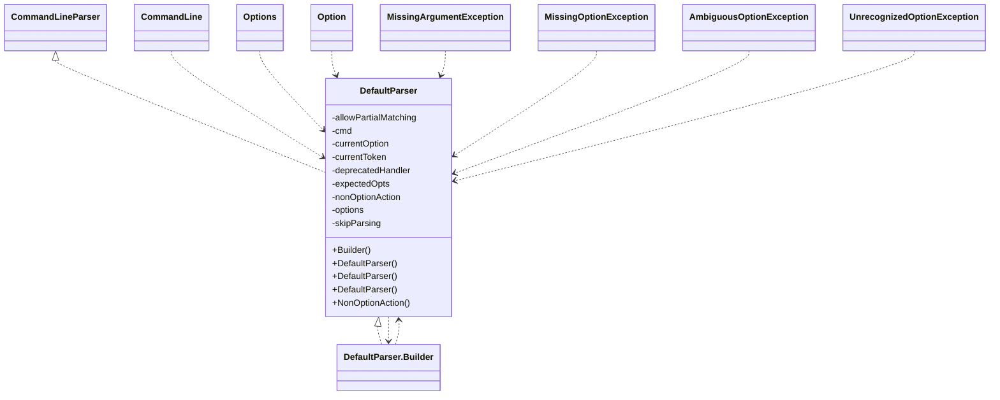
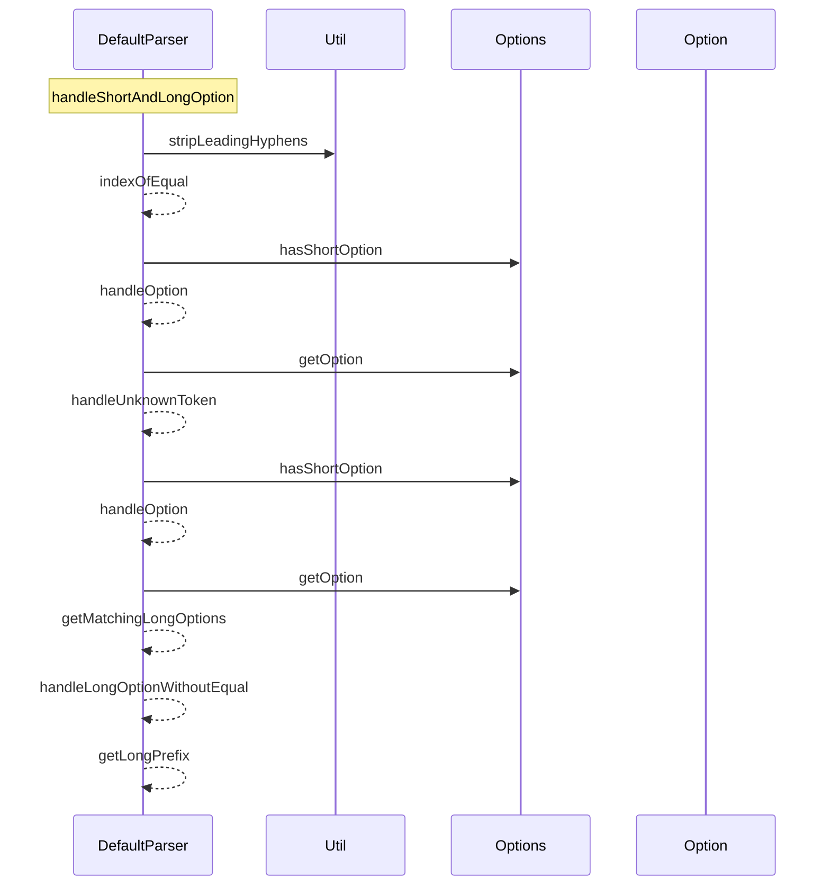
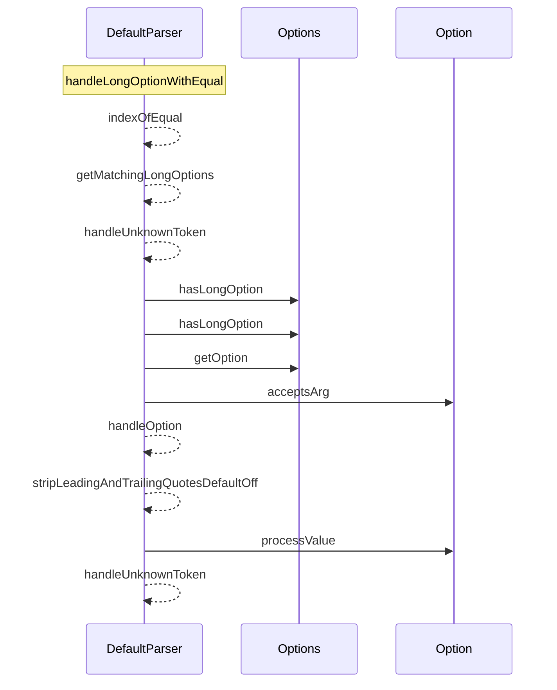
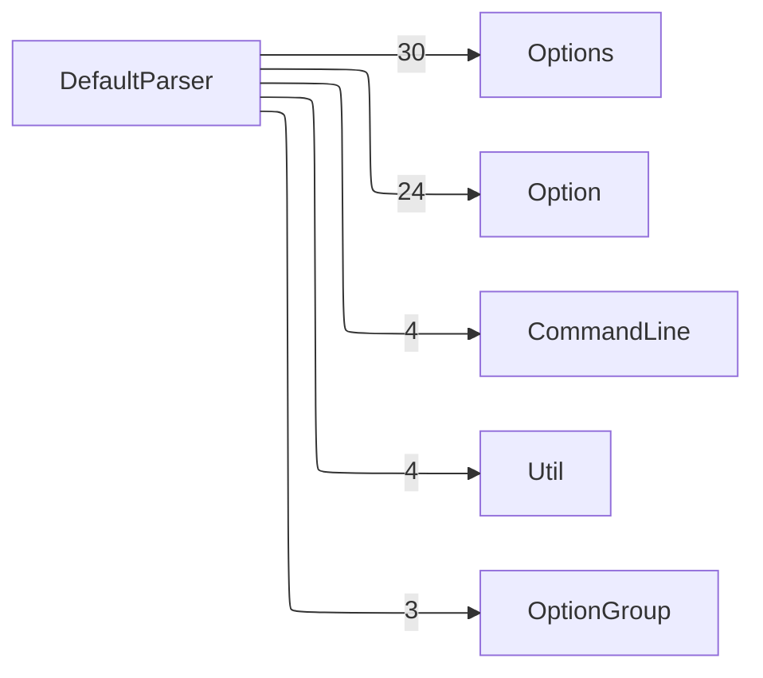

근거 소스 8개

- [`src/main/java/org/apache/commons/cli/DefaultParser.java`](https://github.com/apache/commons-cli/blob/e17111798da51037659b3594d9c0b3b525040081/src/main/java/org/apache/commons/cli/DefaultParser.java#L1-L1)
- [`src/main/java/org/apache/commons/cli/UnrecognizedOptionException.java`](https://github.com/apache/commons-cli/blob/e17111798da51037659b3594d9c0b3b525040081/src/main/java/org/apache/commons/cli/UnrecognizedOptionException.java#L1-L1)
- [`src/main/java/org/apache/commons/cli/ParseException.java`](https://github.com/apache/commons-cli/blob/e17111798da51037659b3594d9c0b3b525040081/src/main/java/org/apache/commons/cli/ParseException.java#L1-L1)
- [`src/main/java/org/apache/commons/cli/AmbiguousOptionException.java`](https://github.com/apache/commons-cli/blob/e17111798da51037659b3594d9c0b3b525040081/src/main/java/org/apache/commons/cli/AmbiguousOptionException.java#L1-L1)
- [`src/main/java/org/apache/commons/cli/CommandLineParser.java`](https://github.com/apache/commons-cli/blob/e17111798da51037659b3594d9c0b3b525040081/src/main/java/org/apache/commons/cli/CommandLineParser.java#L1-L1)
- [`src/main/java/org/apache/commons/cli/MissingArgumentException.java`](https://github.com/apache/commons-cli/blob/e17111798da51037659b3594d9c0b3b525040081/src/main/java/org/apache/commons/cli/MissingArgumentException.java#L1-L1)
- [`src/main/java/org/apache/commons/cli/MissingOptionException.java`](https://github.com/apache/commons-cli/blob/e17111798da51037659b3594d9c0b3b525040081/src/main/java/org/apache/commons/cli/MissingOptionException.java#L1-L1)
- [`src/main/java/org/apache/commons/cli/TypeHandler.java`](https://github.com/apache/commons-cli/blob/e17111798da51037659b3594d9c0b3b525040081/src/main/java/org/apache/commons/cli/TypeHandler.java#L1-L1)

이 묶음이 맡는 일은 문자열 배열 하나를 뜻이 있는 구조로 바꾸는 것이다. 들어오는 것은 `String[]`이고 나가는 것은 `CommandLine`이거나 `ParseException`이다. 옵션 정의 자체는 [옵션과 옵션 묶음](5-option-optiongroup.md)에 있고, 여기는 그 정의에 비추어 토큰을 읽는다.

어려운 것은 명령행 문법이 하나가 아니라는 점이다. `-S`, `-xxx`, `--long`, `-Xmx512m`, `-Dkey=value`, `-abc` 같은 형태가 모두 붙임표로 시작한다. 이 묶음의 코드 대부분이 그 갈래를 가르는 데 쓰인다.

## 이 묶음의 타입

- **`CommandLineParser`**: 파서의 계약이다. 이 묶음 밖에서 보이는 표면은 이것뿐이다 [^E8]
- **`DefaultParser`**: 그 계약의 구현이다. 토큰 하나를 받아 갈래를 가르는 상태 기계다 [^E1]
- **`DefaultParser.NonOptionAction`**: 옵션이 아닌 토큰을 만났을 때의 처리 방침이다 [^E3]
- **`ParseException`**: 파싱 실패의 뿌리다 [^E5]
- **`UnrecognizedOptionException`**: 모르는 옵션을 만났다 [^E4]
- **`AmbiguousOptionException`**: 줄인 이름이 여럿에 맞는다. `UnrecognizedOptionException`을 물려받는다 [^E6]
- **`MissingArgumentException`**: 인수를 받아야 할 옵션에 값이 없다 [^E9]
- **`MissingOptionException`**: 필수 옵션이 안 왔다 [^E10]

**DefaultParser와 UnrecognizedOptionException이 담은 타입**

| 타입 | 종류 | 근거 |
| --- | --- | --- |
| `AmbiguousOptionException` | class | [`src/main/java/org/apache/commons/cli/AmbiguousOptionException.java:L28-L81`](https://github.com/apache/commons-cli/blob/e17111798da51037659b3594d9c0b3b525040081/src/main/java/org/apache/commons/cli/AmbiguousOptionException.java#L28-L81) |
| `Char` | class | [`src/main/java/org/apache/commons/cli/Char.java:L23-L46`](https://github.com/apache/commons-cli/blob/e17111798da51037659b3594d9c0b3b525040081/src/main/java/org/apache/commons/cli/Char.java#L23-L46) |
| `CommandLineParser` | interface | [`src/main/java/org/apache/commons/cli/CommandLineParser.java:L24-L50`](https://github.com/apache/commons-cli/blob/e17111798da51037659b3594d9c0b3b525040081/src/main/java/org/apache/commons/cli/CommandLineParser.java#L24-L50) |
| `DefaultParser.Builder` | class | [`src/main/java/org/apache/commons/cli/DefaultParser.java:L47-L152`](https://github.com/apache/commons-cli/blob/e17111798da51037659b3594d9c0b3b525040081/src/main/java/org/apache/commons/cli/DefaultParser.java#L47-L152) |
| `DefaultParser` | class | [`src/main/java/org/apache/commons/cli/DefaultParser.java:L35-L859`](https://github.com/apache/commons-cli/blob/e17111798da51037659b3594d9c0b3b525040081/src/main/java/org/apache/commons/cli/DefaultParser.java#L35-L859) |
| `DefaultParser.NonOptionAction` | enum | [`src/main/java/org/apache/commons/cli/DefaultParser.java:L159-L177`](https://github.com/apache/commons-cli/blob/e17111798da51037659b3594d9c0b3b525040081/src/main/java/org/apache/commons/cli/DefaultParser.java#L159-L177) |
| `MissingArgumentException` | class | [`src/main/java/org/apache/commons/cli/MissingArgumentException.java:L23-L62`](https://github.com/apache/commons-cli/blob/e17111798da51037659b3594d9c0b3b525040081/src/main/java/org/apache/commons/cli/MissingArgumentException.java#L23-L62) |
| `MissingOptionException` | class | [`src/main/java/org/apache/commons/cli/MissingOptionException.java:L25-L75`](https://github.com/apache/commons-cli/blob/e17111798da51037659b3594d9c0b3b525040081/src/main/java/org/apache/commons/cli/MissingOptionException.java#L25-L75) |
| `ParseException` | class | [`src/main/java/org/apache/commons/cli/ParseException.java:L23-L70`](https://github.com/apache/commons-cli/blob/e17111798da51037659b3594d9c0b3b525040081/src/main/java/org/apache/commons/cli/ParseException.java#L23-L70) |
| `UnrecognizedOptionException` | class | [`src/main/java/org/apache/commons/cli/UnrecognizedOptionException.java:L23-L63`](https://github.com/apache/commons-cli/blob/e17111798da51037659b3594d9c0b3b525040081/src/main/java/org/apache/commons/cli/UnrecognizedOptionException.java#L23-L63) |

## 토큰 하나를 어떻게 가르는가

`handleToken`이 문지기다. 순서가 그대로 우선순위다 [^E34].

1. **`skipParsing`이 켜져 있으면 무조건 인수다.** 뒤에 오는 것을 더 보지 않는다
2. **토큰이 `--`뿐이면 `skipParsing`을 켠다.** 이 지점부터 전부 인수다
3. **직전 옵션이 값을 받을 수 있고 이 토큰이 인수로 보이면 값이다**
4. **`--`로 시작하면 긴 옵션이다**
5. **`-`로 시작하고 `-` 하나만은 아니면 짧거나 긴 옵션이다**
6. **나머지는 모르는 토큰이다**

마지막 줄이 중요하다. 값을 받지 않는 옵션은 처리 직후 `currentOption`을 비운다. 그래서 다음 토큰이 그 옵션의 값으로 잘못 붙지 않는다 [^E34].

"인수로 보이는가"의 판정에 이 라이브러리의 판단이 하나 들어 있다 [^E36].

- 옵션이 아니면 인수다
- **옵션처럼 보여도 음수면 인수다.** `-1`을 옵션으로 읽으면 숫자를 넘길 수 없다

## 붙임표 하나로 시작하는 것들

`handleShortAndLongOption`이 이 묶음에서 가장 긴 메서드다. 등호 자리와 토큰 길이로 세 갈래를 먼저 가른다 [^E33].

- **길이가 1이면** 짧은 옵션이거나 모르는 토큰이다
- **등호가 없으면** 짧은 옵션, 긴 옵션, 긴 접두어, 자바 속성, 붙여 쓴 짧은 옵션 다발의 차례로 본다
- **등호가 있으면** 등호 앞이 한 글자인지, 자바 속성인지, 긴 옵션인지로 다시 가른다

주석에 실제 예가 달려 있어 각 가지가 무엇을 노리는지 알 수 있다. `-Xmx512m`은 긴 접두어 가지이고, `-Dflag`와 `-Dkey=value`는 자바 속성 가지이며, `-S1S2S3`은 다발 가지다 [^E33].

자바 속성 판정은 인수 개수로 한다. 첫 글자로 옵션을 찾고, 그 옵션이 인수를 둘 이상 받거나 무제한이면 자바 속성으로 본다 [^E37]. `-Dkey=value`가 키와 값 둘을 넘기는 형태이기 때문이다.

## 줄여 쓰기를 허용할 것인가

`getMatchingLongOptions`가 그 스위치를 쥔다 [^E26].

- **`allowPartialMatching`이 켜져 있으면** `Options`에게 맞는 것을 모두 물어본다. 여럿이면 뒤에서 `AmbiguousOptionException`이 된다
- **꺼져 있으면** 정확히 일치하는 하나만 본다

기본값은 켜짐이고 `Builder.setAllowPartialMatching`으로 끈다 [^E14]. 켜 두면 `--verb`로 `--verbose`를 쓸 수 있지만, 옵션이 늘어나 이름이 겹치는 순간 예외가 된다. 이 판단은 이 라이브러리를 쓰는 쪽이 한다.

**DefaultParser의 멤버**

| 이름 | 종류 | 근거 |
| --- | --- | --- |
| `Builder` | class | [`src/main/java/org/apache/commons/cli/DefaultParser.java:L47-L152`](https://github.com/apache/commons-cli/blob/e17111798da51037659b3594d9c0b3b525040081/src/main/java/org/apache/commons/cli/DefaultParser.java#L47-L152) |
| `DefaultParser` | constructor | [`src/main/java/org/apache/commons/cli/DefaultParser.java:L262-L266`](https://github.com/apache/commons-cli/blob/e17111798da51037659b3594d9c0b3b525040081/src/main/java/org/apache/commons/cli/DefaultParser.java#L262-L266) |
| `DefaultParser` | constructor | [`src/main/java/org/apache/commons/cli/DefaultParser.java:L288-L292`](https://github.com/apache/commons-cli/blob/e17111798da51037659b3594d9c0b3b525040081/src/main/java/org/apache/commons/cli/DefaultParser.java#L288-L292) |
| `DefaultParser` | constructor | [`src/main/java/org/apache/commons/cli/DefaultParser.java:L300-L304`](https://github.com/apache/commons-cli/blob/e17111798da51037659b3594d9c0b3b525040081/src/main/java/org/apache/commons/cli/DefaultParser.java#L300-L304) |
| `NonOptionAction` | enum | [`src/main/java/org/apache/commons/cli/DefaultParser.java:L159-L177`](https://github.com/apache/commons-cli/blob/e17111798da51037659b3594d9c0b3b525040081/src/main/java/org/apache/commons/cli/DefaultParser.java#L159-L177) |
| `allowPartialMatching` | field | [`src/main/java/org/apache/commons/cli/DefaultParser.java:L230-L230`](https://github.com/apache/commons-cli/blob/e17111798da51037659b3594d9c0b3b525040081/src/main/java/org/apache/commons/cli/DefaultParser.java#L230-L230) |
| `cmd` | field | [`src/main/java/org/apache/commons/cli/DefaultParser.java:L194-L194`](https://github.com/apache/commons-cli/blob/e17111798da51037659b3594d9c0b3b525040081/src/main/java/org/apache/commons/cli/DefaultParser.java#L194-L194) |
| `currentOption` | field | [`src/main/java/org/apache/commons/cli/DefaultParser.java:L219-L219`](https://github.com/apache/commons-cli/blob/e17111798da51037659b3594d9c0b3b525040081/src/main/java/org/apache/commons/cli/DefaultParser.java#L219-L219) |
| `currentToken` | field | [`src/main/java/org/apache/commons/cli/DefaultParser.java:L216-L216`](https://github.com/apache/commons-cli/blob/e17111798da51037659b3594d9c0b3b525040081/src/main/java/org/apache/commons/cli/DefaultParser.java#L216-L216) |
| `deprecatedHandler` | field | [`src/main/java/org/apache/commons/cli/DefaultParser.java:L243-L243`](https://github.com/apache/commons-cli/blob/e17111798da51037659b3594d9c0b3b525040081/src/main/java/org/apache/commons/cli/DefaultParser.java#L243-L243) |
| `expectedOpts` | field | [`src/main/java/org/apache/commons/cli/DefaultParser.java:L227-L227`](https://github.com/apache/commons-cli/blob/e17111798da51037659b3594d9c0b3b525040081/src/main/java/org/apache/commons/cli/DefaultParser.java#L227-L227) |
| `nonOptionAction` | field | [`src/main/java/org/apache/commons/cli/DefaultParser.java:L213-L213`](https://github.com/apache/commons-cli/blob/e17111798da51037659b3594d9c0b3b525040081/src/main/java/org/apache/commons/cli/DefaultParser.java#L213-L213) |
| `options` | field | [`src/main/java/org/apache/commons/cli/DefaultParser.java:L197-L197`](https://github.com/apache/commons-cli/blob/e17111798da51037659b3594d9c0b3b525040081/src/main/java/org/apache/commons/cli/DefaultParser.java#L197-L197) |
| `skipParsing` | field | [`src/main/java/org/apache/commons/cli/DefaultParser.java:L222-L222`](https://github.com/apache/commons-cli/blob/e17111798da51037659b3594d9c0b3b525040081/src/main/java/org/apache/commons/cli/DefaultParser.java#L222-L222) |
| `stopAtNonOption` | field | [`src/main/java/org/apache/commons/cli/DefaultParser.java:L206-L206`](https://github.com/apache/commons-cli/blob/e17111798da51037659b3594d9c0b3b525040081/src/main/java/org/apache/commons/cli/DefaultParser.java#L206-L206) |
| `stripLeadingAndTrailingQuotes` | field | [`src/main/java/org/apache/commons/cli/DefaultParser.java:L235-L235`](https://github.com/apache/commons-cli/blob/e17111798da51037659b3594d9c0b3b525040081/src/main/java/org/apache/commons/cli/DefaultParser.java#L235-L235) |
| `addArg` | method | [`src/main/java/org/apache/commons/cli/DefaultParser.java:L312-L314`](https://github.com/apache/commons-cli/blob/e17111798da51037659b3594d9c0b3b525040081/src/main/java/org/apache/commons/cli/DefaultParser.java#L312-L314) |
| `builder` | method | [`src/main/java/org/apache/commons/cli/DefaultParser.java:L185-L187`](https://github.com/apache/commons-cli/blob/e17111798da51037659b3594d9c0b3b525040081/src/main/java/org/apache/commons/cli/DefaultParser.java#L185-L187) |
| `checkRequiredArgs` | method | [`src/main/java/org/apache/commons/cli/DefaultParser.java:L319-L326`](https://github.com/apache/commons-cli/blob/e17111798da51037659b3594d9c0b3b525040081/src/main/java/org/apache/commons/cli/DefaultParser.java#L319-L326) |
| `checkRequiredOptions` | method | [`src/main/java/org/apache/commons/cli/DefaultParser.java:L333-L338`](https://github.com/apache/commons-cli/blob/e17111798da51037659b3594d9c0b3b525040081/src/main/java/org/apache/commons/cli/DefaultParser.java#L333-L338) |
| `getLongPrefix` | method | [`src/main/java/org/apache/commons/cli/DefaultParser.java:L345-L357`](https://github.com/apache/commons-cli/blob/e17111798da51037659b3594d9c0b3b525040081/src/main/java/org/apache/commons/cli/DefaultParser.java#L345-L357) |
| `getMatchingLongOptions` | method | [`src/main/java/org/apache/commons/cli/DefaultParser.java:L365-L374`](https://github.com/apache/commons-cli/blob/e17111798da51037659b3594d9c0b3b525040081/src/main/java/org/apache/commons/cli/DefaultParser.java#L365-L374) |
| `handleConcatenatedOptions` | method | [`src/main/java/org/apache/commons/cli/DefaultParser.java:L393-L407`](https://github.com/apache/commons-cli/blob/e17111798da51037659b3594d9c0b3b525040081/src/main/java/org/apache/commons/cli/DefaultParser.java#L393-L407) |
| `handleLongOption` | method | [`src/main/java/org/apache/commons/cli/DefaultParser.java:L418-L424`](https://github.com/apache/commons-cli/blob/e17111798da51037659b3594d9c0b3b525040081/src/main/java/org/apache/commons/cli/DefaultParser.java#L418-L424) |
| `handleLongOptionWithEqual` | method | [`src/main/java/org/apache/commons/cli/DefaultParser.java:L435-L455`](https://github.com/apache/commons-cli/blob/e17111798da51037659b3594d9c0b3b525040081/src/main/java/org/apache/commons/cli/DefaultParser.java#L435-L455) |
| `handleLongOptionWithoutEqual` | method | [`src/main/java/org/apache/commons/cli/DefaultParser.java:L466-L476`](https://github.com/apache/commons-cli/blob/e17111798da51037659b3594d9c0b3b525040081/src/main/java/org/apache/commons/cli/DefaultParser.java#L466-L476) |
| `handleOption` | method | [`src/main/java/org/apache/commons/cli/DefaultParser.java:L478-L485`](https://github.com/apache/commons-cli/blob/e17111798da51037659b3594d9c0b3b525040081/src/main/java/org/apache/commons/cli/DefaultParser.java#L478-L485) |
| `handleProperties` | method | [`src/main/java/org/apache/commons/cli/DefaultParser.java:L492-L520`](https://github.com/apache/commons-cli/blob/e17111798da51037659b3594d9c0b3b525040081/src/main/java/org/apache/commons/cli/DefaultParser.java#L492-L520) |
| `handleShortAndLongOption` | method | [`src/main/java/org/apache/commons/cli/DefaultParser.java:L533-L592`](https://github.com/apache/commons-cli/blob/e17111798da51037659b3594d9c0b3b525040081/src/main/java/org/apache/commons/cli/DefaultParser.java#L533-L592) |
| `handleToken` | method | [`src/main/java/org/apache/commons/cli/DefaultParser.java:L600-L620`](https://github.com/apache/commons-cli/blob/e17111798da51037659b3594d9c0b3b525040081/src/main/java/org/apache/commons/cli/DefaultParser.java#L600-L620) |

멤버 46개 중 앞 30개다.

## 무엇이 실패할 수 있는가

- **모르는 옵션.** `handleUnknownToken`이 `nonOptionAction`을 본다. `THROW`일 때만 `UnrecognizedOptionException`을 던지고, `IGNORE`면 버리고, 그 밖이면 인수로 넣는다. `STOP`이면 `skipParsing`을 켜서 나머지를 전부 인수로 만든다 [^E35]
- **필수 옵션 누락.** `checkRequiredOptions`가 `expectedOpts`에 남은 것이 있으면 `MissingOptionException`을 던진다 [^E24]
- **필수 인수 누락.** `checkRequiredArgs`가 본다 [^E23]
- **모호한 줄임말.** `AmbiguousOptionException`의 메시지가 후보를 전부 나열한다. 사람이 무엇을 쳐야 하는지 알아야 하기 때문이다 [^E6]

예외 계층에 판단이 하나 남아 있다. `AmbiguousOptionException`이 `UnrecognizedOptionException`을 물려받는다 [^E6]. 모호한 것은 모르는 것의 한 갈래라는 뜻이고, 모르는 옵션만 잡는 코드가 모호한 경우도 함께 잡는다.

**DefaultParser을 부르는 자리**

| 불리는 멤버 | 부르는 자리 | 수신자 종류 | 근거 |
| --- | --- | --- | --- |
| `addArg` | `DefaultParser.handleToken` | self | [`src/main/java/org/apache/commons/cli/DefaultParser.java:L604-L604`](https://github.com/apache/commons-cli/blob/e17111798da51037659b3594d9c0b3b525040081/src/main/java/org/apache/commons/cli/DefaultParser.java#L604-L604) |
| `addArg` | `DefaultParser.handleUnknownToken` | self | [`src/main/java/org/apache/commons/cli/DefaultParser.java:L636-L636`](https://github.com/apache/commons-cli/blob/e17111798da51037659b3594d9c0b3b525040081/src/main/java/org/apache/commons/cli/DefaultParser.java#L636-L636) |
| `checkRequiredArgs` | `DefaultParser.handleOption` | self | [`src/main/java/org/apache/commons/cli/DefaultParser.java:L480-L480`](https://github.com/apache/commons-cli/blob/e17111798da51037659b3594d9c0b3b525040081/src/main/java/org/apache/commons/cli/DefaultParser.java#L480-L480) |
| `checkRequiredArgs` | `DefaultParser.parse` | self | [`src/main/java/org/apache/commons/cli/DefaultParser.java:L757-L757`](https://github.com/apache/commons-cli/blob/e17111798da51037659b3594d9c0b3b525040081/src/main/java/org/apache/commons/cli/DefaultParser.java#L757-L757) |
| `checkRequiredOptions` | `DefaultParser.parse` | self | [`src/main/java/org/apache/commons/cli/DefaultParser.java:L760-L760`](https://github.com/apache/commons-cli/blob/e17111798da51037659b3594d9c0b3b525040081/src/main/java/org/apache/commons/cli/DefaultParser.java#L760-L760) |
| `getLongPrefix` | `DefaultParser.handleShortAndLongOption` | self | [`src/main/java/org/apache/commons/cli/DefaultParser.java:L552-L552`](https://github.com/apache/commons-cli/blob/e17111798da51037659b3594d9c0b3b525040081/src/main/java/org/apache/commons/cli/DefaultParser.java#L552-L552) |
| `getLongPrefix` | `DefaultParser.isLongOption` | self | [`src/main/java/org/apache/commons/cli/DefaultParser.java:L678-L678`](https://github.com/apache/commons-cli/blob/e17111798da51037659b3594d9c0b3b525040081/src/main/java/org/apache/commons/cli/DefaultParser.java#L678-L678) |
| `getMatchingLongOptions` | `DefaultParser.handleLongOptionWithEqual` | self | [`src/main/java/org/apache/commons/cli/DefaultParser.java:L439-L439`](https://github.com/apache/commons-cli/blob/e17111798da51037659b3594d9c0b3b525040081/src/main/java/org/apache/commons/cli/DefaultParser.java#L439-L439) |
| `getMatchingLongOptions` | `DefaultParser.handleLongOptionWithoutEqual` | self | [`src/main/java/org/apache/commons/cli/DefaultParser.java:L467-L467`](https://github.com/apache/commons-cli/blob/e17111798da51037659b3594d9c0b3b525040081/src/main/java/org/apache/commons/cli/DefaultParser.java#L467-L467) |
| `getMatchingLongOptions` | `DefaultParser.handleShortAndLongOption` | self | [`src/main/java/org/apache/commons/cli/DefaultParser.java:L547-L547`](https://github.com/apache/commons-cli/blob/e17111798da51037659b3594d9c0b3b525040081/src/main/java/org/apache/commons/cli/DefaultParser.java#L547-L547) |
| `getMatchingLongOptions` | `DefaultParser.isLongOption` | self | [`src/main/java/org/apache/commons/cli/DefaultParser.java:L674-L674`](https://github.com/apache/commons-cli/blob/e17111798da51037659b3594d9c0b3b525040081/src/main/java/org/apache/commons/cli/DefaultParser.java#L674-L674) |
| `handleConcatenatedOptions` | `DefaultParser.handleShortAndLongOption` | self | [`src/main/java/org/apache/commons/cli/DefaultParser.java:L564-L564`](https://github.com/apache/commons-cli/blob/e17111798da51037659b3594d9c0b3b525040081/src/main/java/org/apache/commons/cli/DefaultParser.java#L564-L564) |
| `handleLongOption` | `DefaultParser.handleToken` | self | [`src/main/java/org/apache/commons/cli/DefaultParser.java:L610-L610`](https://github.com/apache/commons-cli/blob/e17111798da51037659b3594d9c0b3b525040081/src/main/java/org/apache/commons/cli/DefaultParser.java#L610-L610) |
| `handleLongOptionWithEqual` | `DefaultParser.handleLongOption` | self | [`src/main/java/org/apache/commons/cli/DefaultParser.java:L422-L422`](https://github.com/apache/commons-cli/blob/e17111798da51037659b3594d9c0b3b525040081/src/main/java/org/apache/commons/cli/DefaultParser.java#L422-L422) |
| `handleLongOptionWithEqual` | `DefaultParser.handleShortAndLongOption` | self | [`src/main/java/org/apache/commons/cli/DefaultParser.java:L589-L589`](https://github.com/apache/commons-cli/blob/e17111798da51037659b3594d9c0b3b525040081/src/main/java/org/apache/commons/cli/DefaultParser.java#L589-L589) |
| `handleLongOptionWithoutEqual` | `DefaultParser.handleLongOption` | self | [`src/main/java/org/apache/commons/cli/DefaultParser.java:L420-L420`](https://github.com/apache/commons-cli/blob/e17111798da51037659b3594d9c0b3b525040081/src/main/java/org/apache/commons/cli/DefaultParser.java#L420-L420) |
| `handleLongOptionWithoutEqual` | `DefaultParser.handleShortAndLongOption` | self | [`src/main/java/org/apache/commons/cli/DefaultParser.java:L549-L549`](https://github.com/apache/commons-cli/blob/e17111798da51037659b3594d9c0b3b525040081/src/main/java/org/apache/commons/cli/DefaultParser.java#L549-L549) |
| `handleOption` | `DefaultParser.handleConcatenatedOptions` | self | [`src/main/java/org/apache/commons/cli/DefaultParser.java:L400-L400`](https://github.com/apache/commons-cli/blob/e17111798da51037659b3594d9c0b3b525040081/src/main/java/org/apache/commons/cli/DefaultParser.java#L400-L400) |
| `handleOption` | `DefaultParser.handleLongOptionWithEqual` | self | [`src/main/java/org/apache/commons/cli/DefaultParser.java:L448-L448`](https://github.com/apache/commons-cli/blob/e17111798da51037659b3594d9c0b3b525040081/src/main/java/org/apache/commons/cli/DefaultParser.java#L448-L448) |
| `handleOption` | `DefaultParser.handleLongOptionWithoutEqual` | self | [`src/main/java/org/apache/commons/cli/DefaultParser.java:L474-L474`](https://github.com/apache/commons-cli/blob/e17111798da51037659b3594d9c0b3b525040081/src/main/java/org/apache/commons/cli/DefaultParser.java#L474-L474) |
| `handleOption` | `DefaultParser.handleProperties` | self | [`src/main/java/org/apache/commons/cli/DefaultParser.java:L516-L516`](https://github.com/apache/commons-cli/blob/e17111798da51037659b3594d9c0b3b525040081/src/main/java/org/apache/commons/cli/DefaultParser.java#L516-L516) |
| `handleOption` | `DefaultParser.handleShortAndLongOption` | self | [`src/main/java/org/apache/commons/cli/DefaultParser.java:L539-L539`](https://github.com/apache/commons-cli/blob/e17111798da51037659b3594d9c0b3b525040081/src/main/java/org/apache/commons/cli/DefaultParser.java#L539-L539) |
| `handleProperties` | `DefaultParser.parse` | self | [`src/main/java/org/apache/commons/cli/DefaultParser.java:L759-L759`](https://github.com/apache/commons-cli/blob/e17111798da51037659b3594d9c0b3b525040081/src/main/java/org/apache/commons/cli/DefaultParser.java#L759-L759) |
| `handleShortAndLongOption` | `DefaultParser.handleToken` | self | [`src/main/java/org/apache/commons/cli/DefaultParser.java:L612-L612`](https://github.com/apache/commons-cli/blob/e17111798da51037659b3594d9c0b3b525040081/src/main/java/org/apache/commons/cli/DefaultParser.java#L612-L612) |
| `handleToken` | `DefaultParser.parse` | self | [`src/main/java/org/apache/commons/cli/DefaultParser.java:L753-L753`](https://github.com/apache/commons-cli/blob/e17111798da51037659b3594d9c0b3b525040081/src/main/java/org/apache/commons/cli/DefaultParser.java#L753-L753) |
| `handleUnknownToken` | `DefaultParser.handleConcatenatedOptions` | self | [`src/main/java/org/apache/commons/cli/DefaultParser.java:L397-L397`](https://github.com/apache/commons-cli/blob/e17111798da51037659b3594d9c0b3b525040081/src/main/java/org/apache/commons/cli/DefaultParser.java#L397-L397) |
| `handleUnknownToken` | `DefaultParser.handleLongOptionWithEqual` | self | [`src/main/java/org/apache/commons/cli/DefaultParser.java:L441-L441`](https://github.com/apache/commons-cli/blob/e17111798da51037659b3594d9c0b3b525040081/src/main/java/org/apache/commons/cli/DefaultParser.java#L441-L441) |
| `handleUnknownToken` | `DefaultParser.handleLongOptionWithoutEqual` | self | [`src/main/java/org/apache/commons/cli/DefaultParser.java:L469-L469`](https://github.com/apache/commons-cli/blob/e17111798da51037659b3594d9c0b3b525040081/src/main/java/org/apache/commons/cli/DefaultParser.java#L469-L469) |
| `handleUnknownToken` | `DefaultParser.handleShortAndLongOption` | self | [`src/main/java/org/apache/commons/cli/DefaultParser.java:L541-L541`](https://github.com/apache/commons-cli/blob/e17111798da51037659b3594d9c0b3b525040081/src/main/java/org/apache/commons/cli/DefaultParser.java#L541-L541) |
| `handleUnknownToken` | `DefaultParser.handleToken` | self | [`src/main/java/org/apache/commons/cli/DefaultParser.java:L614-L614`](https://github.com/apache/commons-cli/blob/e17111798da51037659b3594d9c0b3b525040081/src/main/java/org/apache/commons/cli/DefaultParser.java#L614-L614) |

수신자를 스코프에서 푼 호출만이다. 체인 표현식과 상속받은 멤버는 빠진다.

남아 있는 낡은 파서 계층은 [파서 계층과 옵션 그릇](3-parser-options.md)에 있다. 도움말 출력은 [도움말 출력 계층](1-help.md)이 맡는다.

[^E1]: [`src/main/java/org/apache/commons/cli/DefaultParser.java:L35-L859`](https://github.com/apache/commons-cli/blob/e17111798da51037659b3594d9c0b3b525040081/src/main/java/org/apache/commons/cli/DefaultParser.java#L35-L859)
[^E3]: [`src/main/java/org/apache/commons/cli/DefaultParser.java:L159-L177`](https://github.com/apache/commons-cli/blob/e17111798da51037659b3594d9c0b3b525040081/src/main/java/org/apache/commons/cli/DefaultParser.java#L159-L177)
[^E4]: [`src/main/java/org/apache/commons/cli/UnrecognizedOptionException.java:L23-L63`](https://github.com/apache/commons-cli/blob/e17111798da51037659b3594d9c0b3b525040081/src/main/java/org/apache/commons/cli/UnrecognizedOptionException.java#L23-L63)
[^E5]: [`src/main/java/org/apache/commons/cli/ParseException.java:L23-L70`](https://github.com/apache/commons-cli/blob/e17111798da51037659b3594d9c0b3b525040081/src/main/java/org/apache/commons/cli/ParseException.java#L23-L70)
[^E6]: [`src/main/java/org/apache/commons/cli/AmbiguousOptionException.java:L28-L81`](https://github.com/apache/commons-cli/blob/e17111798da51037659b3594d9c0b3b525040081/src/main/java/org/apache/commons/cli/AmbiguousOptionException.java#L28-L81)
[^E8]: [`src/main/java/org/apache/commons/cli/CommandLineParser.java:L24-L50`](https://github.com/apache/commons-cli/blob/e17111798da51037659b3594d9c0b3b525040081/src/main/java/org/apache/commons/cli/CommandLineParser.java#L24-L50)
[^E9]: [`src/main/java/org/apache/commons/cli/MissingArgumentException.java:L23-L62`](https://github.com/apache/commons-cli/blob/e17111798da51037659b3594d9c0b3b525040081/src/main/java/org/apache/commons/cli/MissingArgumentException.java#L23-L62)
[^E10]: [`src/main/java/org/apache/commons/cli/MissingOptionException.java:L25-L75`](https://github.com/apache/commons-cli/blob/e17111798da51037659b3594d9c0b3b525040081/src/main/java/org/apache/commons/cli/MissingOptionException.java#L25-L75)
[^E14]: [`src/main/java/org/apache/commons/cli/UnrecognizedOptionException.java:L38-L40`](https://github.com/apache/commons-cli/blob/e17111798da51037659b3594d9c0b3b525040081/src/main/java/org/apache/commons/cli/UnrecognizedOptionException.java#L38-L40)
[^E23]: [`src/main/java/org/apache/commons/cli/TypeHandler.java:L162-L162`](https://github.com/apache/commons-cli/blob/e17111798da51037659b3594d9c0b3b525040081/src/main/java/org/apache/commons/cli/TypeHandler.java#L162-L162)
[^E24]: [`src/main/java/org/apache/commons/cli/DefaultParser.java:L116-L119`](https://github.com/apache/commons-cli/blob/e17111798da51037659b3594d9c0b3b525040081/src/main/java/org/apache/commons/cli/DefaultParser.java#L116-L119)
[^E26]: [`src/main/java/org/apache/commons/cli/DefaultParser.java:L148-L151`](https://github.com/apache/commons-cli/blob/e17111798da51037659b3594d9c0b3b525040081/src/main/java/org/apache/commons/cli/DefaultParser.java#L148-L151)
[^E33]: [`src/main/java/org/apache/commons/cli/DefaultParser.java:L319-L326`](https://github.com/apache/commons-cli/blob/e17111798da51037659b3594d9c0b3b525040081/src/main/java/org/apache/commons/cli/DefaultParser.java#L319-L326)
[^E34]: [`src/main/java/org/apache/commons/cli/DefaultParser.java:L333-L338`](https://github.com/apache/commons-cli/blob/e17111798da51037659b3594d9c0b3b525040081/src/main/java/org/apache/commons/cli/DefaultParser.java#L333-L338)
[^E35]: [`src/main/java/org/apache/commons/cli/DefaultParser.java:L345-L357`](https://github.com/apache/commons-cli/blob/e17111798da51037659b3594d9c0b3b525040081/src/main/java/org/apache/commons/cli/DefaultParser.java#L345-L357)
[^E36]: [`src/main/java/org/apache/commons/cli/DefaultParser.java:L365-L374`](https://github.com/apache/commons-cli/blob/e17111798da51037659b3594d9c0b3b525040081/src/main/java/org/apache/commons/cli/DefaultParser.java#L365-L374)
[^E37]: [`src/main/java/org/apache/commons/cli/DefaultParser.java:L393-L407`](https://github.com/apache/commons-cli/blob/e17111798da51037659b3594d9c0b3b525040081/src/main/java/org/apache/commons/cli/DefaultParser.java#L393-L407)
