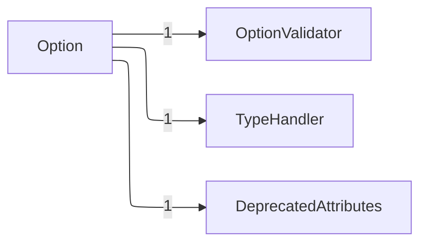
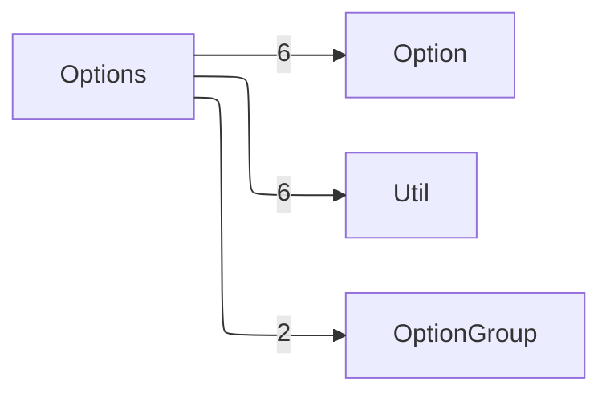
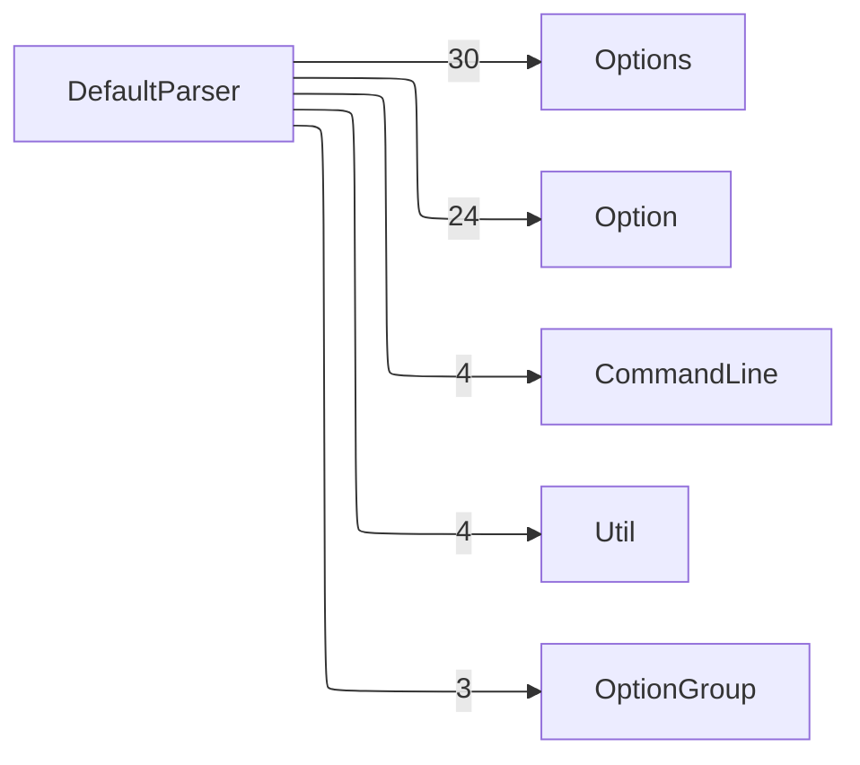
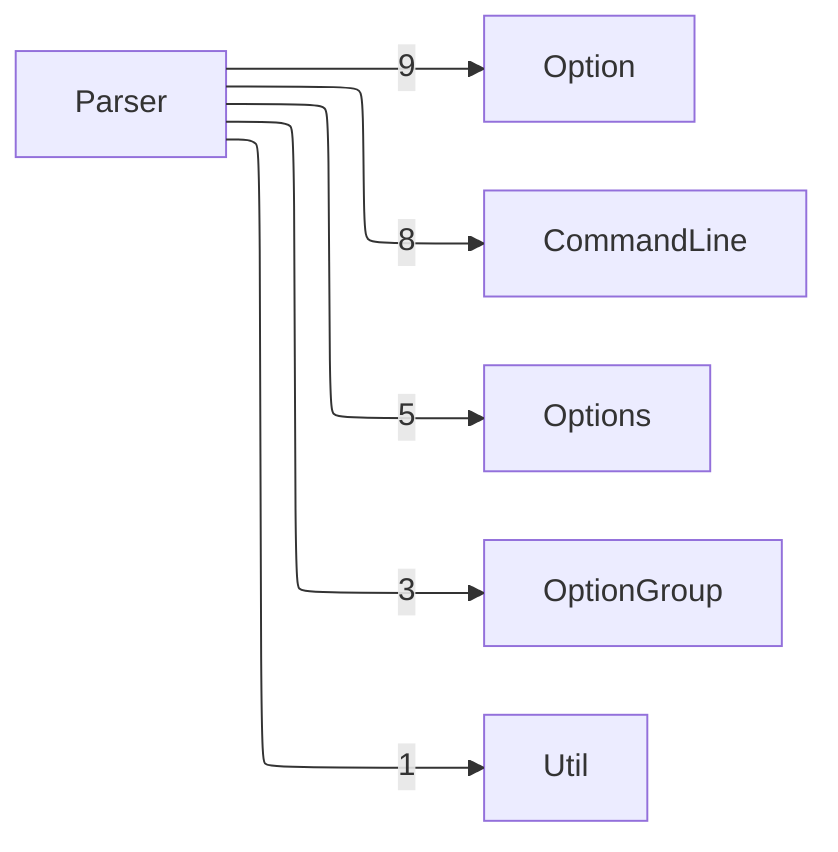
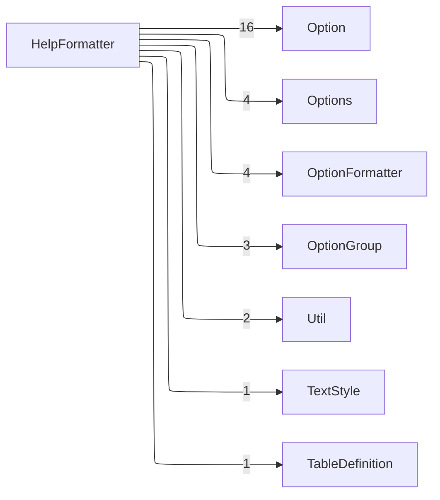
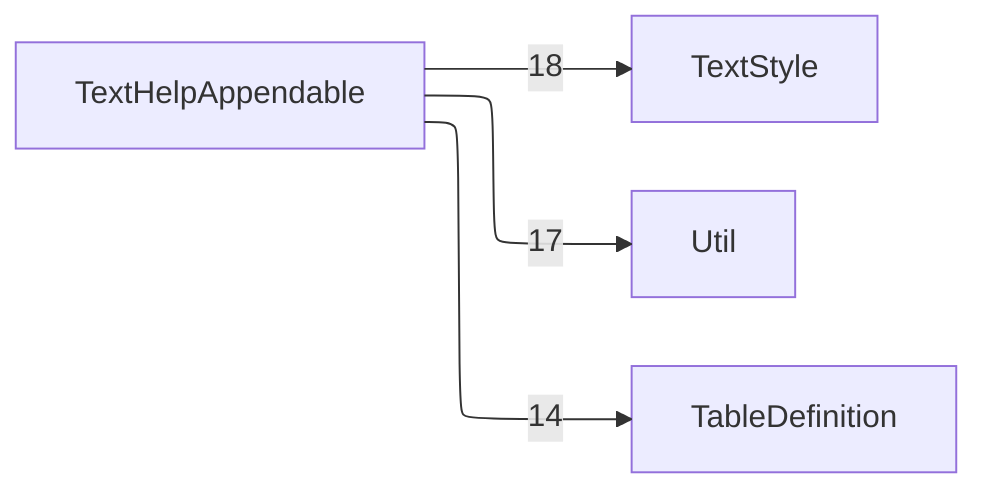
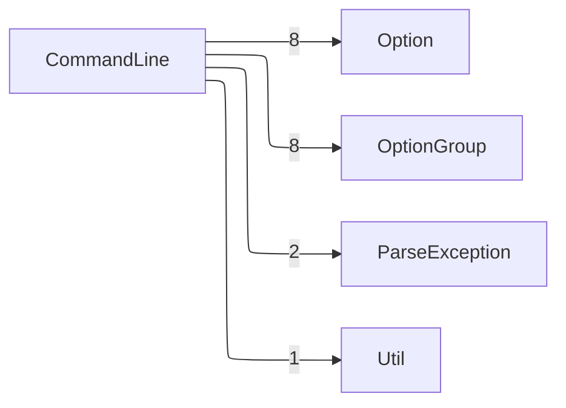

근거 소스 12개

- [`CONTRIBUTING.md`](https://github.com/apache/commons-cli/blob/e17111798da51037659b3594d9c0b3b525040081/CONTRIBUTING.md#L1-L1)
- [`README.md`](https://github.com/apache/commons-cli/blob/e17111798da51037659b3594d9c0b3b525040081/README.md#L1-L1)
- [`src/main/java/org/apache/commons/cli/Option.java`](https://github.com/apache/commons-cli/blob/e17111798da51037659b3594d9c0b3b525040081/src/main/java/org/apache/commons/cli/Option.java#L1-L1)
- [`src/main/java/org/apache/commons/cli/Parser.java`](https://github.com/apache/commons-cli/blob/e17111798da51037659b3594d9c0b3b525040081/src/main/java/org/apache/commons/cli/Parser.java#L1-L1)
- [`src/main/java/org/apache/commons/cli/OptionGroup.java`](https://github.com/apache/commons-cli/blob/e17111798da51037659b3594d9c0b3b525040081/src/main/java/org/apache/commons/cli/OptionGroup.java#L1-L1)
- [`src/main/java/org/apache/commons/cli/help/AbstractHelpFormatter.java`](https://github.com/apache/commons-cli/blob/e17111798da51037659b3594d9c0b3b525040081/src/main/java/org/apache/commons/cli/help/AbstractHelpFormatter.java#L1-L1)
- [`src/main/java/org/apache/commons/cli/Options.java`](https://github.com/apache/commons-cli/blob/e17111798da51037659b3594d9c0b3b525040081/src/main/java/org/apache/commons/cli/Options.java#L1-L1)
- [`src/main/java/org/apache/commons/cli/DefaultParser.java`](https://github.com/apache/commons-cli/blob/e17111798da51037659b3594d9c0b3b525040081/src/main/java/org/apache/commons/cli/DefaultParser.java#L1-L1)
- [`src/main/java/org/apache/commons/cli/CommandLine.java`](https://github.com/apache/commons-cli/blob/e17111798da51037659b3594d9c0b3b525040081/src/main/java/org/apache/commons/cli/CommandLine.java#L1-L1)
- [`src/main/java/org/apache/commons/cli/Converter.java`](https://github.com/apache/commons-cli/blob/e17111798da51037659b3594d9c0b3b525040081/src/main/java/org/apache/commons/cli/Converter.java#L1-L1)
- [`src/main/java/org/apache/commons/cli/AlreadySelectedException.java`](https://github.com/apache/commons-cli/blob/e17111798da51037659b3594d9c0b3b525040081/src/main/java/org/apache/commons/cli/AlreadySelectedException.java#L1-L1)
- [`src/main/java/org/apache/commons/cli/DeprecatedAttributes.java`](https://github.com/apache/commons-cli/blob/e17111798da51037659b3594d9c0b3b525040081/src/main/java/org/apache/commons/cli/DeprecatedAttributes.java#L1-L1)

Apache Commons CLI가 하는 일은 README의 한 줄이 그대로 말한다. 명령행 인터페이스를 보여 주고 처리하고 검사하는 간단한 API를 준다는 것이다 [^E4].

저장소는 단일 모듈이다. 자바 파일 87개에 2만 458줄이고, 그 가운데 제품 코드가 36개다. 나머지는 시험이다. 자바스크립트 파일 둘은 문서 쪽에 딸린 것이다. 빌드 모듈이 하나뿐이라 모듈 사이 의존이라는 층이 아예 없고, 볼 것은 타입 사이의 관계다.

**언어와 런타임 버전**

| 언어 | 버전 | 선언 자리 | 근거 |
| --- | --- | --- | --- |
| Java | 1.8 | maven.compiler.source | [`pom.xml:L89-L89`](https://github.com/apache/commons-cli/blob/e17111798da51037659b3594d9c0b3b525040081/pom.xml#L89-L89) |

저장소가 빌드 파일에 적어 둔 값이다. 실제로 설치되는 버전이 아니다.

## 세 갈래

코드를 성격으로 가르면 셋이다.

- **정의**: 무엇을 옵션으로 받을 것인가. `Option`, `OptionGroup`, `Options`가 여기 있다 [^E6] [^E9] [^E12]
- **파싱**: 들어온 문자열을 그 정의에 비추어 읽는다. `DefaultParser`가 지금 쓰는 것이고 `Parser` 계층이 옛 것이다 [^E13] [^E8]
- **출력**: 정의를 사람이 읽을 글로 편다. `AbstractHelpFormatter`와 그 아래가 맡는다 [^E10]

결과를 담는 `CommandLine`이 셋 사이에 놓인다 [^E16]. 파싱이 그것을 만들고 쓰는 쪽이 그것을 읽는다. 그 안은 목록 둘이다. 처리한 옵션과, 옵션으로 읽히지 않은 나머지 인수다 [^E16].

조립 방식도 한 가지로 모여 있다. `Option`과 `CommandLine`과 `AbstractHelpFormatter`가 모두 `Supplier`를 구현한 중첩 `Builder`를 가진다 [^E7] [^E16] [^E10]. 필드가 많고 대부분 선택인 값을 만들 때 이 라이브러리가 고른 방식이다. 오래된 생성자와 `Builder()` 생성자는 `@Deprecated`가 붙어 정적 `builder()`로 옮겨 가는 중이다 [^E16].

쪽으로는 이렇게 나뉜다.

- [옵션 정의와 배타 묶음](concepts/5-option-optiongroup.md): 옵션 하나가 무엇이고 배타 묶음이 어떻게 막는지
- [옵션 그릇과 낡은 파서 계층](concepts/3-parser-options.md): 정의를 담는 그릇과 남겨 둔 옛 파서
- [토큰 해석과 실패 처리](concepts/2-defaultparser-unrecognizedoptionexception.md): 붙임표로 시작하는 것들을 어떻게 가르는지
- [값 변환과 이름 검사](concepts/4-converter-deprecatedattributes.md): 문자열을 자바 타입으로 바꾸는 자리
- [도움말 출력 계층](concepts/1-help.md): 정의를 글로 펴는 자리

## 무엇이 무엇에 기대는가

의존의 방향이 한쪽이다. 파싱과 출력이 정의에 기대고, 정의는 둘 중 어느 쪽도 모른다.

`Option`을 부르는 쪽이 가장 많다. 이 라이브러리에서 거의 모든 코드가 옵션 하나를 들고 무언가를 한다.

`Options`는 그 옵션들을 담아 조회를 책임진다 [^E12]. 파서가 토큰을 만날 때마다 여기에 묻는다.

파싱 쪽의 중심은 `DefaultParser`다 [^E13].

출력 쪽은 형식을 정하는 자리와 글자를 내보내는 자리가 갈라져 있다.

결과를 읽는 표면과 배타 묶음은 이렇게 걸린다.

## 이 코드베이스를 읽을 때 걸리는 것

- **정의와 상태가 한 객체에 있다.** `Option`이 정의를 들고 있으면서 파싱 중 받은 값도 같은 곳에 쌓는다 [^E6]. 그래서 같은 `Options`를 두 번 파싱하면 앞의 값이 남는다
- **파서가 두 벌이다.** `Parser`와 그 하위 셋이 전부 `@Deprecated`다 [^E8]. 새로 쓸 것은 `DefaultParser`뿐이다
- **낡음을 구조로 들고 있다.** `DeprecatedAttributes`가 까닭과 판과 지울 것인지를 따로 담는다 [^E20]. 도움말이 그것을 열로 뽑는다
- **변환기가 던지는 예외를 타입으로 밝힌다.** `Converter`의 둘째 타입 인수가 그것이다 [^E18]. 부르는 쪽이 무엇을 잡아야 할지 시그니처에서 안다
- **예외가 맥락을 들고 있다.** `AlreadySelectedException`은 묶음과 옵션을 둘 다 필드로 들고 메시지에 무엇이 이미 뽑혔는지 적는다 [^E19]
- **낡은 옵션을 만나면 표준 출력으로 알린다.** `CommandLine.Builder`의 기본 처리기가 `System.out.println`이다 [^E16]. 라이브러리가 화면에 직접 쓰는 몇 안 되는 자리이고, 바꾸려면 처리기를 갈아 끼운다
- **타입을 안 주면 문자열이다.** `Option.Builder`가 `null` 타입을 `String.class`로 되돌린다 [^E7]

이 저장소는 아파치 공용 빌드 플러그인이 README와 CONTRIBUTING을 생성한다. 두 파일 머리에 직접 고치지 말라는 표시와 재생성 명령이 적혀 있다 [^E4] [^E3]. 그 파일들을 고쳐도 다음 생성에 지워진다.

## 어디부터 읽을 것인가

라이브러리라 진입점이 없다. 부르는 쪽이 진입점이다. 그래서 읽는 차례는 데이터를 따라가는 것이 낫다.

1. **`Option`**부터 본다. 이 라이브러리의 다른 모든 것이 이것을 들고 움직인다 [^E6]
2. **`Options`**로 넘어가 그것들이 어떻게 담기고 조회되는지 본다 [^E12]
3. **`DefaultParser.handleToken`**에서 토큰 하나가 어느 갈래로 가는지 본다 [^E13]
4. **`AbstractHelpFormatter.printHelp`**에서 출력의 차례를 본다 [^E10]

판별 정보와 빌드는 [언어와 라이브러리 버전](overview/stack.md)과 [빌드와 검사 파이프라인](quality/pipeline.md)에 있다. 실제 입력의 경우들은 [사용 예](usage/examples.md)에서 본다. 낱말과 코드 실체의 대응은 [낱말 사전](glossary.md)에 있다.

[^E3]: [`CONTRIBUTING.md:L1-L116`](https://github.com/apache/commons-cli/blob/e17111798da51037659b3594d9c0b3b525040081/CONTRIBUTING.md#L1-L116)
[^E4]: [`README.md:L1-L119`](https://github.com/apache/commons-cli/blob/e17111798da51037659b3594d9c0b3b525040081/README.md#L1-L119)
[^E6]: [`src/main/java/org/apache/commons/cli/Option.java:L41-L1031`](https://github.com/apache/commons-cli/blob/e17111798da51037659b3594d9c0b3b525040081/src/main/java/org/apache/commons/cli/Option.java#L41-L1031)
[^E7]: [`src/main/java/org/apache/commons/cli/Option.java:L55-L353`](https://github.com/apache/commons-cli/blob/e17111798da51037659b3594d9c0b3b525040081/src/main/java/org/apache/commons/cli/Option.java#L55-L353)
[^E8]: [`src/main/java/org/apache/commons/cli/Parser.java:L34-L338`](https://github.com/apache/commons-cli/blob/e17111798da51037659b3594d9c0b3b525040081/src/main/java/org/apache/commons/cli/Parser.java#L34-L338)
[^E9]: [`src/main/java/org/apache/commons/cli/OptionGroup.java:L31-L179`](https://github.com/apache/commons-cli/blob/e17111798da51037659b3594d9c0b3b525040081/src/main/java/org/apache/commons/cli/OptionGroup.java#L31-L179)
[^E10]: [`src/main/java/org/apache/commons/cli/help/AbstractHelpFormatter.java:L39-L509`](https://github.com/apache/commons-cli/blob/e17111798da51037659b3594d9c0b3b525040081/src/main/java/org/apache/commons/cli/help/AbstractHelpFormatter.java#L39-L509)
[^E12]: [`src/main/java/org/apache/commons/cli/Options.java:L42-L349`](https://github.com/apache/commons-cli/blob/e17111798da51037659b3594d9c0b3b525040081/src/main/java/org/apache/commons/cli/Options.java#L42-L349)
[^E13]: [`src/main/java/org/apache/commons/cli/DefaultParser.java:L35-L859`](https://github.com/apache/commons-cli/blob/e17111798da51037659b3594d9c0b3b525040081/src/main/java/org/apache/commons/cli/DefaultParser.java#L35-L859)
[^E16]: [`src/main/java/org/apache/commons/cli/CommandLine.java:L41-L1044`](https://github.com/apache/commons-cli/blob/e17111798da51037659b3594d9c0b3b525040081/src/main/java/org/apache/commons/cli/CommandLine.java#L41-L1044)
[^E18]: [`src/main/java/org/apache/commons/cli/Converter.java:L37-L117`](https://github.com/apache/commons-cli/blob/e17111798da51037659b3594d9c0b3b525040081/src/main/java/org/apache/commons/cli/Converter.java#L37-L117)
[^E19]: [`src/main/java/org/apache/commons/cli/AlreadySelectedException.java:L23-L82`](https://github.com/apache/commons-cli/blob/e17111798da51037659b3594d9c0b3b525040081/src/main/java/org/apache/commons/cli/AlreadySelectedException.java#L23-L82)
[^E20]: [`src/main/java/org/apache/commons/cli/DeprecatedAttributes.java:L34-L196`](https://github.com/apache/commons-cli/blob/e17111798da51037659b3594d9c0b3b525040081/src/main/java/org/apache/commons/cli/DeprecatedAttributes.java#L34-L196)
